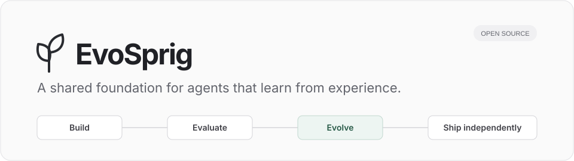
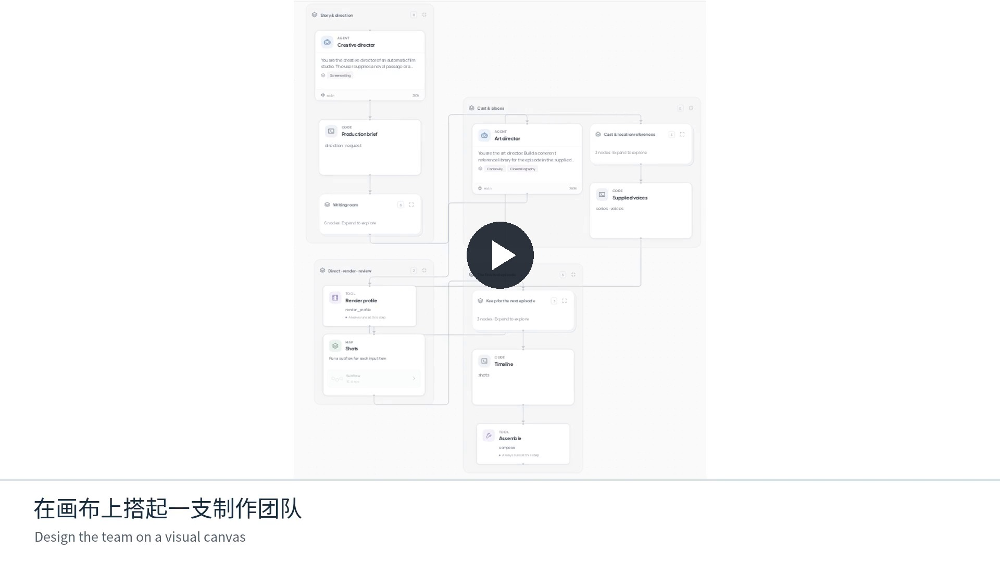
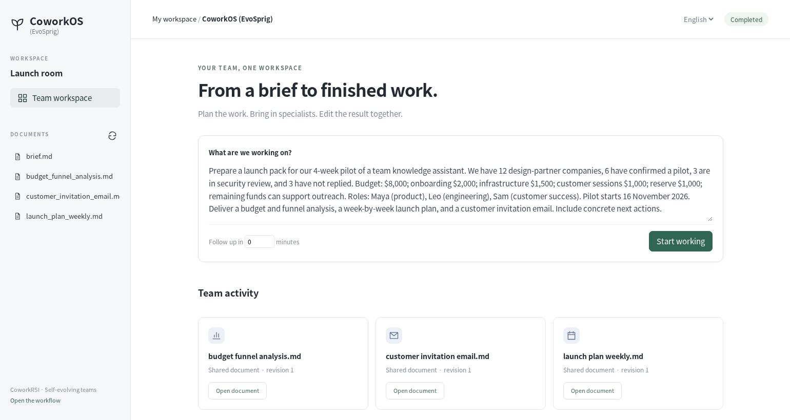
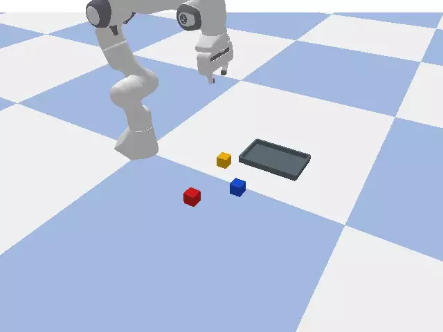
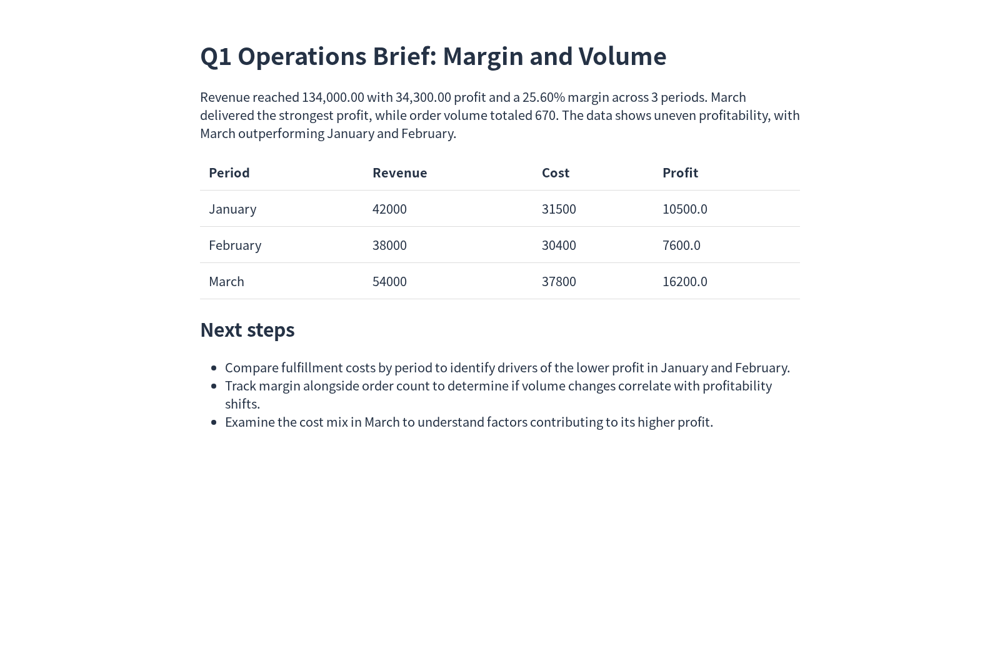
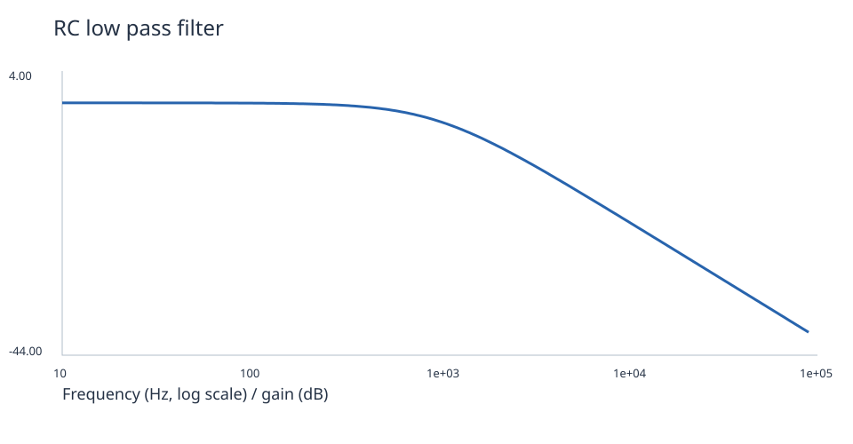
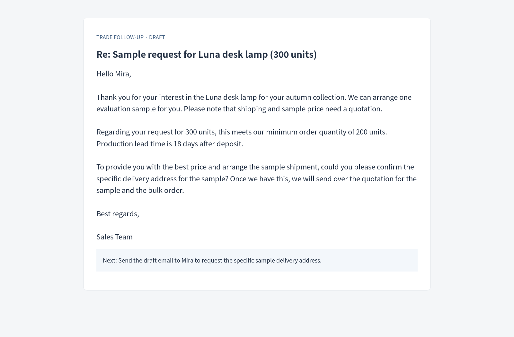
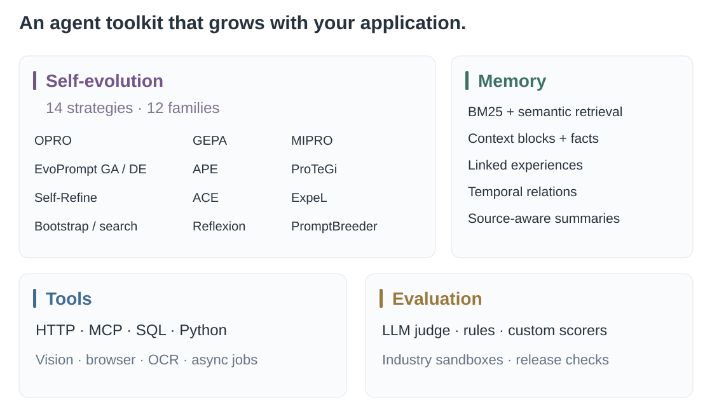
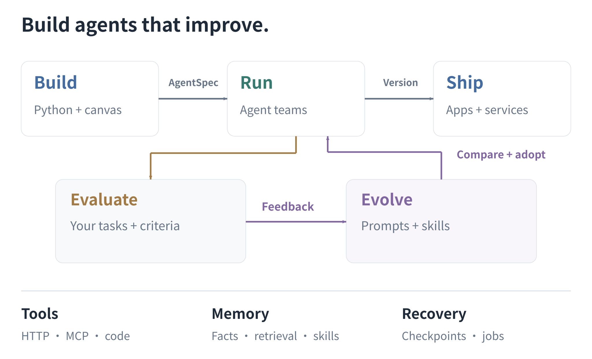
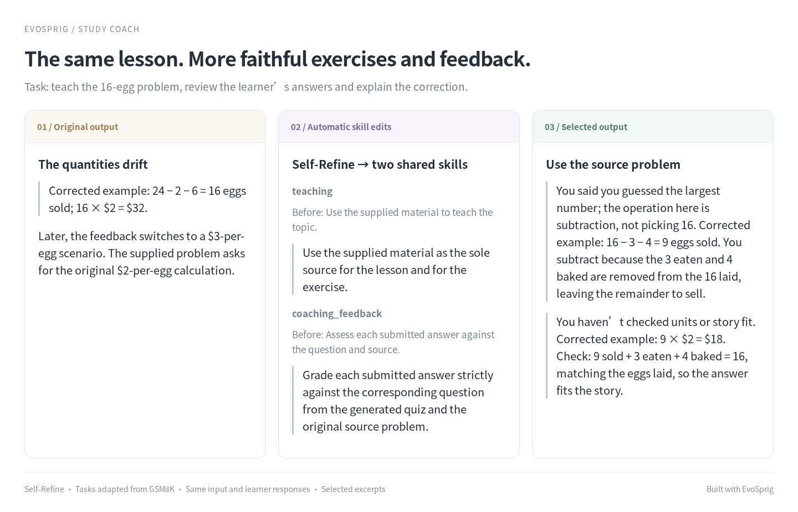

<div align="center">



**An open-source framework for self-evolving agents.**

[](https://github.com/Toyhom/EvoSprig/actions/workflows/ci.yml)
[](https://www.python.org/)
[](LICENSE)

**English** · [简体中文](README.zh-CN.md)

[Tutorials](docs/tutorials/README.md) · [Quickstart](docs/quickstart.md) · [Examples](examples/README.md) · [Evolution](docs/evolution.md) · [Documentation](docs/README.md) · [Research references](docs/references.md)

</div>

## News

- **2026-11-04** · **[ComfyUI workflows](docs/comfyui.md)** — import workflow JSON, edit and debug its tool nodes on the canvas, and export back to ComfyUI.
- **2026-11-04** · **[Episode Studio](examples/episode-studio/)** — a multi-agent production team that turns stories into animated films, with a recurring cast and automatic shot review.
- **2026-11-02** · EvoSprig is open source: a platform for building and evolving agent applications with Python or a visual canvas.

Build agents with Python or a visual canvas, then improve their behavior automatically on your own tasks. EvoSprig combines multi-agent workflows, tools, persistent memory and **controlled self-improvement (RSI)**: generate candidate versions, evaluate the running application, compare results and enable a version. Export your application to run independently.

[](docs/assets/evosprig-demo.mp4)

**[Watch EvoSprig in 52 seconds · sound on](docs/assets/evosprig-demo.mp4)**

## What will you build?

### Episode Studio — a story, a cast, a film

[](examples/episode-studio/)

A production team turns a novel or one sentence into an animated film. Agents choose the style, write the script, create the cast and voices, and direct and review each shot. **[Watch the scene and make your own](examples/episode-studio/)**.

<table>
<tr>
<td width="50%" valign="top"><a href="examples/video-studio/"></a><br><b><a href="examples/video-studio/">VideoClaw (EvoSprig)</a></b><br>A story idea becomes a short film.<br><sub>Original: <a href="https://github.com/HITsz-TMG/VideoClaw">VideoClaw</a></sub></td>
<td width="50%" valign="top"><a href="examples/cowork/"></a><br><b><a href="examples/cowork/">CoworkOS (EvoSprig)</a></b><br>A team that plans, writes and works with you.<br><sub>Original: <a href="https://github.com/RUC-NLPIR/CoworkOS">CoworkOS</a></sub></td>
</tr>
<tr>
<td width="50%" valign="top"><a href="examples/rai-manipulation/"></a><br><b><a href="examples/rai-manipulation/">RAI manipulation (EvoSprig)</a></b><br>See the scene. Move the objects. Check the result.<br><sub>Original: <a href="https://github.com/RobotecAI/rai">RAI</a></sub></td>
<td width="50%" valign="top"><a href="examples/industry-environment-builder/"></a><br><b><a href="examples/industry-environment-builder/">Industry environment builder</a></b><br>Build a business world for your agent to learn in.<br><sub><a href="docs/industry-environments.md">Environment guide</a></sub></td>
</tr>
<tr>
<td width="50%" valign="top"><a href="examples/comic-studio/"></a><br><b><a href="examples/comic-studio/">Comic Studio</a></b><br>A story becomes a comic, with a shared cast and panel-by-panel review.<br><sub><a href="docs/tutorials/comic-studio.md">Build it in ten minutes</a></sub></td>
<td width="50%" valign="top"><a href="examples/office-deliverables/"></a><br><b><a href="examples/office-deliverables/">Office deliverables</a></b><br>One table becomes an editable spreadsheet, report and slide deck.</td>
</tr>
<tr>
<td width="50%" valign="top"><a href="examples/circuit-lab/"></a><br><b><a href="examples/circuit-lab/">Circuit Lab</a></b><br>Describe a circuit. Get a netlist, a simulation and measured results.</td>
<td width="50%" valign="top"><a href="examples/trade-followup/"></a><br><b><a href="examples/trade-followup/">Trade follow-up</a></b><br>Turn customer conversations and product facts into a useful reply.</td>
</tr>
</table>

| Build an agent that… | Start here |
| --- | --- |
| Directs an animated story with dialogue | **[Episode Studio](examples/episode-studio/)** — a shared cast, connected shots and automatic retakes |
| Repairs code and returns a tested patch | **[Super-agent (EvoSprig)](examples/repository-agent/)** — a repository team based on [DeepSeek's Super-agent](https://github.com/deepseek-ai/dsh-superagent-prototype) |
| Turns a story into a film | **[VideoClaw (EvoSprig)](examples/video-studio/)** — characters, scenes and a finished cut ([original VideoClaw](https://github.com/HITsz-TMG/VideoClaw)) |
| Works with you on a project | **[CoworkOS (EvoSprig)](examples/cowork/)** — specialist teams and shared documents ([original CoworkOS](https://github.com/RUC-NLPIR/CoworkOS)) |
| Sees a scene and controls a robot arm | **[RAI manipulation (EvoSprig)](examples/rai-manipulation/)** — visual planning, pick-and-place and task checks ([original RAI](https://github.com/RobotecAI/rai)) |
| Builds a business sandbox for agent development | **[Industry environment builder](examples/industry-environment-builder/)** — procedures, tools, data and business-state checks |
| Tailors a resume and runs interview practice | **[Career coach](examples/career-coach/)** — job fit, application materials and feedback |
| Writes a Xiaohongshu post from your notes | **[Xiaohongshu Studio](examples/xiaohongshu-studio/)** — reader angles, style examples and guided revisions |
| Produces editable office files | **[Office deliverables](examples/office-deliverables/)** — spreadsheet, brief and slides from one table |
| Designs and tests a small circuit | **[Circuit Lab](examples/circuit-lab/)** — netlists, ngspice waveforms and measured targets |
| Drafts a useful buyer follow-up | **[Trade follow-up](examples/trade-followup/)** — customer history, product facts and reviewed drafts |
| Draws a complete comic page | **[Comic Studio](examples/comic-studio/)** — shared cast, panel review and page layout |
| Turns one announcement into a content campaign | **[Content studio](examples/content-studio/)** — parallel channels and shared editing skills |
| Teaches a topic and reviews your answers | **[Study coach](examples/study-coach/)** — lessons, exercises and personal feedback |
| Turns a brief into a working web app | **[Software team](examples/software-team/)** — design, implementation, browser checks and repair |
| Runs Python and explains your data | **[Data Interpreter](examples/data-interpreter/)** — files, calculations and charts |
| Helps you make a difficult decision | **[Decision room](examples/debate/)** — opposing arguments, rebuttals and a moderated recommendation |
| Reads receipts and checks expenses | **[Receipt assistant](examples/receipt-assistant/)** — OCR, structured extraction and policy review |
| Researches a question with a team | **[Research team](examples/research-team/)** — parallel investigation, sources and editorial approval |
| Organizes the rest of your work | **[Meetings](examples/meeting-assistant/)** · **[Books](examples/book-studio/)** · **[Travel](examples/travel-planner/)** |

Also explore **[SQL analysis](examples/data-analyst/)**, **[document chat](examples/document-chat/)**, **[customer support](examples/customer-support/)** and **[personal memory](examples/personal-memory/)**. Open the **[gallery](examples/README.md)** for setup, workflow canvases and application outputs.

## Why EvoSprig?



- **Self-evolving agents, under your control.** 23 training-free strategies across 21 method families, including SkillOpt, ADAS, ModularRSI, DarwinX and Arbor. Evolve prompts, skills, harnesses, workflows and code. Choose the resources, budget and release criteria.
- **Evaluation that fits your application.** Start with task inputs and an LLM judge, or bring reference answers, business checks and a sandbox. Score outputs, steps, tools and environment outcomes.
- **Code and canvas, one application.** Build typed workflows with parallel agents, dynamic map, loops and human approvals. Organize large teams with nested groups and edit executable subflows.
- **Build the environment as well as the agent.** Turn a finance, government or manufacturing scenario into schemas, procedures, tools and data drafts. Connect the validated business sandbox to task evaluation and self-evolution. [Get started](docs/industry-environments.md).
- **Memory agents can use.** Scoped facts, hybrid retrieval, context blocks, temporal relations, linked experiences and source-aware summaries.
- **Tools for real work.** Vision inputs, MCP, HTTP, SQL and Python plugins; optional code execution, browser checks and OCR; read-only concurrency and recoverable tool feedback.
- **Run, recover and ship.** Checkpoints and external job receipts preserve progress. Export standalone Python, HTTP applications or container build projects.

## How it fits together



Build the application on the canvas or in Python; both produce the same versioned **AgentSpec**. The runtime coordinates agents, tools and shared memory, saving progress for debugging and recovery. Evaluation feeds real tasks and outcomes into controlled evolution, which changes selected resources or workflow settings; compare the candidates, enable a version and export the application. ComfyUI graphs can join the workflow as editable tools and be exported back to ComfyUI.

## Get started

Requires **Python 3.12+**. Studio also requires **Node.js 20+**.

```bash
git clone https://github.com/Toyhom/EvoSprig.git
cd EvoSprig
python -m pip install -e '.[server,evolution,mcp]'

# Run your first workflow without an API key.
evosprig run examples/hello/agent.yaml --input '{"question":"Hello"}' --mock

# Open Studio.
npm --prefix apps/studio ci
npm --prefix apps/studio run build
evosprig serve --project examples/hello/agent.yaml \
  --studio-dir apps/studio/dist --workspace .evosprig
```

Open **http://127.0.0.1:18766**. Studio starts in English; switch to **中文** in the sidebar. Your language preference is saved in the browser.

For live models, configure environment-based credentials in a [deployment profile](examples/deployment.example.yaml). Follow the [quickstart](docs/quickstart.md) for model connections and export.

## Self-improvement you can see

Build your agent, add task inputs, select the resources to change and choose an algorithm. EvoSprig writes candidates and runs your application to compare them. Review the prompt or skill changes alongside the outputs, then enable your chosen version. [Configure your first improvement](docs/agent-resources.md#improve-selected-resources).



In the **[study coach](examples/study-coach/)**, one Self-Refine round changed two shared skills so exercises and feedback stay tied to the supplied lesson. The page shows the actual edits and answers, using tasks adapted from GSM8K.

Explore the **[book-writing comparison](examples/book-studio/)** and **[document-answering comparison](examples/document-chat/)** to see prompt changes and selected outputs. Each page shows what changed and how it affected the answer.

Bring your own inputs to **[LLM-as-judge](docs/evaluation.md)**, or connect your evaluator. The **[method guide](docs/evolution.md)** explains which feedback each strategy uses.

## Documentation

Follow the [tutorials](docs/tutorials/README.md) to build your first application. Use the [reference](docs/README.md#reference) to look up models, tools, memory, evaluation and deployment. Both are available in [Chinese](docs/zh-CN/README.md).

**[Build applications: canvas and Python](docs/build-applications.md)** · **[Extend the framework](docs/extend-framework.md)** · **[Add an evolution algorithm](docs/optimizer-plugins.md)**

[Workflows and architecture](docs/architecture.md) · [Memory](docs/memory.md) · [Tools and MCP](docs/tools.md) · [Durable execution](docs/durable-runtime.md) · [Deployment](docs/deployment.md) · [Roadmap](docs/roadmap.md)

## Contributing

Bug reports, example applications and integrations are welcome. Read the [contributing guide](CONTRIBUTING.md) to run checks and submit a change.

## License

[Apache-2.0](LICENSE).
