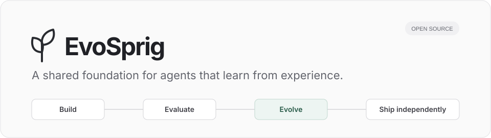
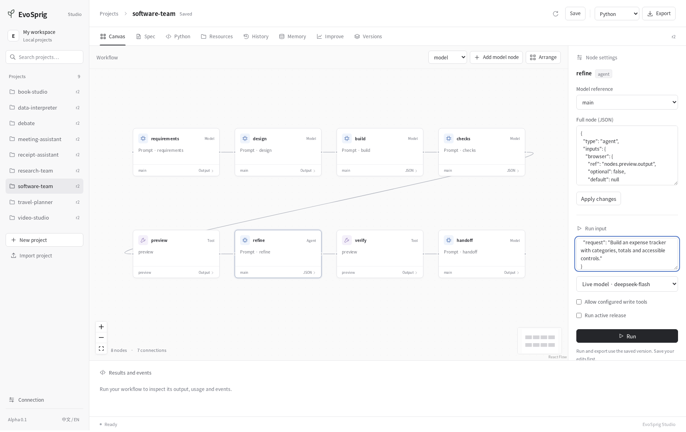
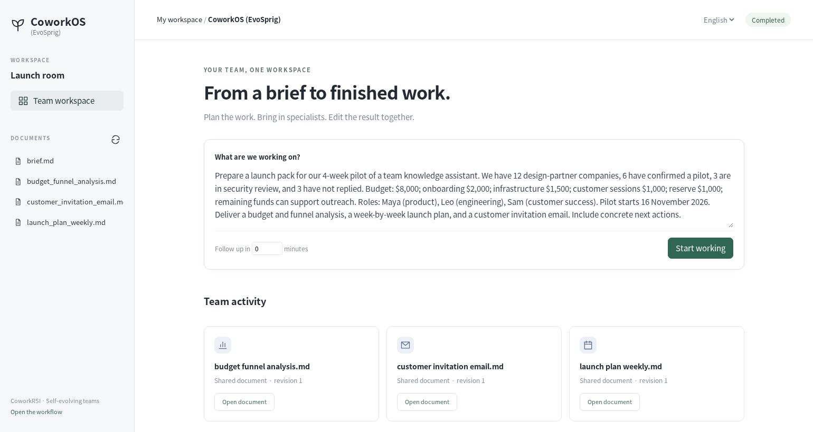
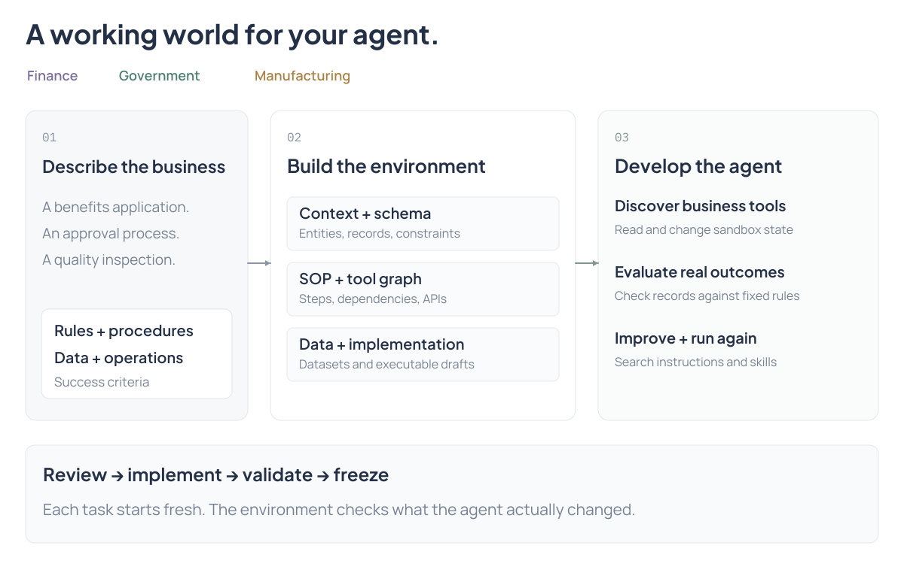
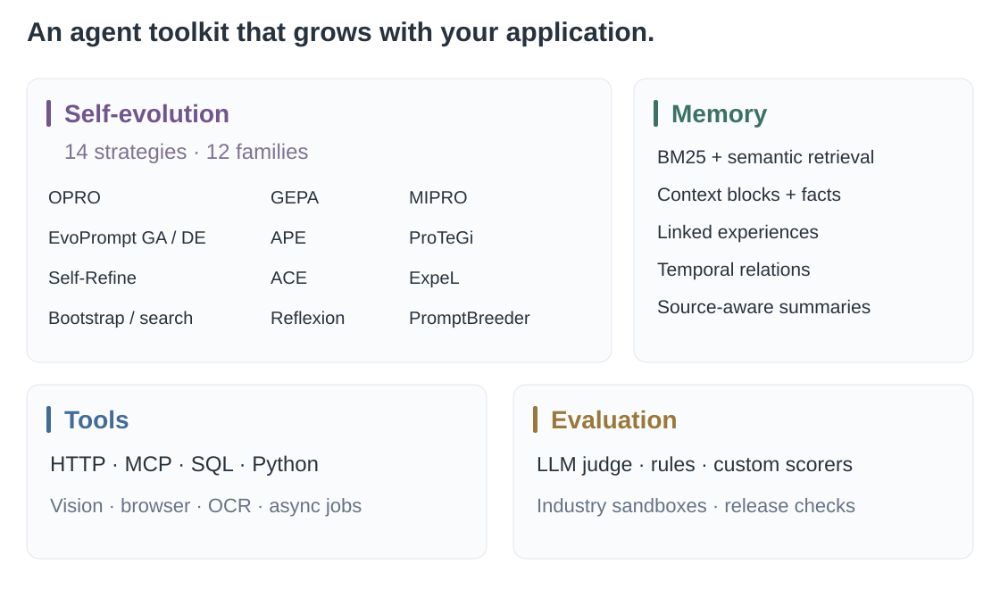
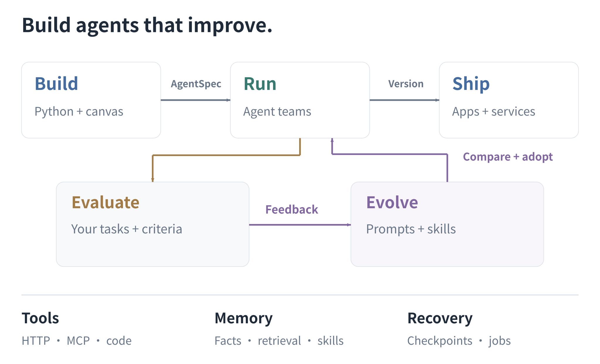
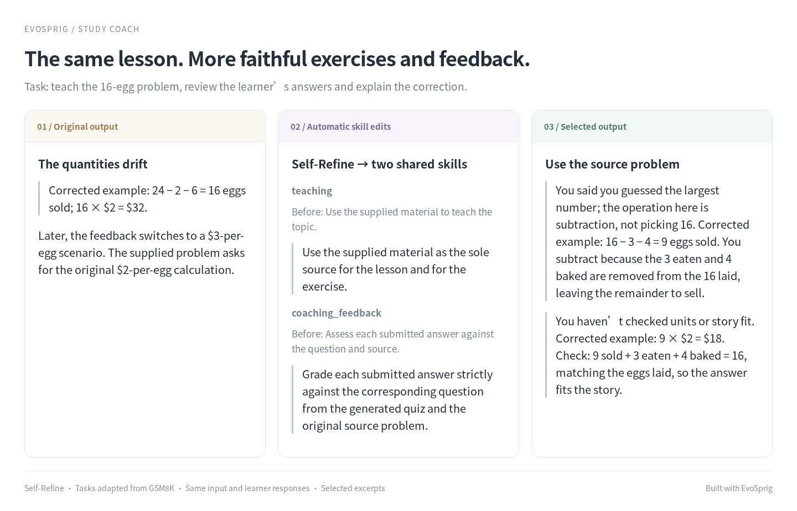

<div align="center">



**面向自进化智能体的开源开发框架。**

[](https://github.com/Toyhom/EvoSprig/actions/workflows/ci.yml)
[](https://www.python.org/)
[](LICENSE)

[English](README.md) · **简体中文**

[快速开始](docs/quickstart.md) · [应用案例](examples/README.md) · [自进化](docs/evolution.md) · [文档](docs/README.md) · [论文引用](docs/references.md)

</div>

## News · 项目动态

- **2026-11-02** · EvoSprig 初版开源：自进化智能体共性开发平台，支持代码与画布开发、任务评估和持续改进。

使用 Python 或可视化画布开发智能体，再用自己的任务推动智能体持续改进。EvoSprig 将多智能体、工具、持久记忆与**可控自进化（Self-improvement / RSI）**连接起来：生成候选、运行评测、比较结果、启用版本，最后导出独立应用。



## 你可以开发什么？

### Episode Studio：把故事拍成动画

[](examples/episode-studio/)

输入一段小说或一句想法，制作团队自动选风格、写剧本、设计角色与声音，再逐镜头导演、生成和检查。**[观看片段，制作自己的动画](examples/episode-studio/README.zh-CN.md)**。

<table>
<tr>
<td width="50%" valign="top"><a href="examples/video-studio/"></a><br><b><a href="examples/video-studio/">VideoClaw (EvoSprig)</a></b><br>从一句故事到一部短片。<br><sub>原项目：<a href="https://github.com/HITsz-TMG/VideoClaw">VideoClaw</a></sub></td>
<td width="50%" valign="top"><a href="examples/cowork/"></a><br><b><a href="examples/cowork/">CoworkOS (EvoSprig)</a></b><br>与专家团队一起完成项目。<br><sub>原项目：<a href="https://github.com/RUC-NLPIR/CoworkOS">CoworkOS</a></sub></td>
</tr>
<tr>
<td width="50%" valign="top"><a href="examples/rai-manipulation/"></a><br><b><a href="examples/rai-manipulation/">RAI manipulation (EvoSprig)</a></b><br>看见场景，操纵机械臂，检查结果。<br><sub>原项目：<a href="https://github.com/RobotecAI/rai">RAI</a></sub></td>
<td width="50%" valign="top"><a href="examples/industry-environment-builder/"></a><br><b><a href="examples/industry-environment-builder/">行业环境构造</a></b><br>构造业务世界，让行业智能体在其中学习。<br><sub><a href="docs/industry-environments.md">行业环境指南</a></sub></td>
</tr>
</table>

| 想做什么 | 从这里开始 |
| --- | --- |
| 把故事拍成带对白的动画 | **[Episode Studio](examples/episode-studio/)**：固定角色、镜头衔接和自动重做 |
| 修改代码并交付通过测试的补丁 | **[Super-agent (EvoSprig)](examples/repository-agent/)**：基于 [DeepSeek Super-agent](https://github.com/deepseek-ai/dsh-superagent-prototype) 的代码维护团队 |
| 把故事拍成短片 | [VideoClaw (EvoSprig)](examples/video-studio/)：角色、分镜和成片（[VideoClaw 原项目](https://github.com/HITsz-TMG/VideoClaw)） |
| 与智能体团队一起完成项目 | [CoworkOS (EvoSprig)](examples/cowork/)：任务分工、共享文档和后续跟进（[CoworkOS 原项目](https://github.com/RUC-NLPIR/CoworkOS)） |
| 看懂场景并操纵机械臂 | [RAI manipulation (EvoSprig)](examples/rai-manipulation/)：视觉规划、抓取放置和任务检查（[RAI 原项目](https://github.com/RobotecAI/rai)） |
| 构造业务模拟环境并改进行业智能体 | **[行业环境构造](examples/industry-environment-builder/)** — 业务规则、工具、数据与状态评估 |
| 准备求职材料并练习面试 | [求职教练](examples/career-coach/)：岗位匹配、简历要点和练习反馈 |
| 把一份公告改写成多个渠道的内容 | [内容工作室](examples/content-studio/)：并行写作、共享文风和事实核对技能 |
| 讲解知识并根据回答安排练习 | [学习教练](examples/study-coach/)：课程、互动练习与针对性反馈 |
| 把需求变成能操作的网页 | [软件开发团队](examples/software-team/)：设计、编码、浏览器检查与修复 |
| 让智能体运行代码分析数据 | [Data Interpreter](examples/data-interpreter/)：文件、计算与图表 |
| 从多个角度分析决策 | [决策讨论室](examples/debate/)：正反论证、回应与建议 |
| 自动整理票据与报销 | [收据助手](examples/receipt-assistant/)：OCR、结构化提取、算账与规则核对 |
| 组织团队完成资料研究 | [研究团队](examples/research-team/)：并行调查、引用与人工审稿 |
| 安排日常工作与创作 | [会议助手](examples/meeting-assistant/) · [书籍创作](examples/book-studio/) · [旅行规划](examples/travel-planner/) |

还有 [SQL 分析](examples/data-analyst/)、[文档对话](examples/document-chat/)、[客服](examples/customer-support/)和[个人记忆](examples/personal-memory/)。所有案例均使用 EvoSprig 自身框架编排，打开[应用库](examples/README.md)即可修改成自己的智能体。

## 平台特色



- **可控自进化**：23 种无需训练模型的策略、21 个方法家族，包括 SkillOpt、ADAS、ModularRSI、DarwinX 和 Arbor，支持提示词、技能、harness、流程与代码进化；资源、预算和发布条件由你控制。
- **适配真实应用的评估**：只提供任务输入即可使用 LLM judge，也可接入参考答案、业务评分器或评测环境；支持答案、节点、轨迹、工具和环境结果等粒度。
- **代码与画布一致**：统一 AgentSpec，支持多智能体、并行、动态 map、循环与人工审核，以及多层分组、折叠展开和子流程编辑。
- **连同业务环境一起构建**：从金融、政务或制造业场景生成数据结构、SOP、工具与数据草稿，将验证后的业务沙箱接入评估和自进化。[使用方法](docs/industry-environments.md)。
- **可用的长期记忆**：作用域隔离、混合检索、上下文块、时序关系、关联经验和保留来源的摘要。
- **面向实际工作的工具**：视觉输入、HTTP、MCP、SQL 与 Python 插件，可选代码执行、浏览器和 OCR 服务，以及只读并发与错误反馈。
- **恢复和独立部署**：持久检查点、外部任务回执、版本比较与回滚；导出 Python、HTTP 服务或容器构建工程。

## 框架结构




## 快速开始

需要 Python 3.12+，Studio 还需要 Node.js 20+。

```bash
git clone https://github.com/Toyhom/EvoSprig.git
cd EvoSprig
python -m pip install -e '.[server,evolution,mcp]'
evosprig run examples/hello/agent.yaml --input '{"question":"Hello"}' --mock
npm --prefix apps/studio ci
npm --prefix apps/studio run build
evosprig serve --project examples/hello/agent.yaml \
  --studio-dir apps/studio/dist --workspace .evosprig
```

打开 http://127.0.0.1:18766，在侧栏切换 **中文**，语言选择会保留。实际模型连接通过[部署配置](examples/deployment.example.yaml)设置，凭据使用环境变量。

## 看得见的自进化：从任务到更好的提示词与技能

搭好智能体后，添加任务输入，选中可修改的 prompt／skill，选择算法并设置预算。平台自动生成候选、运行应用和评分；你可以同时查看资源改动与输出，再启用选定版本。节点面板支持技能组合、工具选择、项目共享记忆、Temperature、Top P 和输出上限。



[学习教练](examples/study-coach/)使用 GSM8K 改编的教学任务，一轮 Self-Refine 自动修改两个共享技能，让出题和反馈围绕给定教材；页面直接展示实际改动和答案。

[书籍创作](examples/book-studio/)与[文档问答](examples/document-chat/)直接展示实际提示词修改和精选输出对照。使用自己的输入开启 [LLM-as-judge](docs/evaluation.md)，或提供评测集与环境。[配置指南](docs/agent-resources.md)说明如何完成首次改进。

## 文档与贡献

**[应用开发：画布与 Python](docs/build-applications.md)** · **[框架扩展](docs/extend-framework.md)** · **[接入自进化算法](docs/optimizer-plugins.md)**

[架构](docs/architecture.md) · [记忆](docs/memory.md) · [工具](docs/tools.md) · [部署](docs/deployment.md) · [路线图](docs/roadmap.md) · [贡献指南](CONTRIBUTING.md)

[Apache-2.0](LICENSE)
