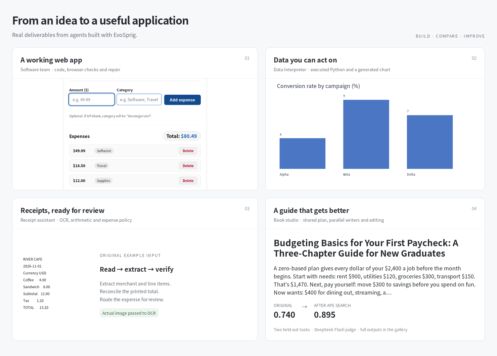

<div align="center">


**开发智能体，用实际任务改进它，再独立部署。**

[](https://github.com/Toyhom/EvoSprig/actions/workflows/ci.yml)
[](https://www.python.org/)
[](LICENSE)

[English](README.md) · **简体中文**

[快速开始](docs/quickstart.md) · [应用案例](examples/README.md) · [自进化](docs/evolution.md) · [文档](docs/README.md)

</div>

EvoSprig 将可视化工作流、持久记忆、工具调用和可控自进化整合在同一个智能体开发平台。使用 Python 或 Studio 开发，用自己的任务比较版本，再导出独立应用。


## 你可以开发什么？



| 想做什么 | 从这里开始 |
| --- | --- |
| 把需求变成能操作的网页 | [软件开发团队](examples/software-team/)：设计、编码、浏览器检查与修复 |
| 让智能体运行代码分析数据 | [Data Interpreter](examples/data-interpreter/)：文件、计算与图表 |
| 从多个角度分析决策 | [决策讨论室](examples/debate/)：正反论证、回应与建议 |
| 自动整理票据与报销 | [收据助手](examples/receipt-assistant/)：OCR、结构化提取、算账与规则核对 |
| 组织团队完成资料研究 | [研究团队](examples/research-team/)：并行调查、引用与人工审稿 |
| 把想法变成视频 | [视频工作室](examples/video-studio/)：分镜、素材工具、审核与局部重做 |
| 安排日常工作与创作 | [会议助手](examples/meeting-assistant/) · [书籍创作](examples/book-studio/) · [旅行规划](examples/travel-planner/) |

还有 [SQL 分析](examples/data-analyst/)、[文档对话](examples/document-chat/)、[客服](examples/customer-support/)和[个人记忆](examples/personal-memory/)。所有案例均使用 EvoSprig 自身框架编排，打开[应用库](examples/README.md)即可修改成自己的智能体。

## 平台特色

- **可控自进化**：13 种无需模型训练的策略，覆盖 11 个方法家族，包括提示搜索、种群搜索、示范选择、反思与经验手册；资源、预算和发布条件由你控制。
- **适配真实应用的评估**：只提供任务输入即可使用 LLM judge，也可接入参考答案、业务评分器或评测环境；支持答案、节点、轨迹、工具和环境结果等粒度。
- **代码与画布一致**：统一 AgentSpec，支持多智能体、并行、动态 map、循环与人工审核。
- **可用的长期记忆**：作用域隔离、混合检索、上下文块、时序关系、关联经验和保留来源的摘要。
- **面向实际工作的工具**：HTTP、MCP、SQL 与 Python 插件，可选代码执行、浏览器和 OCR 服务，以及只读并发与错误反馈。
- **恢复和独立部署**：持久检查点、外部任务回执、版本比较与回滚；导出 Python、HTTP 服务或容器构建工程。

## 框架结构


## 快速开始

需要 Python 3.12+，Studio 还需要 Node.js 20+。

```bash
git clone https://github.com/Toyhom/EvoSprig.git
cd EvoSprig
python -m pip install -e '.[server,evolution,mcp]'
evosprig run examples/hello/agent.yaml --input '{"question":"Hello"}' --mock
npm --prefix apps/studio ci
npm --prefix apps/studio run build
evosprig serve --project examples/hello/agent.yaml \
  --studio-dir apps/studio/dist --workspace .evosprig
```

打开 http://127.0.0.1:18766，在侧栏切换 **中文**，语言选择会保留。实际模型连接通过[部署配置](examples/deployment.example.yaml)设置，凭据使用环境变量。

## 看看进化前后有什么变化

[应用对比](examples/README.md#before-and-after)展示固定任务上的原始输出和搜索后保留的版本，可查看实际产物、候选资源以及最终选择。候选未改善选择集表现时，平台保留基线；搜索不会自动改变线上版本。

使用自己的输入开启 [LLM-as-judge](docs/evaluation.md)，或提供评测集与环境。[方法指南](docs/evolution.md)说明各方法需要的反馈形式，随后可以在 Studio 中检查差异并手动发布。

## 文档与贡献

[架构](docs/architecture.md) · [记忆](docs/memory.md) · [工具](docs/tools.md) · [部署](docs/deployment.md) · [路线图](docs/roadmap.md) · [贡献指南](CONTRIBUTING.md)

[Apache-2.0](LICENSE)
