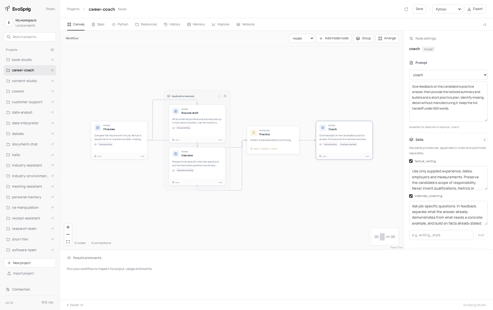

# Configure an agent

An agent combines a model, a main prompt, reusable skills and a selected set of tools. These settings are part of its behavior version and travel with an exported application.



## Prompt and skills

Use the main prompt for the role and task. Use skills for procedures shared across roles, such as checking product claims or following an editorial style.

```python
from evosprig.sdk import Builder

agent = (
    Builder("editor", {}, {}, spec_version="0.3")
    .model("main", "main")
    .resource("editor", "prompts/editor.md")
    .skill("brand_voice", "skills/brand_voice.md")
    .skill("fact_check", "skills/fact_check.md")
    .node(
        "write", "model", model="main",
        instructions={"resource": "editor"},
        skills=["brand_voice", "fact_check"],
        temperature=0.3, top_p=0.9,
        max_output_tokens=2400, output_schema={"type": "object"},
    )
    .output(text={"ref": "nodes.write.output.text"})
    .build_spec()
)
```

Create the three Markdown files before compiling the agent. Skills are appended to the main instruction in the listed order. A skill is a text procedure; executable capabilities are tools. Several agents can reference the same skill. Updating it creates a new behavior version for the application.

In Studio, select a model or agent node. The inspector lets you edit its prompt, turn an inline prompt into an optimizable resource, attach skills and edit their contents. Shared resource edits apply to every node using that resource.

## Tools and memory

An `agent` node chooses from its assigned tools. A `tool` node always runs its configured tool when that step is reached. Use a tool node for required OCR or calculations, and an agent node when the model must decide what to call.

The inspector lists tools declared in the application and provides shortcuts for built-in memory and document tools. Agents under the same user and project share those records; other users and projects have separate scopes. Shared knowledge can be added in the Memory panel. A memory write still requires the application's write permission and the run's write permission.

Choose all tools or task-based selection, bound tool rounds, and enable parallel read calls when useful. Write tools keep their configured permissions and idempotency behavior. See [tools](tools.md) and [memory](memory.md).

## Model parameters

| Setting | Default | Range / behavior |
| --- | --- | --- |
| `temperature` | 0 | 0–2; provider support applies |
| `top_p` | Provider default | Greater than 0, at most 1 |
| `max_output_tokens` | Application setting | 1–32,768; also bounded by the remaining run budget |
| `response_format` | `text` | `json` enables schema validation |
| `output_errors` | `raise` | `feedback` asks the model to repair invalid output |
| `max_output_retries` | 1 | 0–3 repairs |

With feedback enabled, field errors are grouped into one repair request. Repairs share the run's token and call budgets.

Model credentials and provider options stay in the deployment profile. Sampling parameters, skills and tool choices are versioned with the workflow. The provider may impose tighter limits than these settings.

## Improve selected resources

1. Build and run the application.
2. In **Improve**, add a JSON array of at least four distinct task inputs. The platform creates fixed search, selection and release splits. A judge can score inputs without reference answers; custom scorers and environments are also supported. For workflows with human nodes, import an [EvalSuite with task responses](evaluation.md#bring-your-own-task-suite) so each evaluation can continue through those checkpoints.
3. Select the prompt and/or skill resources to change, choose an algorithm and set the budget.
4. Start improvement. EvoSprig generates resource edits and runs the same application on the task set.
5. Open **Compare prompts, skills and outputs**. Review the original and selected resource contents together with the paired answers. Enable your chosen version in **Versions**.

Choose text resources or a structured search space for per-agent harness settings, model routes, retrieval parameters, code and topology. Deployment permissions and task partitions remain fixed. See [harness search](harness-search.md) for configuration and [evolution](evolution.md) for methods and release checks.
