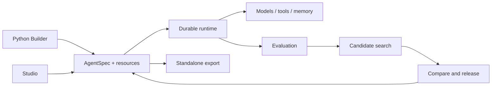

# Architecture

AgentSpec is the shared contract for Python, Studio, evaluation and export. A version combines a validated graph, content-addressed resources and dependency information. Layout changes do not change the behavior hash.

| Module | Responsibility |
| --- | --- |
| `core` | Typed contracts, graph execution, operation journal, budgets and versions |
| `sdk` | Declarative Python Builder |
| `plugins` | Model APIs, tools, scoped storage and retrieval |
| `evaluation` | Fixed task partitions, metrics and sample reports |
| `evolution` | Search methods, candidate lineage and release gates |
| `server` | API, authenticated identities, workers and event streams |
| `exporters` | Portable source projects, dependencies and archive import |
| `apps/studio` | Visual editing, run history, memory, improvement and releases |

The core has no dependency on a particular HTTP client, optimizer or UI. Optional integrations are installed through package extras.

## Execution

AgentSpec 0.3 supports model, agent, tool, condition, transform, join, bounded loop, parallel, dynamic map and human nodes. Explicit edges define dependencies. Nested branches share the run budget; human checkpoints and asynchronous tool jobs retain their completed predecessors.

The runtime journals external operations before execution. Leases and fencing prevent a stale worker from overwriting a recovered run. Unknown write outcomes require reconciliation. See [durable execution](durable-runtime.md).

## Improvement

An optimizer receives authorized resources and search/selection data. Release and test partitions are evaluated separately. Candidates are immutable versions; publishing uses revision checks, and existing runs retain their frozen version. See [evolution](evolution.md).

## Memory and delivery

Memory is scoped by tenant, user, project, role and namespace. Retrieval, context blocks and temporal relations share deletion semantics. Application exports contain the selected resources and runtime, while operational databases remain in the deployment workspace. See [memory](memory.md) and [deployment](deployment.md).
