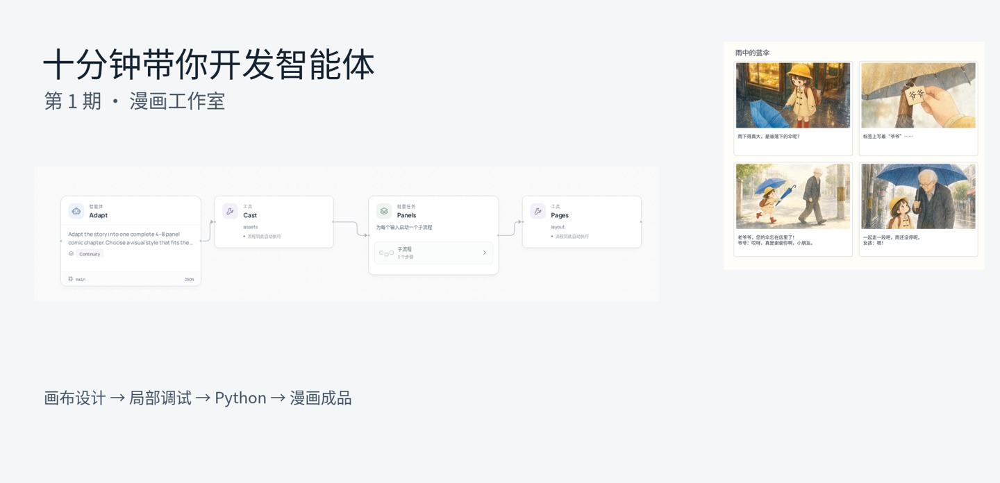
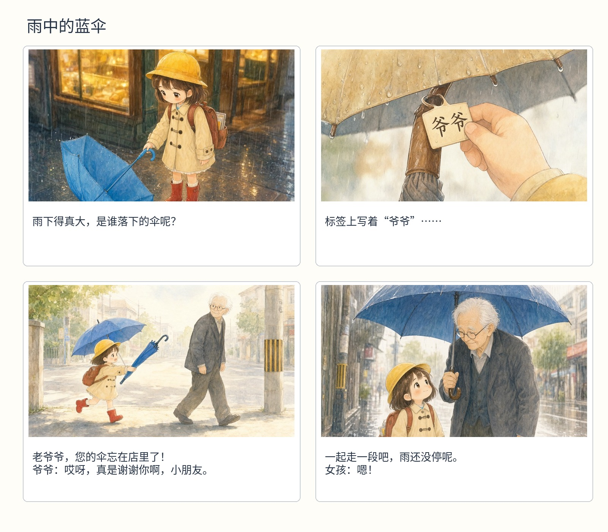

# Ten minutes to a comic agent

[English](comic-studio.md) · [简体中文](../zh-CN/tutorials/comic-studio.md) · [Learning path](README.md)

[](assets/comic-01.mp4)

**[Watch the 10-minute walkthrough](assets/comic-01.mp4)** · Chinese subtitles · [Import the lesson project](assets/comic-project.zip)

| Time | Topic |
| --- | --- |
| 00:12 | Read the four-step workflow |
| 00:58 | Shared model and connections |
| 01:44 | Writer prompt, continuity skill and harness |
| 03:16 | Story input and a real selected-node debug |
| 04:25 | Shared character references, map and retake loop |
| 05:57 | Panel director, image tool and visual reviewer |
| 07:29 | Feedback, history and page layout |
| 08:38 | Switch to Python and export |
| 09:24 | The finished comic |

The lesson project contains the Chinese prompts edited in the video. Import its ZIP in Studio, or unpack it and follow its README. Copy `deployment.example.yaml` to `deployment.yaml`, configure the text and vision connections, then supply a story JSON and the image service described below.

**Goal:** customize a complete comic application on the canvas. You will edit the writer, shared character references, panel loop and visual review, then open the Python view.

Start from the [working Comic Studio template](../../examples/comic-studio/). Its image and page-layout tools are already connected, so the lesson focuses on the agent design. Install and configure it using the example's **Run** section, including a multimodal reviewer and a running image service. Then open:

```bash
python examples/quickstart.py comic-studio studio --port 18766
```

## 1. Read the four-part workflow

The main canvas has **adapt → cast → panels → pages**. `adapt` turns the story into a structured plan. `cast` prepares shared character references. `panels` runs a subflow for every panel. `pages` lays out the images and lettering.

Use **Arrange** to fit the graph. Open the nested `panels` workflow instead of expanding every implementation detail at once.

## 2. Set one model for the team

Open **Model connections**, enter your provider URL, model ID and API-key environment variable, then save the connection. Choose it as **Application default model**. Nodes using `main` share this choice.

The visual reviewer uses the `vision` connection. Select it on that node and enable the image input. One multimodal model can serve both roles; a text model and a separate vision model also work.

## 3. Give the writer an output contract

Select `adapt`. Read its prompt and the `continuity` skill. Change the story direction to a four-panel comic with a clear beginning, turn and ending. Keep the output fields: title, style, characters and panels. Each panel includes camera, characters, description, caption and dialogue.

In the harness, keep structured-output feedback enabled and limit retries. Save before running. Try a short story about a child lending a blue umbrella to an older neighbor; keep the cast small while learning.

## 4. Keep references shared

Select `cast`. This is a required tool step: the workflow always prepares the character catalog. Its output feeds the panel subflow. The agents decide the character descriptions; the tool performs the image work.

Change a character's costume in the plan and follow how its reference ID reaches each panel. This is the place to make cast-wide changes.

## 5. Open the panel and retake loops

Open `panels`, then `takes`. The inner sequence is **direct → draw → preview → review → remember**. The director writes the image prompt; the image tool draws; preview makes the frame available to the reviewer. The reviewer returns `accepted` and specific `feedback`.

Edit the director's prompt to name the panel's camera and action, and reuse the supplied character references. Keep the loop at three attempts while testing. The next attempt receives the previous feedback; acceptance stops the loop early.

## 6. Debug one panel

Save. Use **History**, open a completed panel's step, and choose **Debug with these inputs**. Check the selected map item and loop iteration before running. You can change the director or reviewer and retry that part with its saved inputs.

For a new project with no history, select `adapt` and use **Debug selection** with the story input first. Inspect its plan before spending image-generation time.

## 7. Make the page, then open Python

Return to the main workflow. `pages` receives the panel images, captions and dialogue and produces a PDF, image and editable HTML. Run with **Live models** and **Allow configured write tools**. The worker follows image jobs in the background.

Open **Python** after saving. These are the same nodes, resources, model bindings and loops. Use **Export → Python** to continue in an editor.



## Try it yourself

Change the story and one character trait. Keep the output contract, shared-reference flow and review loop. Compare the plan and resulting panels, then adjust the smallest role responsible for a problem.

**Next:** [move from canvas to Python](canvas-to-python.md). Lookup: [node resources](../agent-resources.md), [Studio debugging](../studio.md), [model services](../local-models.md).
