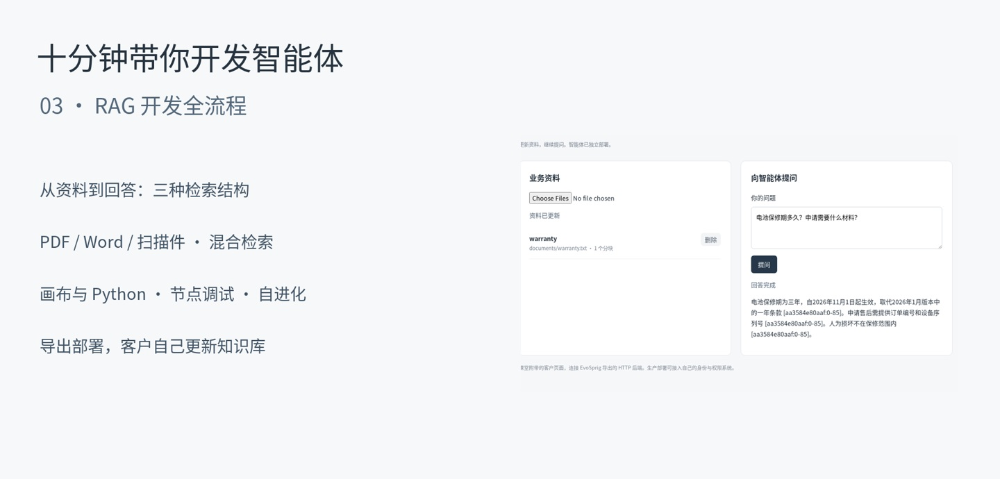

# RAG development, from documents to deployment

[English](rag-development.md) · [简体中文](../zh-CN/tutorials/rag-development.md)

[](assets/rag-03.mp4)

**Ten minutes of RAG development:** import business documents, build three retrieval patterns, debug the graph, connect embeddings and deliver a service whose customer can keep updating its knowledge.

[Video](assets/rag-03.mp4) · [Chinese subtitles](assets/rag-03.zh-CN.srt) · [Completed application](assets/rag-03-project.zip)

## Prepare

Use Python 3.12+, Git and a text model that supports tool calls and structured output. No local GPU is required when the chat and embedding models use APIs.

```bash
git clone https://github.com/Toyhom/EvoSprig.git
cd EvoSprig
python -m venv .venv
source .venv/bin/activate
python -m pip install -e '.[server,models,documents]'
cp docs/tutorials/rag/deployment.example.yaml deployment.yaml
export MODEL_API_KEY='your-key'
# For scanned PDFs and images on Debian/Ubuntu:
sudo apt-get install tesseract-ocr tesseract-ocr-eng tesseract-ocr-chi-sim
```

Edit `models.main` in `deployment.yaml`: provider URL, model ID and the environment variable containing its key. The supplied connection is an example; another compatible provider or a local model service uses the same fields. Build Studio with `npm ci && npm run build` in `apps/studio` (Node.js 20+), then return to the repository root:

```bash
evosprig serve --workspace .evosprig/rag-lesson --profile deployment.yaml \
  --studio-dir apps/studio/dist --port 18777
```

Open `http://127.0.0.1:18777`. [Classroom files](rag/) include all three SDK graphs, prompt resources, sample documents and an optional customer page.

## 1. Configure and populate the knowledge library · 00:30–03:00

Create an empty project. Import [library.json](rag/library.json) in **Resources**; it adds prompts, tool definitions and the model declaration, with no graph nodes. Set **main** as the application model.

Open **Knowledge → Intake & deployment**. Set chunks to **800**, overlap to **100**, OCR languages to **chi_sim+eng**, and enable customer uploads. Set file/batch quotas to fit your deployment; blank values remove those quotas. Save, then upload the classroom `warranty.txt`, `delivery.docx`, `returns.md`, `support-hours.pdf` and `service-notice-scan.pdf` from [documents](rag/documents/).

Use **Retrieval test** for “电池保修期和申请材料”. Check the returned title, source, text and page. The scanned notice contains the November warranty update. Reuploading the same source replaces it after parsing succeeds. Chunk settings affect new imports; reupload to reindex an existing source.

## 2. Retrieve every time · 03:00–04:30

In **Workflow settings**, use this input schema and set output to an object with a required `text` string:

```json
{"type":"object","properties":{"question":{"type":"string"}},"required":["question"],"additionalProperties":false}
```

Create and connect these nodes:

| Node | Type and settings | Inputs |
| --- | --- | --- |
| `retrieve` | Tool: `search` (`documents.search`); output object | `query` ← `input.question`; fixed `limit` = 5 |
| `answer` | Model: global main; prompt `answer`; text response | `question` ← `input.question`; `citations` ← `nodes.retrieve.output.citations` |

Connect `retrieve → answer`. Set workflow output `text` to `nodes.answer.output.text`. Save. Select `retrieve`, choose **Debug selection**, and enter a question. Check its citations before running the whole graph in **Live** mode. For a group, select its nodes together; the debug panel asks for missing upstream inputs.

The [answer prompt](rag/prompts/answer.md) requires source labels and handles dated policy updates. Retrieved text remains task data, not a system instruction.

## 3. Try two other graph patterns · 04:30–05:30

**Agent-selected retrieval:** create an agent node with the `agent` prompt and add `search` under **Tools & knowledge**. Connect `question` to `input.question`; use a text response and three tool rounds. Business-policy questions require retrieval; greetings can be answered directly.

**Query rewriting:** create a `rewrite` model with the `rewrite` prompt and a JSON output containing a string array named `queries`. Connect it to a tool node using `retrieve_many` (`documents.retrieve`): `queries` ← `nodes.rewrite.output.queries`, `limit` = 5, `diversity` = 0.3. Connect that node to the same answer node. The tool fuses query results and reduces repeated excerpts.

Build either complete graph from code:

```bash
python docs/tutorials/rag/build_agent.py --mode agent --out ./rag-agent
python docs/tutorials/rag/build_agent.py --mode multiquery --out ./rag-multiquery
# --mode fixed builds the first graph.
```

Use a separate workspace/scope for independent applications, or import documents for each application ID.

## 4. Embeddings, external databases and harness · 05:30–07:30

In library settings, select **Hybrid**, then provide an embedding API URL, model and key-variable name. The video uses a local BGE-M3 endpoint. A cloud embedding service works the same way:

```yaml
documents:
  retrieval: hybrid
  embeddings:
    base_url: https://your-embedding-service/v1
    model: your-embedding-model
    api_key_env: EMBEDDING_API_KEY
```

Restart a CLI/service with this profile, or save the connection in Studio. Run the same retrieval test again. Vectors are cached persistently. The built-in adapter combines lexical ranks and exact cosine search; connect a large existing vector database with an [HTTP/MCP tool](../tools.md). [external-tools.yaml](rag/external-tools.yaml) gives the binding structure: return text, source and page fields to the answering node.

Under **Tools & knowledge**, choose document and memory tools. Under **Runtime**, configure tool rounds, token budgets and output repair. Facts/shared context and business documents use separate namespaces. A [Python example](rag/library.py) covers ingestion, query, update and deletion using the same library as Studio.

## 5. Export, deploy and let customers update documents · 07:30–09:00

Select **HTTP service** and export. Unzip it into `rag-service`, then:

```bash
cd rag-service
python -m pip install -r requirements.lock -r requirements-documents.lock
python -m pip install --no-deps .
cp deployment.example.yaml deployment.yaml
# Set models.main and documents.customer_uploads: true in deployment.yaml.
export MODEL_API_KEY='your-key'
export EVOSPRIG_SERVICE_TOKEN='your-service-token'
python serve.py --profile deployment.yaml --workspace ./state --port 18778
```

The export is a backend. The classroom supplies an optional client in `customer_app.py` and `customer.html`. In a second terminal, use the same service token:

```bash
python /path/to/EvoSprig/docs/tutorials/rag/customer_app.py --port 18779
```

Open `http://127.0.0.1:18779`. Upload `warranty.txt` and ask about warranty. Then upload the update **using the same source name**: rename a copy of `warranty-update.txt` to `warranty.txt`, and upload that file. Ask again. The service now answers from the new text, while its agent version stays the same. Delete an outdated source from the customer page. The client keeps the service token on its backend.

Your own customer portal can call the [document API](../rag.md#let-customers-maintain-the-deployed-library) instead. HTTP exports include the developer's document settings; importing an export back into Studio restores them. The database stays in the deployment workspace. To ingest initial documents without a browser, use `python app.py --documents ./knowledge --profile deployment.yaml --workspace ./state`.

## 6. Evaluate and self-evolve the selected module · 09:00–10:00

Create a suite of real customer questions. Evaluate whether retrieved passages answer each question, whether claims follow those passages, and whether citations identify the correct source. Supply expected answers or configure an LLM judge. Keep a separate validation subset.

In **Improve**, select the `answer` node, module **prompt**, a search algorithm, maximum rounds, target score and patience. This scopes changes to the selected node; it does not rewrite your knowledge base. Inspect the candidate and its results before adoption. See [scoped self-evolution](scoped-evolution.md) for a complete search run.

[Knowledge-library reference](../rag.md) · [Model connections](../model-connections.md) · [Canvas and debugging](../studio.md)

For the fixed and multi-query graphs, select `check_citations` under the answer node’s **Runtime → Application validation**, enable model feedback and set two repair attempts. The included code checks source labels before returning an answer.

To continue from the completed application, import `rag-03-project.zip` using Studio's **Import project**, or run `evosprig import rag-03-project.zip --out ./rag-project`. Configure the model connection and import your documents into its workspace.

Narration: [Qwen3-TTS](https://github.com/QwenLM/Qwen3-TTS). Music: [Inspired](https://incompetech.com/music/royalty-free/index.html?isrc=USUAN1600022) and [On My Way](https://incompetech.com/music/royalty-free/index.html?isrc=USUAN1600062) — Kevin MacLeod, [CC BY 4.0](https://creativecommons.org/licenses/by/4.0/); edited and mixed for this lesson.
