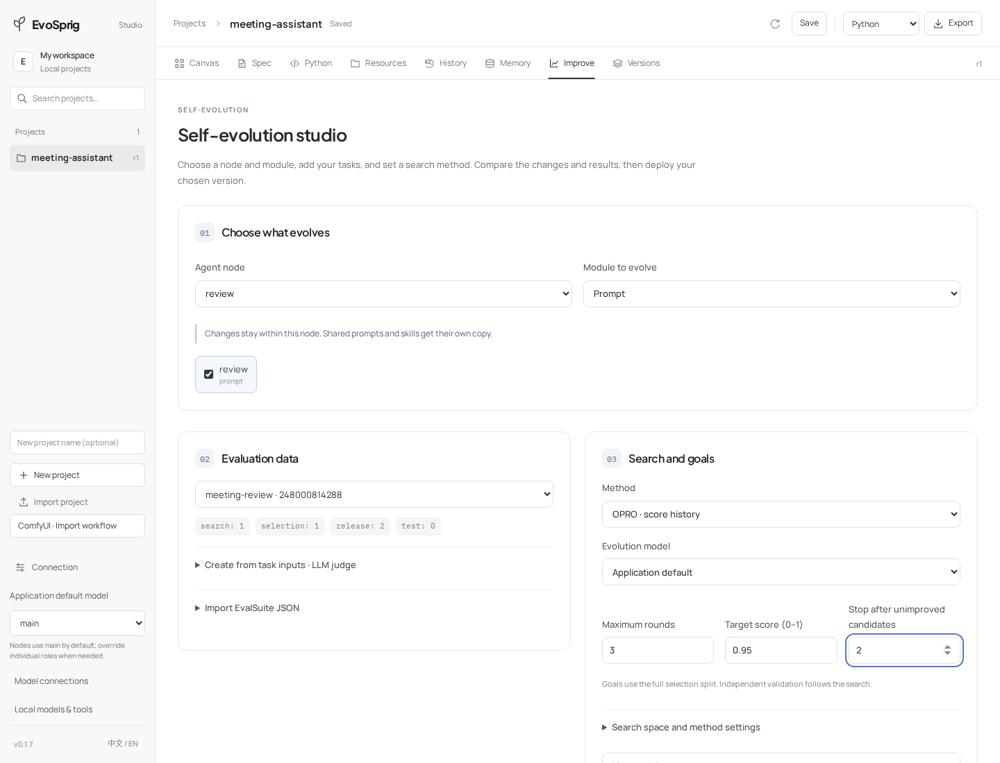

# Evolve one agent in a team

[English](scoped-evolution.md) · [简体中文](../zh-CN/tutorials/scoped-evolution.md) · [Learning path](README.md)

Use [Meeting Assistant](../../examples/meeting-assistant/), a three-node team that extracts commitments, reviews them against the transcript, and writes the final record. This lesson changes only the reviewer's prompt.



## 1. Run the application

Follow the example's **Run locally** instructions to install dependencies and configure an API model. Import its `agent.yaml` and resources through its project ZIP, or start Studio from the repository root:

```bash
evosprig serve --project examples/meeting-assistant/agent.yaml \
  --profile .evosprig/examples/meeting-assistant/deployment.yaml \
  --studio-dir apps/studio/dist --port 8080
```

Run a short transcript once. Open the `review` node and read **Design → Prompt**. The extraction and finalization nodes should remain unchanged during this lesson.

## 2. Add representative tasks

Open **Improve → Create from task inputs**. Name the suite `meeting-review`. Paste this array:

```json
[
  {"meeting_date":"2026-11-05","transcript":"Maya will send the release note Monday. Leo can investigate the bug but has not committed to a fix date."},
  {"meeting_date":"2026-11-05","transcript":"Ana proposed a two-week trial. The team did not approve it. The current trial remains seven days."},
  {"meeting_date":"2026-11-05","transcript":"Priya approved a 10 percent rollout tomorrow. Sam will monitor errors for two days. Full rollout is undecided."},
  {"meeting_date":"2026-11-05","transcript":"Chen will call the vendor this afternoon. Lee will list backup suppliers before November 9. No backup supplier has been selected."}
]
```

Set the rubric: **Keep decisions separate from suggestions. Preserve owners and dates. Mark unconfirmed commitments. Do not invent missing details.** Click **Create task suite**. You can also import a full EvalSuite with reference answers, executable scorers or environment checks.

## 3. Select the reviewer

Under **Choose what evolves**, select `review` and `Prompt`. Select **OPRO**, your live model, one round and an optional target score such as `0.95`. Under **Budget and adoption criteria**, start with 80 model calls, 200,000 tokens and 900 seconds. These limits cover the complete application, proposer and judge.

Click **Start improvement**. EvoSprig evaluates the application, proposes changes to the review prompt, and evaluates candidates. When the original version already reaches the target, it proceeds directly to release validation. Leave the target blank to run the configured search rounds.

## 4. Inspect and reuse

Open **Compare prompts, skills and outputs**. Read the prompt change and the final meeting records together. In **Versions**, export the chosen version, or enable a candidate that passes your adoption criteria. Use new transcripts with the deployed application; evolution is a development step, not something users must repeat for every meeting.

For another experiment, choose `Skills`, or a node with a structured harness and set a parameter's search bounds. If two nodes share a prompt or skill, node-scoped evolution isolates the selected node automatically.

**Next:** [all evolution settings](../evolution.md), [custom evaluations](../evaluation.md), [harness search](../harness-search.md).
