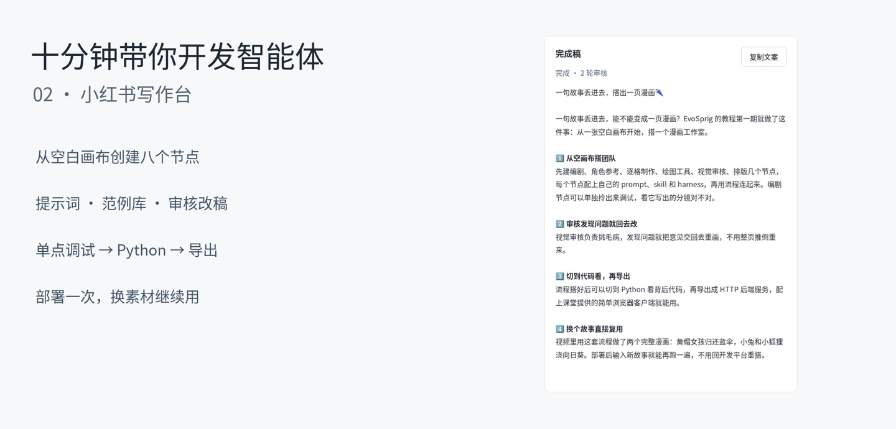
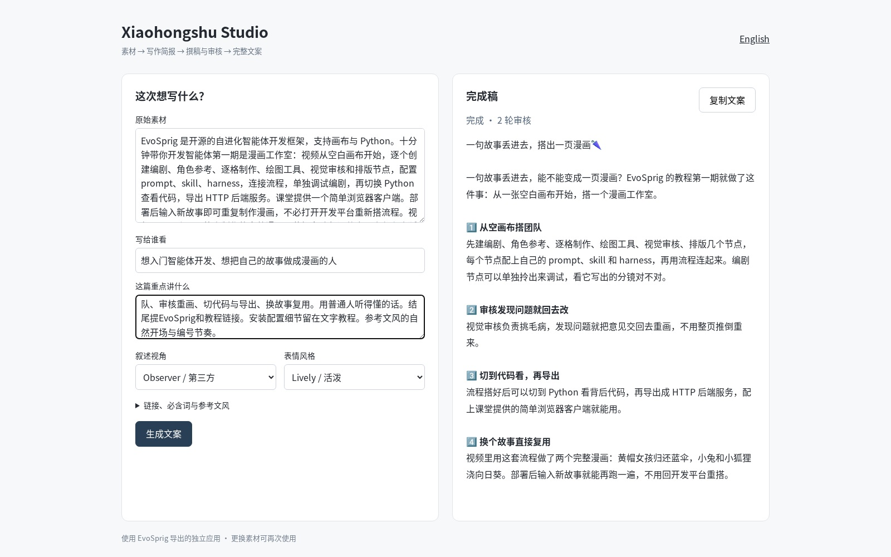
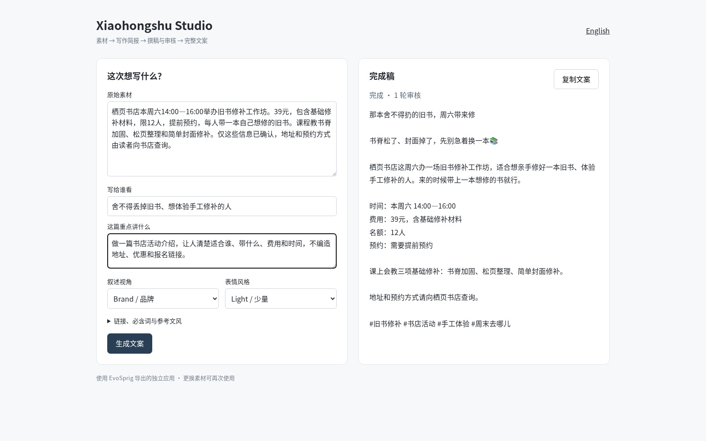

# Ten minutes to a writing agent

[English](xiaohongshu-studio.md) · [简体中文](../zh-CN/tutorials/xiaohongshu-studio.md) · [Learning path](README.md)

[](assets/xhs-02.mp4)

**[Watch lesson 2](assets/xhs-02.mp4)** · Chinese narration · [Subtitles](assets/xhs-02.zh-CN.srt) · [Classroom materials](assets/xhs-materials.zip) · [Completed application](assets/xhs-project.zip)

Build a Xiaohongshu writing desk that turns source notes into a brief, drafts a post, checks it and revises it. Create all eight nodes on the canvas, inspect the Python version, then export and run the application independently. The same deployed application writes a tutorial introduction and a bookshop announcement.

| Time | In the video |
| --- | --- |
| 00:10 | Empty project, resource library and global model |
| 01:18 | Create the main nodes |
| 03:06 | Create the draft, checks, review and state nodes |
| 05:10 | Connect the subflow and main graph |
| 06:02 | Debug a node, inspect Python and export |
| 06:50 | Deploy the independent service and writing page |
| 07:30 | Write the comic tutorial introduction |
| 08:05 | See the actual review and second draft |
| 08:45 | Reuse the deployment for a bookshop event |
| 09:45 | One application, new inputs |

## 1. Prepare Studio and a model connection

You need **Python 3.12+, Node.js 20+, Git and a text-model API**. This lesson uses API inference and needs no local GPU.

```bash
git clone --depth 1 https://github.com/Toyhom/EvoSprig.git
cd EvoSprig
python3.12 -m venv .venv
source .venv/bin/activate
python -m pip install -e '.[models,server]'
npm --prefix apps/studio ci
npm --prefix apps/studio run build
python examples/quickstart.py xiaohongshu-studio setup
export DEEPSEEK_API_KEY="your-api-key"
evosprig serve --workspace .evosprig/xhs-classroom \
  --profile .evosprig/examples/xiaohongshu-studio/deployment.yaml \
  --studio-dir apps/studio/dist --port 18772
```

Setup creates `.evosprig/examples/xiaohongshu-studio/deployment.yaml`. Its `models.main` connection uses DeepSeek Flash. To use another compatible provider, set **base_url**, **model** and **api_key_env**, and adjust provider-specific options. Set the named key variable in the shell that starts the service. Keep the profile separate from the classroom library.

Open **http://127.0.0.1:18772**. Download and unzip the classroom materials. They contain `library.json`, `SETTINGS.md`, `schemas/`, and two inputs. The library supplies prompts, skills and code; you will build the graph yourself.

## 2. Create an empty project

Enter `xhs-classroom` in **New project name**, create it, select the starter node and press Delete. In **Resources → Import tool and resource library**, import `library.json`.

The resources have three distinct jobs:

| Resource | What to look for |
| --- | --- |
| `brief`, `draft`, `review` prompts | Each role's decision and output fields |
| `voice`, `source_fidelity`, `examples` skills | Voice rules, source handling and writing examples |
| `prepare`, `check`, `remember`, `format` code | Defaults, exact checks, revision state and final formatting |

Return to Canvas. In **Workflow settings**, paste `application-input.json`, `application-output.json` and `execution-budget.json` from `schemas/` into their fields. Select **main** as **Application default model**. New agent nodes inherit it.

Only `source` is required. Optional inputs choose the reader, goal, voice, emoji, required terms, links, reference posts and length limits. For example:

```json
{
  "source": "A bookshop offers a book repair workshop on Saturday, 14:00–16:00. The fee is 39 yuan including materials. There are 12 places; booking is required. Bring one damaged book.",
  "audience": "Readers who want to repair a favorite book",
  "voice": "brand",
  "emoji": "light",
  "required_terms": ["39", "12"]
}
```

## 3. Add the four main nodes

Type the node name, select its type, then choose **Add node**. Use the inspector to select resources and create input bindings. The complete field values and output schemas are in `SETTINGS.md` and `schemas/`.

| Node | Type | Main settings |
| --- | --- | --- |
| `prepare` | Code | Tool `python`, code `prepare`; `request ← input` |
| `brief` | Agent | Prompt `brief`; skills `source_fidelity`, `examples`; `request ← nodes.prepare.output` |
| `editing` | Loop | Maximum iterations **3**; stop when **input.accepted** is true |
| `format` | Code | Tool `python`, code `format`; `state ← nodes.editing.output` |

For `brief`, choose JSON response, paste its output schema, and enable the structured harness: output errors **feedback**, **1** repair attempt, **2,400** output tokens and **1** tool round. Set temperature to **0.2**.

Give `editing` six inputs: `request` from `nodes.prepare.output`, `brief` from `nodes.brief.output`, and fixed values `previous = {}`, `feedback = []`, `rounds = 0`, `changes = []`.

## 4. Build the draft-and-review loop

Select `editing`, choose **Open subflow**, and delete its starter node. Create:

| Node | Type | Inputs and responsibility |
| --- | --- | --- |
| `draft` | Agent | Request, brief, previous post and feedback from the loop input; prompt `draft`, all three skills |
| `check` | Code | Request from `input.request`, post from `nodes.draft.output`; code `check` |
| `review` | Agent | Request, brief, draft and check results; prompt `review`, skills `voice` and `source_fidelity` |
| `remember` | Code | Current loop input, draft, checks and review; code `remember` |

The writer's temperature is **0.6**; the reviewer's is **0.2**. Both use JSON responses and the same harness limits as `brief`. Copy each output schema from the field sheet.

Connect **draft → check → review → remember** by dragging each right handle to the next left handle. In this subflow's Workflow settings, return `request`, `brief`, `previous`, `feedback`, `accepted`, `rounds` and `changes` from `nodes.remember.output`.

The code checks character limits and required terms. The reviewer checks reader value and factual claims. When either finds a problem, the next draft receives specific feedback. A successful review stops the loop early; the three-round limit bounds the work.

## 5. Finish the graph and debug a node

Use the breadcrumb to return to the main workflow. Connect **prepare → brief → editing → format**. Set the application outputs `text`, `post`, `ready`, `feedback`, `rounds` and `changes` from `nodes.format.output`. Arrange and save.

Paste `input-one.json` into **Run input**, choose **Live model**, select `prepare` and choose **Debug selection**. Inspect the normalized request. Next, you can run the entire graph or debug another node using its saved upstream inputs.

Here the source describes the first comic-agent tutorial; reference posts guide the writing style while the source supplies the facts.

## 6. Open Python and export

Choose **Python** to inspect the SDK version of the same graph. Select **HTTP service** in the export menu and download the ZIP.

Extract it into a new directory. Copy your configured `deployment.yaml` there. Copy [xhs_app.py](xhs_app.py) alongside `serve.py` to use the simple writing page shown in the lesson. The completed classroom ZIP already includes this optional client; the generic HTTP export provides the backend service.

## 7. Deploy and write two different posts

From the extracted directory:

```bash
python3.12 -m venv .venv
source .venv/bin/activate
python -m pip install -r requirements.lock
python -m pip install --no-deps .
export DEEPSEEK_API_KEY="your-api-key"
export EVOSPRIG_SERVICE_TOKEN="choose-a-local-service-token"
python serve.py --profile deployment.yaml --workspace runtime --port 18773
```

In another terminal, activate the same environment and set the same service token:

```bash
export EVOSPRIG_SERVICE_TOKEN="choose-a-local-service-token"
python xhs_app.py --port 18774
```

Open **http://127.0.0.1:18774/**, or **/?lang=zh** for Chinese. Enter the source, reader and angle. Expand the optional fields to add links, required terms and a reference style. Choose **Write a post**. The page shows the finished text and review status; **Copy post** copies the title, body, links and tags.



Now replace the material with `input-two.json`: a bookshop repair event. Use the **brand** voice, fewer emoji and the required booking details. Submit again in the same application:



Daily users can keep submitting new material here. Return to Studio when changing the roles, prompts, skills or checks. Stop the two local processes with Ctrl+C; reuse the same `runtime` directory when restarting to retain runs.

To continue editing the exported application elsewhere:

```bash
evosprig import xhs-project.zip --out .evosprig/imported-xhs
evosprig serve --project .evosprig/imported-xhs/agent.yaml \
  --profile deployment.yaml --workspace .evosprig/xhs-editor \
  --studio-dir apps/studio/dist --port 18772
```

**Try next:** add one of your own writing examples, change a review criterion, or [configure self-evolution on a set of writing tasks](improve-an-agent.md). Reference: [agent resources](../agent-resources.md), [model connections](../model-connections.md), [export and deployment](../deployment.md).

Narration: [Qwen3-TTS](https://github.com/QwenLM/Qwen3-TTS). Music: [Inspired](https://incompetech.com/music/royalty-free/index.html?isrc=USUAN1600022) and [On My Way](https://incompetech.com/music/royalty-free/index.html?isrc=USUAN1600062) — Kevin MacLeod, [CC BY 4.0](https://creativecommons.org/licenses/by/4.0/); edited and mixed for this lesson.
