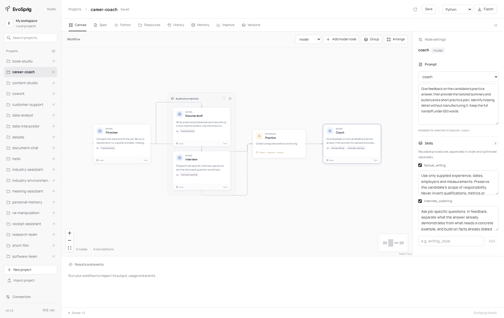

[English](../agent-resources.md) · **简体中文** · [文档目录](README.md)

<a id="configure-an-agent"></a>

# 配置智能体

智能体组合了模型、主提示词、可复用技能和一组选定的工具。这些设置是其行为版本的一部分，并随导出的应用一同迁移。



<a id="prompt-and-skills"></a>

## 提示词与技能

主提示词用于定义角色和任务。技能用于跨角色共享的流程，例如核对产品声明或遵循编辑风格。

```python
from evosprig.sdk import Builder

agent = (
    Builder("editor", {}, {}, spec_version="0.3")
    .model("main", "main")
    .resource("editor", "prompts/editor.md")
    .skill("brand_voice", "skills/brand_voice.md")
    .skill("fact_check", "skills/fact_check.md")
    .node(
        "write", "model", model="main",
        instructions={"resource": "editor"},
        skills=["brand_voice", "fact_check"],
        temperature=0.3, top_p=0.9,
        max_output_tokens=2400, output_schema={"type": "object"},
    )
    .output(text={"ref": "nodes.write.output.text"})
    .build_spec()
)
```

在编译智能体之前创建这三个 Markdown 文件。技能按列出的顺序追加到主指令中。技能是文本流程；可执行能力是工具。多个智能体可以引用同一个技能。更新该技能会为应用创建新的行为版本。

在 Studio 中，选择模型节点或智能体节点。检查器可用于编辑其提示词、将内联提示词转换为可优化资源、附加技能并编辑技能内容。对共享资源的编辑会应用到使用该资源的每个节点。

<a id="tools-and-memory"></a>

## 工具与记忆

`agent` 节点从其分配的工具中进行选择。`tool` 节点在到达该步骤时始终运行其配置的工具。对于必需的 OCR 或计算，使用工具节点；当模型必须决定调用什么时，使用智能体节点。

检查器会列出应用中声明的工具，并提供内置记忆和文档工具的快捷方式。同一用户和项目下的智能体共享这些记录；其他用户和项目具有独立的作用域。可在 Memory 面板中添加共享知识。写入记忆仍需要应用的写入权限和运行的写入权限。

选择所有工具或基于任务的选取，限制工具轮次，并在需要时启用并行读取调用。写入工具会保留其配置的权限和幂等行为。请参阅[工具](tools.md)和[记忆](memory.md)。

<a id="code-node-limits"></a>

## 代码节点限制

代码节点默认接受最多 1,048,576 个字符的 JSON 值。对于更大的批次，在节点上设置 `code_max_value_chars`（1,024–8,388,608），或使用画布检查器中的 **JSON 值限制**。该限制涵盖输入、中间值和输出；指令和分配预算仍然适用。将大型媒体文件保留在工件存储中，并传递其句柄。

<a id="model-parameters"></a>

## 模型参数

每个节点选择自己的模型绑定。在[模型连接](model-connections.md)中配置供应商、API 密钥变量及关联的本地服务。

| 设置 | 默认值 | 范围 / 行为 |
| --- | --- | --- |
| `temperature` | 0 | 0–2；取决于提供商支持情况 |
| `top_p` | 提供商默认值 | 大于 0，至多为 1 |
| `max_output_tokens` | 应用设置 | 1–32,768；还受剩余运行预算限制 |
| `response_format` | `text` | `json` 启用 schema 校验 |
| `output_errors` | `raise` | `feedback` 要求模型修复无效输出 |
| `max_output_retries` | 1 | 0–3 次修复 |

启用反馈后，字段错误会合并为一个修复请求。修复会共享该运行的 token 和调用预算。

模型凭据和提供商选项保留在部署配置文件中。采样参数、技能和工具选择会随工作流进行版本管理。提供商可能施加比这些设置更严格的限制。

<a id="improve-selected-resources"></a>

## 改进选定资源

1. 构建并运行应用。
2. 在 **Improve** 中，添加一个至少包含四个不同任务输入的 JSON 数组。平台会创建固定的搜索、选择和发布划分。评判器可以在没有参考答案的情况下对输入评分；也支持自定义评分器和环境。对于包含人工节点的工作流，导入[带有任务响应的 EvalSuite](evaluation.md#bring-your-own-task-suite)，以便每次评估都能继续经过这些检查点。
3. 选择要更改的提示词和/或技能资源，选择算法并设置预算。
4. 启动改进。EvoSprig 会生成资源编辑，并在任务集上运行同一个应用。
5. 打开 **Compare prompts, skills and outputs**。查看原始资源与选定资源的内容以及配对答案。在 **Versions** 中启用你选择的版本。

针对每个智能体的 harness 设置、模型路由、检索参数、代码和拓扑，选择文本资源或结构化搜索空间。部署权限和任务分区保持固定。有关配置，请参阅[harness 搜索](harness-search.md)；有关方法和发布检查，请参阅[evolution](evolution.md)。

<a id="long-tool-results"></a>

### 长工具结果

设置 `harness.max_tool_result_chars`（例如 `8000`）以限制发送给该智能体的每个工具观察结果。较长的结果会变成带有原始长度和哈希的标记预览。完整结果仍保留在运行日志中。对于下一次模型调用需要完整结构化输出的工具，请勿设置该限制。Studio 在 Harness 下提供该设置。

### 多轮工具调用的上下文

节点设置分为三组：**设计**管理提示词、技能和图片输入；**工具与知识**管理可调用工具和检索；**运行**管理 harness 与模型参数。

长任务可以启用 **运行 → 上下文管理 → 限制工具历史长度**：

```yaml
harness:
  tool_history:
    max_chars: 16000
    keep_recent_rounds: 2
```

每次请求模型之前，平台缩短较早的工具结果，保留最近两轮的完整结果（包括同一轮的并行调用）。系统指令、用户消息及工具调用/结果的配对 ID 均保留。最近轮次本身较大时可以超过目标预算。完整输出仍在运行日志中，`context.pruned` 事件记录缩减量。该策略随应用导出，也能通过有界 harness 字段参与自进化。

运行记录与模型上下文分开管理的做法，也见于 [DeepSeek Harness](https://github.com/deepseek-ai/deepseek-harness/tree/master/packages/compaction)。
