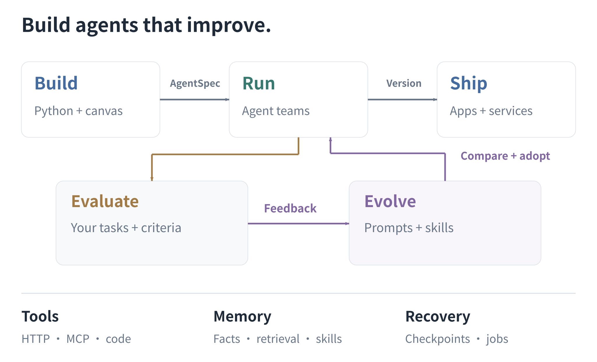

[English](../architecture.md) · **简体中文** · [文档目录](README.md)

# 架构

AgentSpec 是 Python、Studio、评估和导出共享的契约。一个版本由经过验证的图、内容寻址的资源和依赖信息组成。布局变更不会改变行为哈希。

| 模块 | 职责 |
| --- | --- |
| `core` | 类型化契约、图执行、操作日志、预算和版本 |
| `sdk` | 声明式 Python Builder |
| `plugins` | 模型 API、工具、作用域存储和检索 |
| `evaluation` | 固定任务分区、指标和样本报告 |
| `evolution` | 搜索方法、候选谱系和发布门禁 |
| `server` | API、已认证身份、Worker 和事件流 |
| `exporters` | 可移植源项目、依赖和归档导入 |
| `apps/studio` | 可视化编辑、运行历史、记忆、改进和发布 |

核心不依赖于特定的 HTTP 客户端、优化器或 UI。可选集成通过包 extras 安装。

## 执行

AgentSpec 0.3 支持 model、agent、tool、condition、transform、join、bounded loop、parallel、dynamic map 和 human 节点。显式边定义依赖关系。嵌套分支共享运行预算；人工检查点和异步工具作业保留其已完成的前驱。

运行时在执行前记录外部操作日志。租约和 fencing 防止过期 Worker 覆盖已恢复的运行。未知写入结果需要对账。参见[持久执行](durable-runtime.md)。

## 改进

优化器接收已授权资源和搜索/选择数据。发布分区和测试分区分别评估。候选是不可变版本；发布使用修订检查，现有运行保留其冻结版本。参见[进化](evolution.md)。

## 记忆与交付

记忆按租户、用户、项目、角色和命名空间划分作用域。检索、上下文块和时间关系共享删除语义。应用导出包含选定的资源和运行时，而运营数据库保留在部署工作区中。参见[记忆](memory.md)和[部署](deployment.md)。
