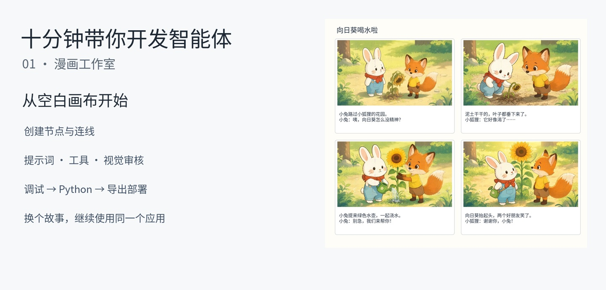
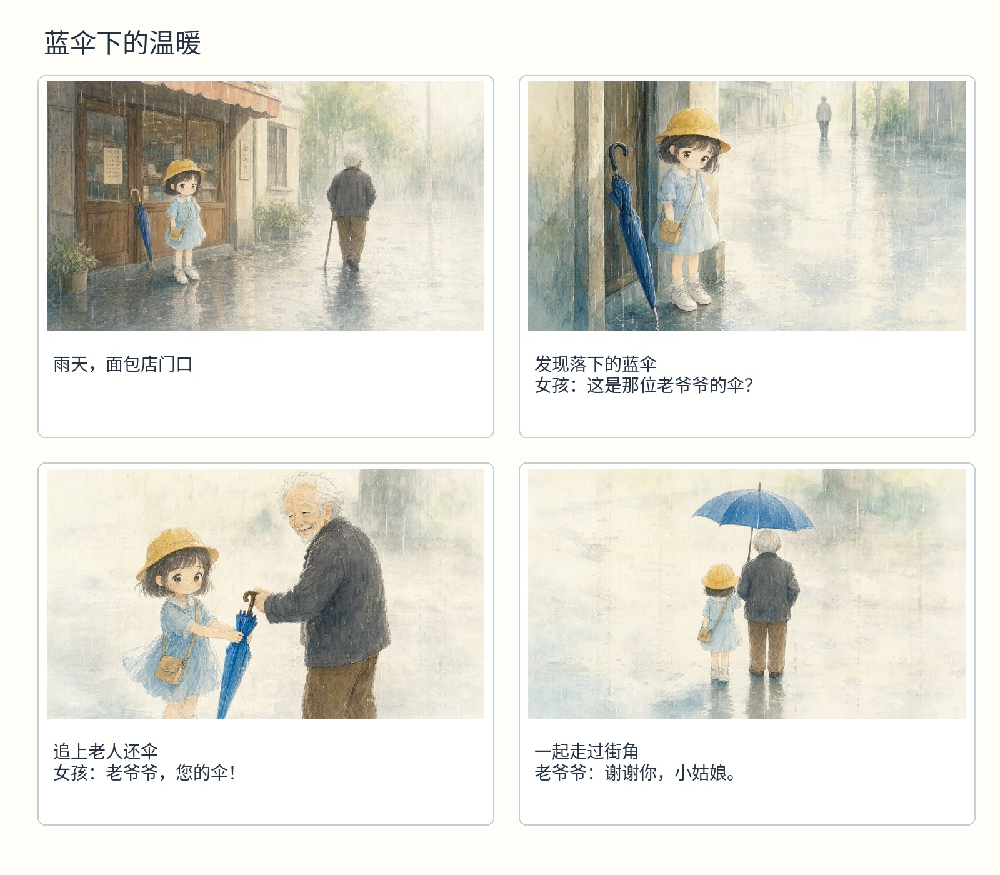
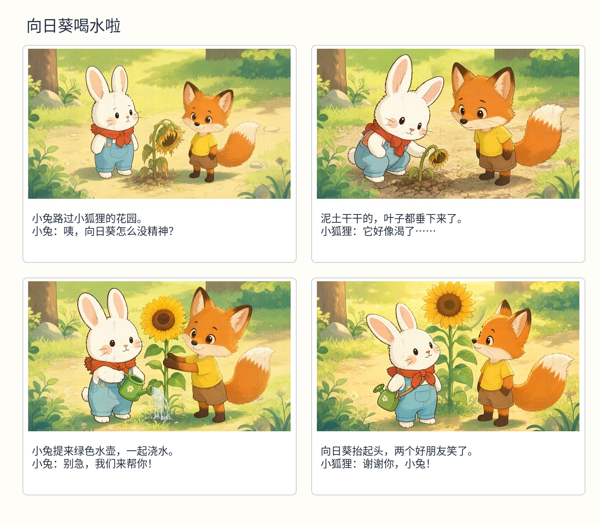

# 十分钟带你开发智能体：漫画工作室

[English](../../tutorials/comic-studio.md) · **简体中文** · [学习路线](README.md)

[](../../tutorials/assets/comic-01.mp4)

**[观看第一期](../../tutorials/assets/comic-01.mp4)** · 中文字幕 · [课堂素材](../../tutorials/assets/comic-materials.zip) · [完成版应用](../../tutorials/assets/comic-project.zip)

从空白画布开始，逐个创建节点、连接工具、加入角色参考和视觉审核循环。完成后切换 Python，导出并独立部署，再给同一个应用输入另一个故事。

| 时间 | 视频内容 |
| --- | --- |
| 00:10 | 空白画布、资源库和应用输入 |
| 01:05 | 编剧、角色参考、逐格处理与整页排版 |
| 02:30 | 子流程、绘图工具和视觉审核循环 |
| 04:55 | 连接节点并保存 |
| 06:00 | 单独调试节点、检查结果 |
| 06:30 | Python 视图与 HTTP 导出 |
| 07:08 | 配置并启动独立应用 |
| 07:50 | 制作第一篇漫画 |
| 08:38 | 同一个应用接收另一个故事 |
| 09:20 | 漫画成品 |

## 1. 准备模型和工具

需要 Python 3.12+、Node.js 20+、Git、文本模型、视觉模型，以及图像生成服务。也可以让一个多模态 API 同时承担两个智能体角色。

```bash
git clone --depth 1 https://github.com/Toyhom/EvoSprig.git
cd EvoSprig
python3.12 -m venv .venv
source .venv/bin/activate
python -m pip install -e '.[models,server,artifacts]'
npm --prefix apps/studio ci
npm --prefix apps/studio run build
python examples/quickstart.py comic-studio setup
```

编辑 `.evosprig/examples/comic-studio/deployment.yaml` 中的 `models.main` 和 `models.vision`，填写厂商的 `base_url`、服务提供的 `model` ID 和 `api_key_env`。在启动 Studio 的终端中设置相应密钥环境变量。DeepSeek Flash 文本调用可设置 `options: {thinking: {type: disabled}}`；视觉审核使用支持图片输入的连接。

按[图像服务教程](../../../apps/media-service/README.md)启动 `http://127.0.0.1:18880`，使用 `--preload image --idle-unload-seconds 0` 预加载并保留模型。中文排版需要中文字体，例如 [Noto Sans CJK](https://github.com/notofonts/noto-cjk)：

```bash
export EVOSPRIG_COMIC_FONT="/path/to/NotoSansCJKsc-Regular.otf"
export EVOSPRIG_IMAGE_ORIGIN="http://127.0.0.1:18880"
evosprig serve --workspace .evosprig/comic-classroom \
  --profile .evosprig/examples/comic-studio/deployment.yaml \
  --studio-dir apps/studio/dist --port 18766
```

打开 `http://127.0.0.1:18766`，切换中文。解压课堂素材：`library.json` 是工具、提示词、技能和数据整理代码；`SETTINGS.md` 是逐节点字段表；`schemas/` 是可以粘贴到表单中的输出格式。

## 2. 从空白画布开始

在“新工程名称”中填写 `comic-classroom`，点击“新建项目”。选中默认节点并按 Delete 删除。在“资源 → 导入工具与资源库”中选择 `library.json`。

返回画布，打开“工作流设置”。将 `schemas/application-input.json` 粘贴到应用输入，并设置素材中的应用输出格式和执行预算。应用只接收一个 `story` 字段。在左侧“应用默认模型”中选择配置好的 `main` 连接。

## 3. 逐个创建主流程节点

输入节点名、选择类型，再点击“添加节点”。在右侧选择提示词或工具，用“输入连接”添加字段，选择上游引用或固定值。

| 节点 | 类型 | 设置 |
| --- | --- | --- |
| `adapt` | 智能体 | 提示词 `adapter`，技能 `continuity`，`story` 来自 `input.story`；按素材设置 JSON 输出格式 |
| `cast` | 工具 | 选择 `assets`；角色与画风来自编剧输出 |
| `panels` | 逐项处理 | 列表来自 `nodes.adapt.output.panels`，传入角色目录和画风 |
| `pages` | 工具 | 选择 `layout`；接收标题和 `nodes.panels.output.items` |

编剧先确定角色，再规划四格。它的 prompt 分配开端、问题、行动和结局；continuity 技能约束衣服、道具和角色 ID。打开输出格式反馈，最多修复两次，单次输出上限设为 3,200 tokens。

## 4. 搭一格漫画，再加入重画循环

打开 `panels` 子流程，删除默认节点，创建三个节点：

| 节点 | 类型 | 用途 |
| --- | --- | --- |
| `context` | 代码 | 选择 `frame_context`，取出当前分格对应的角色参考 |
| `takes` | 循环 | 最多三次，`input.accepted` 为真时提前结束 |
| `letter` | 代码 | 选择 `panel`，整理图片、字幕和对白 |

打开 `takes`，再创建五个节点：

| 节点 | 类型 | 设置 |
| --- | --- | --- |
| `direct` | 智能体 | 提示词 `frame_director`，读取分格、参考图顺序与上一轮反馈 |
| `draw` | 工具 | 选择 `image`，传入绘图 prompt、参考图与图像参数 |
| `preview` | 工具 | 选择 `preview`，读取生成图 |
| `review` | 智能体 | 提示词 `frame_review`，模型选 `vision`，勾选 `images` 为图片输入 |
| `remember` | 代码 | 选择 `frame_carry`，将图片与审核结果传到下一轮 |

按 `SETTINGS.md` 设置输入字段和子流程输出。智能体的响应格式选 JSON，输出格式从 `schemas/` 粘贴。审核返回 `accepted` 和具体的 `feedback`，例如“补上右侧白发老人，女孩把合拢的蓝伞递向他的手”。

## 5. 拖线连接，先调试编剧

从一个节点右侧的连接点拖到下一个节点左侧：

- 主流程：**adapt → cast → panels → pages**。
- 每一格：**context → takes → letter**。
- 每次尝试：**direct → draw → preview → review → remember**。

分别在“工作流设置”中配置子流程输出。主流程按字段表返回 `chapter`、`plan`、`catalog` 和 `panels`。自动排列并保存。

选中 `adapt`，切到“真实模型”，填入一个短故事，点击“调试所选”。先看角色设定和四格剧情，再运行图像生成。之后可以从“历史 → 使用这些输入调试”单独重试某一格，复用它的参考图与反馈。

## 6. 切换 Python，导出应用

保存后打开 **Python**，可以看到刚才创建的同一组节点、资源和循环。导出类型选择 **HTTP service**，下载 ZIP。

解压到新目录，把配置好的 `deployment.yaml` 复制进去，保持图像服务运行。将 [comic_app.py](../../tutorials/comic_app.py) 放在 `serve.py` 旁边，它提供视频中的故事输入界面；完成版课堂 ZIP 已包含这个文件。

## 7. 独立部署，换故事继续用

在解压后的目录运行：

```bash
python3.12 -m venv .venv
source .venv/bin/activate
python -m pip install -r requirements.lock
python -m pip install --no-deps .
export EVOSPRIG_SERVICE_TOKEN="设置一个本地服务令牌"
# 同时设置 deployment.yaml 中指定的模型密钥环境变量。
export EVOSPRIG_COMIC_FONT="/path/to/NotoSansCJKsc-Regular.otf"
export EVOSPRIG_IMAGE_ORIGIN="http://127.0.0.1:18880"
python serve.py --profile deployment.yaml --workspace runtime \
  --port 18770 --allow-writes
```

另开一个终端，激活同一环境，并使用相同的服务令牌：

```bash
export EVOSPRIG_SERVICE_TOKEN="设置一个本地服务令牌"
python comic_app.py --workspace runtime --port 18771
```

打开 **http://127.0.0.1:18771/?lang=zh**。输入故事，点击“开始制作”。应用会在后台跟进图像作业，完成后展示漫画页，并提供 PDF 和 HTML。

再输入另一个故事，就能继续使用已经部署的智能体。团队、工具和模型服务都会复用；想改变应用的工作方式时，再回到开发平台修改。



给同一个应用换一个“小兔和小狐狸给向日葵浇水”的故事：



**下一步：** [用 Python 修改应用](canvas-to-python.md)，或[配置自进化](improve-an-agent.md)。查阅：[画布操作](../studio.md)、[模型连接](../model-connections.md)、[导出部署](../deployment.md)。
