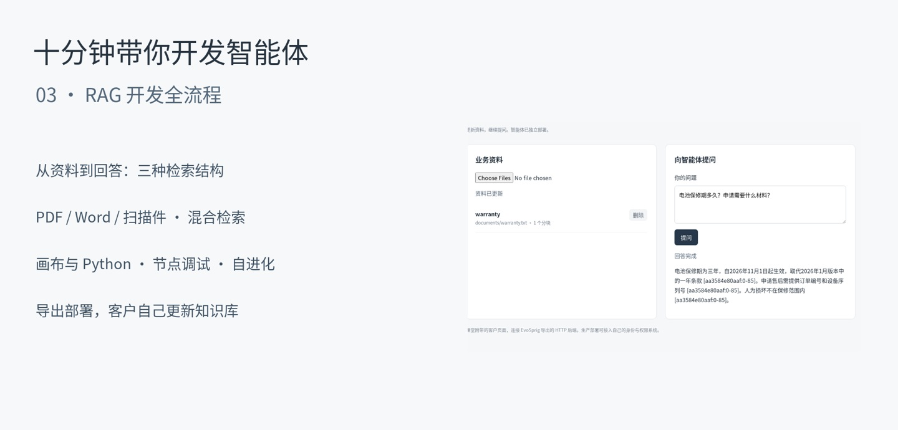

# RAG 开发：从资料导入到独立部署

[English](../../tutorials/rag-development.md) · [简体中文](rag-development.md)

[](../../tutorials/assets/rag-03.mp4)

**十分钟带你开发智能体 · 第三期**：导入业务文档，搭建三种检索结构，调试节点、连接向量模型，再交付一个允许客户持续更新资料的独立服务。

## 准备环境

需要 Python 3.12+、Git，以及支持工具调用和结构化输出的文本模型。聊天和向量模型都使用 API 时，本机不需要 GPU。

```bash
git clone https://github.com/Toyhom/EvoSprig.git
cd EvoSprig
python -m venv .venv
source .venv/bin/activate
python -m pip install -e '.[server,models,documents]'
cp docs/tutorials/rag/deployment.example.yaml deployment.yaml
export MODEL_API_KEY='你的密钥'
# Debian / Ubuntu 上安装扫描件识别程序与语言包：
sudo apt-get install tesseract-ocr tesseract-ocr-eng tesseract-ocr-chi-sim
```

修改 `deployment.yaml` 中 `models.main` 的服务地址、模型名称和密钥环境变量。示例连接可以换成其他兼容 API 或本地模型服务。使用 Node.js 20+，在 `apps/studio` 中运行 `npm ci && npm run build`，再回到仓库根目录：

```bash
evosprig serve --workspace .evosprig/rag-lesson --profile deployment.yaml \
  --studio-dir apps/studio/dist --port 18777
```

打开 `http://127.0.0.1:18777`。[课堂文件](../../tutorials/rag/) 包含三种原生 SDK 流程、提示词、样例文档和可选客户页面。

## 1. 设置并导入知识库 · 00:30–03:00

新建空白工程。在**资源**中导入 [library.json](../../tutorials/rag/library.json)，添加提示词、工具定义和模型声明；文件不包含节点或连线。将应用默认模型设为 **main**。

进入**知识库 → 导入与部署设置**：分块字符数 **800**、重叠 **100**、OCR 语言 **chi_sim+eng**，开启客户上传。按部署需求设置文件与批次配额；相应配额留空表示不限。保存，然后上传 [documents](../../tutorials/rag/documents/) 中的 `warranty.txt`、`delivery.docx`、`returns.md`、`support-hours.pdf` 和 `service-notice-scan.pdf`。

在**检索测试**中查询“电池保修期和申请材料”，检查标题、来源、正文和页码。扫描通知中包含十一月的新保修规则。重新上传同一来源会在解析成功后替换原版本。修改分块设置后，重新上传已有来源即可重建索引。

## 2. 每次都先检索 · 03:00–04:30

在**工作流设置**中填写以下输入格式，输出设为包含必填 `text` 字符串的对象：

```json
{"type":"object","properties":{"question":{"type":"string"}},"required":["question"],"additionalProperties":false}
```

逐个创建节点：

| 节点 | 类型与设置 | 输入 |
| --- | --- | --- |
| `retrieve` | 工具：`search`（`documents.search`）；输出为对象 | `query` ← `input.question`；固定 `limit` = 5 |
| `answer` | 模型：全局 main；提示词 `answer`；文本响应 | `question` ← `input.question`；`citations` ← `nodes.retrieve.output.citations` |

连接 `retrieve → answer`。工作流输出 `text` 绑定 `nodes.answer.output.text`，保存。选择 `retrieve`，点击**调试所选**，输入问题，先检查引用片段，再切换**真实调用**运行完整流程。选中多个节点也可调试，缺少的上游结果在调试表单中单独提供。

[回答提示词](../../tutorials/rag/prompts/answer.md) 要求使用来源编号，按明确生效日期处理政策更新。检索到的文字作为任务资料输入，不成为系统指令。

## 3. 再试两种检索结构 · 04:30–05:30

**智能体自主检索**：创建 agent 节点，选择 `agent` 提示词，在**工具与知识**中勾选 `search`。将 `question` 绑定 `input.question`，使用文本响应和三轮工具调用。涉及业务政策时查询资料；简单问候可以直接回答。

**先改写查询**：创建 `rewrite` 模型，使用同名提示词，JSON 输出包含字符串数组 `queries`。连接到使用 `retrieve_many`（`documents.retrieve`）的工具节点：`queries` ← `nodes.rewrite.output.queries`，`limit` = 5，`diversity` = 0.3。随后接同一个回答节点。工具会合并多条查询的结果并减少重复片段。

也可直接生成完整流程：

```bash
python docs/tutorials/rag/build_agent.py --mode agent --out ./rag-agent
python docs/tutorials/rag/build_agent.py --mode multiquery --out ./rag-multiquery
# --mode fixed 对应第一种结构。
```

独立应用使用各自的资料范围；为不同应用 ID 导入资料时，注意工作区和用户身份保持一致。

## 4. 混合检索、外部向量库和 harness · 05:30–07:30

知识库设置选择**混合**，填写向量服务地址、模型和密钥环境变量。视频使用本地 BGE-M3 服务，云向量接口也使用同样的字段：

```yaml
documents:
  retrieval: hybrid
  embeddings:
    base_url: https://your-embedding-service/v1
    model: your-embedding-model
    api_key_env: EMBEDDING_API_KEY
```

命令行或独立服务重启时加载此配置；Studio 可以直接保存连接。重新执行同一个检索测试。向量缓存持久保存，内置适配器融合关键词排序与精确余弦检索。已有大型向量库可通过 [HTTP/MCP 工具](../tools.md) 接入。[external-tools.yaml](../../tutorials/rag/external-tools.yaml) 给出绑定格式，按实际接口返回文字、来源和页码即可连接回答节点。

节点的**工具与知识**区选择文档、记忆工具；**运行**区设置工具轮次、输出预算和格式修复。事实记忆、共享上下文和业务文档使用不同命名空间。[Python 示例](../../tutorials/rag/library.py) 演示同一知识库的导入、查询、替换和删除。

## 5. 导出服务，让客户持续更新资料 · 07:30–09:00

确认已开启客户上传，选择 **HTTP service** 并导出。解压到 `rag-service`：

```bash
cd rag-service
python -m pip install -r requirements.lock -r requirements-documents.lock
python -m pip install --no-deps .
cp deployment.example.yaml deployment.yaml
# 配置 models.main，并设置 documents.customer_uploads: true。
export MODEL_API_KEY='你的密钥'
export EVOSPRIG_SERVICE_TOKEN='你的服务访问令牌'
python serve.py --profile deployment.yaml --workspace ./state --port 18778
```

导出产物是后端服务。课堂另附 `customer_app.py` 和 `customer.html` 组成的简洁客户页面。在第二个终端使用相同服务令牌：

```bash
python /path/to/EvoSprig/docs/tutorials/rag/customer_app.py --port 18779
```

打开 `http://127.0.0.1:18779`，上传 `warranty.txt` 并询问保修期限。随后把 `warranty-update.txt` 的一份副本重命名为 `warranty.txt`，再次上传，以相同来源替换旧条款。重新提问，智能体版本不变，回答已读取新资料。页面也可以删除过期来源；服务令牌保留在客户页面的后端。

正式业务页面可直接对接[文档 API](../rag.md)。HTTP 导出携带开发者配置，重新导入 Studio 时也会恢复知识库设置；资料数据库由部署工作区持久保存。批量预装资料可运行 `python app.py --documents ./knowledge --profile deployment.yaml --workspace ./state`，不用通过浏览器逐份上传。

## 6. 评测并自进化指定模块 · 09:00–10:00

准备一组真实客户问题。分别检查检索片段是否覆盖问题、回答是否忠实于资料、引用是否指向正确来源。可以提供标准答案、业务规则，也可配置模型评委；保留独立验证集。

进入**自进化**，选择 `answer` 节点与 **prompt** 模块，指定算法、最大轮数、目标分数和无提升停止次数。搜索只作用于选中节点，不重写业务知识库。查看候选和评测结果再采纳。[节点级自进化教程](scoped-evolution.md) 演示完整搜索过程。

[知识库参考文档](../rag.md) · [模型连接](../model-connections.md) · [画布与调试](../studio.md)

固定检索与多查询流程可在回答节点的**运行 → 业务规则校验**中选择 `check_citations`，开启反馈修复并设置两次重试。课堂代码会在返回回答前检查来源编号。

[完整视频](../../tutorials/assets/rag-03.mp4) · [中文字幕](../../tutorials/assets/rag-03.zh-CN.srt) · [完成版工程](../../tutorials/assets/rag-03-project.zip)

从完成版继续开发：在 Studio 中选择**导入工程**，载入 `rag-03-project.zip`；或执行 `evosprig import rag-03-project.zip --out ./rag-project`。配置模型连接后，将业务资料导入该应用的工作区。

配音：[Qwen3-TTS](https://github.com/QwenLM/Qwen3-TTS)。音乐：[Inspired](https://incompetech.com/music/royalty-free/index.html?isrc=USUAN1600022)、[On My Way](https://incompetech.com/music/royalty-free/index.html?isrc=USUAN1600062)，Kevin MacLeod，[CC BY 4.0](https://creativecommons.org/licenses/by/4.0/)，经剪辑与混音用于本教程。
