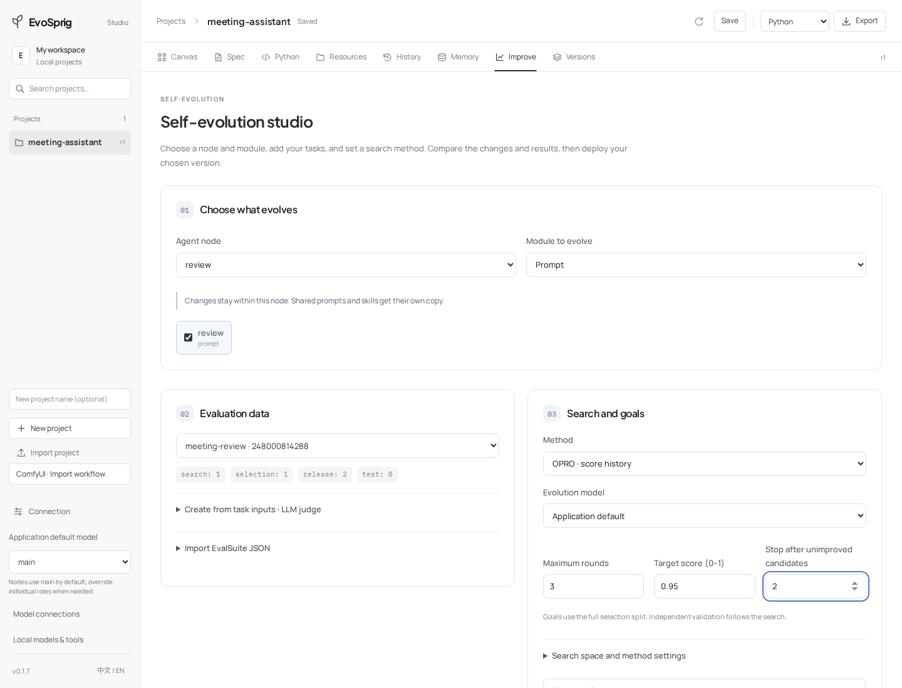

# 只进化团队中的一个智能体

[English](../../tutorials/scoped-evolution.md) · **简体中文** · [学习路线](README.md)

本课使用[会议助手](../../../examples/meeting-assistant/)。它包含提取、审核、整理三个节点，我们只进化审核节点的提示词。



## 1. 先运行应用

按照样例的 **Run locally** 配好环境和 API 模型。通过项目 ZIP 导入画布，或从仓库根目录启动：

```bash
evosprig serve --project examples/meeting-assistant/agent.yaml \
  --profile .evosprig/examples/meeting-assistant/deployment.yaml \
  --studio-dir apps/studio/dist --port 8080
```

先运行一份简短会议记录。点开 `review` 节点，在**设计 → 提示词**中查看当前指令。本课保持 `extract` 和 `finalize` 两个节点不变。

## 2. 添加任务

打开**自进化 → 从任务输入创建**，名称填 `meeting-review`，粘贴以下数组：

```json
[
  {"meeting_date":"2026-11-05","transcript":"小林周一发送发布说明。小陈可以调查故障，但尚未承诺修复日期。"},
  {"meeting_date":"2026-11-05","transcript":"小李提议把试用期改为两周，团队没有通过，当前仍为七天。"},
  {"meeting_date":"2026-11-05","transcript":"负责人同意明天向百分之十的用户开放。小周监控两天错误率。全面开放时间待定。"},
  {"meeting_date":"2026-11-05","transcript":"小吴今天下午联系供应商。小赵在十一月九日前列出备选供应商，目前还没有选定替代方。"}
]
```

评分标准填：**区分决定和提议，保留负责人及日期，标明尚未确认的事项，不补造缺失信息。** 点击**创建任务集**。如果已有标准答案、业务评分器或模拟环境，也可以直接导入完整 EvalSuite。

## 3. 指定审核节点

在**进化范围**中选择 `review` 和 `Prompt`。算法选择 **OPRO**，切换到真实模型，先运行一轮。目标分数可选 `0.95`，也可以留空。在**预算与采纳条件**中先设置 80 次模型调用、200,000 tokens、900 秒；整个应用、候选提案和评委都计入预算。

点击**开始自进化**。平台运行应用、提出审核提示词的修改并评估候选。原版本已经达到目标分数时，会直接进入独立验证；目标留空时按配置的轮次搜索。

## 4. 查看并复用

打开**查看提示词、技能与结果对比**，结合最终会议记录检查修改。在**版本**中导出所选版本，或启用通过采纳条件的候选。部署后直接输入新的会议记录即可使用，不需要每次重新开发或重新进化。

下一次可以改为搜索 `Skills`，或选择启用了独立 harness 的节点，填写参数上下限。多个节点共享提示词或技能时，节点级进化会自动隔离选中节点。

**继续阅读：**[全部进化设置](../evolution.md)、[自定义评估](../evaluation.md)、[harness 搜索](../harness-search.md)。
