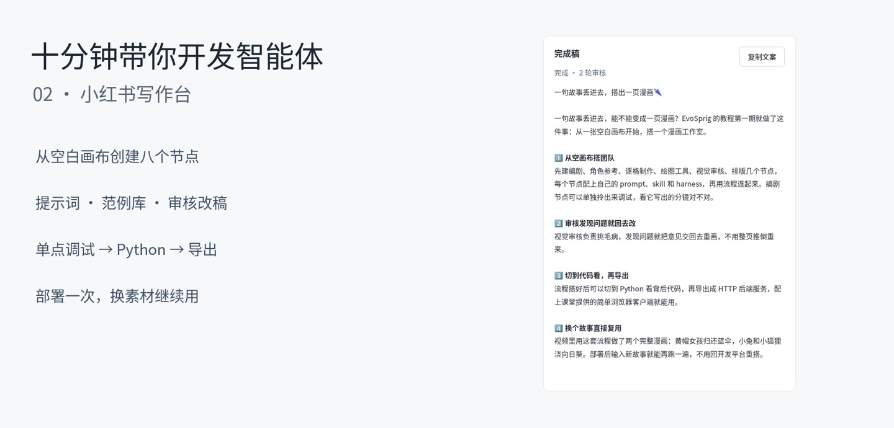
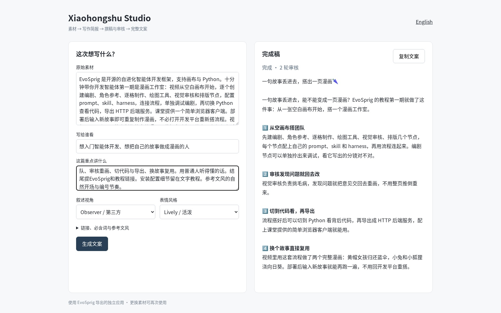
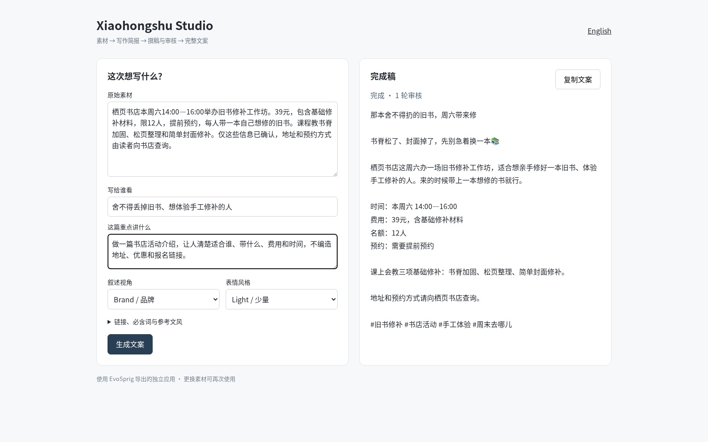

# 十分钟带你开发智能体 · 第二期：小红书写作台

[English](../../tutorials/xiaohongshu-studio.md) · 简体中文 · [学习路线](README.md)

[](../../tutorials/assets/xhs-02.mp4)

**[观看第二期](../../tutorials/assets/xhs-02.mp4)** · 中文字幕 · [课堂素材](../../tutorials/assets/xhs-materials.zip) · [完成版应用](../../tutorials/assets/xhs-project.zip)

这期做一个小红书文案应用：整理素材、确定切口、起草、检查、按意见修改。我们从空画布逐个创建八个节点，切换 Python 查看代码，然后导出并独立部署。最后，用同一个应用分别写漫画教程介绍和书店活动通知。

| 时间 | 视频内容 |
| --- | --- |
| 00:10 | 新建空项目、导入资源、选择全局模型 |
| 01:18 | 创建主流程节点 |
| 03:06 | 创建撰稿、检查、审核与状态节点 |
| 05:10 | 连接子流程与主流程 |
| 06:02 | 调试节点、查看 Python、导出 |
| 06:50 | 独立部署后端和写作页面 |
| 07:30 | 写漫画教程的介绍文案 |
| 08:05 | 查看真实审核意见与第二稿 |
| 08:45 | 换成书店活动，复用同一个应用 |
| 09:45 | 开发一次，接着使用 |

## 1. 准备开发平台与模型

需要 **Python 3.12+、Node.js 20+、Git，以及一个文本模型 API**。本课使用 API 推理，不需要本地显卡。

```bash
git clone --depth 1 https://github.com/Toyhom/EvoSprig.git
cd EvoSprig
python3.12 -m venv .venv
source .venv/bin/activate
python -m pip install -e '.[models,server]'
npm --prefix apps/studio ci
npm --prefix apps/studio run build
python examples/quickstart.py xiaohongshu-studio setup
export DEEPSEEK_API_KEY="你的 API Key"
evosprig serve --workspace .evosprig/xhs-classroom \
  --profile .evosprig/examples/xiaohongshu-studio/deployment.yaml \
  --studio-dir apps/studio/dist --port 18772
```

setup 会生成 `.evosprig/examples/xiaohongshu-studio/deployment.yaml`，其中 `models.main` 默认连接 DeepSeek Flash。换厂商时，修改 **base_url、model、api_key_env**，并调整厂商专用 options。启动服务的终端要设置对应密钥环境变量。模型连接配置与课堂资源库分开保存。

打开 **http://127.0.0.1:18772**，下载并解压课堂素材。`library.json` 提供提示词、技能和代码；`SETTINGS.md` 提供字段表；`schemas/` 提供可粘贴的格式定义；另有两个输入文件。节点和连线由你自己创建。

## 2. 从一张空白画布开始

在“新工程名称”输入 `xhs-classroom`，新建工程。选中默认节点，按 Delete 删除。打开“资源 → 导入工具与资源库”，选择 `library.json`。

先认识资源的分工：

| 资源 | 看什么 |
| --- | --- |
| `brief`、`draft`、`review` 提示词 | 每个角色负责的判断与输出 |
| `voice`、`source_fidelity`、`examples` 技能 | 语气、事实来源与写作范例 |
| `prepare`、`check`、`remember`、`format` 代码 | 默认值、准确检查、循环状态与成稿整理 |

回到画布，打开“工作流设置”。将 `schemas/` 中的 `application-input.json`、`application-output.json`、`execution-budget.json` 分别粘贴到应用输入、输出和执行预算。左侧“应用默认模型”选择 **main**，后面的智能体节点会沿用它。

输入只要求 `source`，其他字段可以设置读者、目标、语气、表情、必含词、链接、参考文风和字数。例如：

```json
{
  "source": "书店周六14:00—16:00举办旧书修补工作坊。39元含材料，限12人，需要提前预约，每人带一本旧书。",
  "audience": "想修补心爱旧书的读者",
  "voice": "brand",
  "emoji": "light",
  "required_terms": ["39元", "12人", "提前预约"]
}
```

## 3. 创建主流程的四个节点

输入节点名，选择类型，点击“添加节点”。右侧检查器选择资源、添加输入字段。完整设置见 `SETTINGS.md`，输出格式从 `schemas/` 复制。

| 节点 | 类型 | 主要设置 |
| --- | --- | --- |
| `prepare` | 代码 | 工具 `python`，代码 `prepare`；`request ← input` |
| `brief` | 智能体 | 提示词 `brief`；技能 `source_fidelity`、`examples`；`request ← nodes.prepare.output` |
| `editing` | 循环 | 最多 **3** 轮；`input.accepted` 为真时停止 |
| `format` | 代码 | 工具 `python`，代码 `format`；`state ← nodes.editing.output` |

`brief` 选择 JSON 响应，粘贴对应输出格式。启用独立 harness：格式错误处理设为 **feedback**，修复次数 **1**，输出上限 **2400 token**，工具轮数 **1**。Temperature 设为 **0.2**。

给 `editing` 设置六个输入：`request` 来自 `nodes.prepare.output`，`brief` 来自 `nodes.brief.output`；其余使用固定值：`previous = {}`、`feedback = []`、`rounds = 0`、`changes = []`。

## 4. 创建起草与审核子流程

选中 `editing`，点击“打开子流程”，删除默认节点。依次创建：

| 节点 | 类型 | 输入与职责 |
| --- | --- | --- |
| `draft` | 智能体 | 从循环输入读取 request、brief、previous、feedback；提示词 `draft`，勾选三个技能 |
| `check` | 代码 | request 来自 `input.request`，post 来自 `nodes.draft.output`；代码 `check` |
| `review` | 智能体 | 读取需求、简报、初稿和代码检查结果；提示词 `review`，技能 `voice`、`source_fidelity` |
| `remember` | 代码 | 读取当前循环输入、初稿、检查和审核；代码 `remember` |

写作者 Temperature 设 **0.6**，审核者设 **0.2**；均使用 JSON 响应，harness 与 `brief` 相同。各节点输出格式按字段表粘贴。

从节点右侧拖到下一节点左侧，连接 **draft → check → review → remember**。在子流程的“工作流设置”中，将 `nodes.remember.output` 的 `request`、`brief`、`previous`、`feedback`、`accepted`、`rounds`、`changes` 作为输出。

代码检查负责字数和必含词；审核智能体负责读者感受与事实。没有通过时，下一轮会收到具体修改意见；通过后提前退出，最多写三稿。

## 5. 连好主流程，先调试一个节点

点击面包屑回到主工作流，连接 **prepare → brief → editing → format**。应用输出中的 `text`、`post`、`ready`、`feedback`、`rounds`、`changes` 分别读取 `nodes.format.output` 对应字段。自动排列并保存。

将 `input-one.json` 粘贴到“运行输入”，选择“真实模型”，选中 `prepare`，点击“调试所选”。检查整理后的请求，再运行完整流程，或用历史输入调试其他节点。

这份素材介绍第一期漫画智能体教程。参考笔记负责文风，当前素材负责事实。

## 6. 查看 Python，导出应用

点击 **Python**，查看同一份流程对应的 SDK 代码。导出类型选择 **HTTP service**，下载 ZIP。

在一个新目录解压，把已经配好的 `deployment.yaml` 复制进去。再将 [xhs_app.py](../../tutorials/xhs_app.py) 放到 `serve.py` 旁边，它提供视频里的简单写作页面。完成版课堂 ZIP 已附带这个客户端；通用 HTTP 导出提供的是后端服务。

## 7. 独立部署，换一份素材继续写

在解压目录运行：

```bash
python3.12 -m venv .venv
source .venv/bin/activate
python -m pip install -r requirements.lock
python -m pip install --no-deps .
export DEEPSEEK_API_KEY="你的 API Key"
export EVOSPRIG_SERVICE_TOKEN="设置一个本地服务令牌"
python serve.py --profile deployment.yaml --workspace runtime --port 18773
```

另开终端，激活同一环境，设置同一个服务令牌：

```bash
export EVOSPRIG_SERVICE_TOKEN="设置一个本地服务令牌"
python xhs_app.py --port 18774
```

打开 **http://127.0.0.1:18774/?lang=zh**，填写素材、读者和切入点。可展开补充链接、必含词与参考文风，点击“生成文案”。右侧显示完整稿和审核状态；“复制文案”会复制标题、正文、链接与话题。



把素材换成 `input-two.json` 中的书店修书活动：视角选品牌，表情少一些，保留费用、人数和预约要求。在同一个应用中再次提交：



日常使用直接换素材即可；想修改角色分工、提示词、技能或检查规则时，再打开开发平台。关闭两个进程可按 Ctrl+C；重启时继续使用同一个 `runtime` 目录，保留运行记录。

想把导出的应用导入另一个 EvoSprig 继续开发：

```bash
evosprig import xhs-project.zip --out .evosprig/imported-xhs
evosprig serve --project .evosprig/imported-xhs/agent.yaml \
  --profile deployment.yaml --workspace .evosprig/xhs-editor \
  --studio-dir apps/studio/dist --port 18772
```

**接着试试：**补充一篇喜欢的范例，修改一个审核标准，或[用一组写作任务配置自进化](improve-an-agent.md)。参考文档：[智能体资源](../agent-resources.md)、[模型连接](../model-connections.md)、[导出与部署](../deployment.md)。
