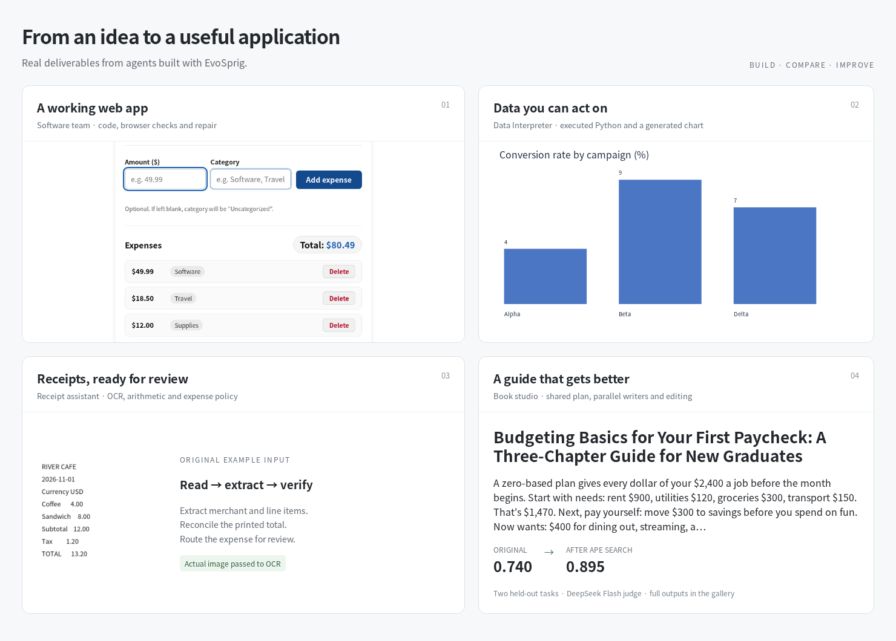
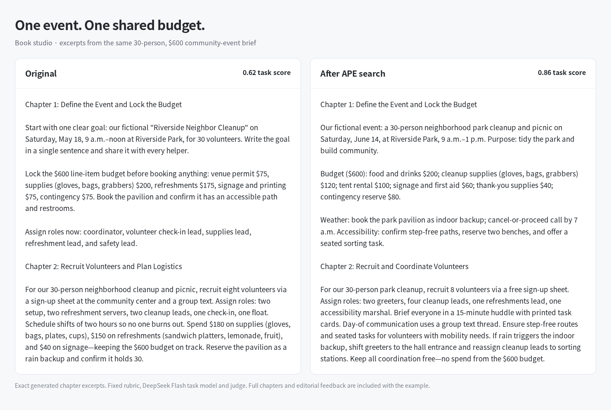

# What will you build?

Start with a working application pattern, connect your model and tools, then make it your own. Each application uses EvoSprig's SDK, AgentSpec and runtime for its coordination, tool calls, memory and approvals.



## Build something useful

| I want an agent that… | Application | What you can customize |
| --- | --- | --- |
| Turns an idea into a web app | [Software team](software-team/) | Product roles, acceptance checks, browser tools and design conventions |
| Analyzes files and draws charts | [Data Interpreter](data-interpreter/) | Data files, Python environment, analysis and review |
| Helps make a difficult decision | [Decision room](debate/) | Perspectives, rebuttals and decision criteria |
| Reads receipts and checks expenses | [Receipt assistant](receipt-assistant/) | OCR, arithmetic, expense rules and approval routing |
| Turns a question into a sourced brief | [Research team](research-team/) | Planning, parallel researchers, document collections and editorial review |
| Makes a video from a brief | [Video studio](video-studio/) | Characters, storyboards, image/video providers, shot approval and retakes |
| Turns a meeting into clear next steps | [Meeting assistant](meeting-assistant/) | Decisions, owners, dates and review criteria |
| Writes a consistent multi-chapter guide | [Book studio](book-studio/) | Shared outline, parallel writers, style and editing |
| Builds a trip that fits the budget | [Travel planner](travel-planner/) | Traveler constraints, available activities and cost checks |
| Answers questions about business data | [SQL analyst](data-analyst/) | SQLite databases, CSV imports and business questions |
| Knows the team handbook | [Chat with your documents](document-chat/) | Handbooks, policies, product notes and citations |
| Helps customers with orders | [Customer support](customer-support/) | Order services, refund policies and human approval |
| Remembers preferences across sessions | [Personal assistant](personal-memory/) | Scoped facts, linked recall and source-aware summaries |

The catalog includes the five application categories highlighted by [MetaGPT](https://github.com/FoundationAgents/MetaGPT), writing/planning patterns from [CrewAI](https://github.com/crewAIInc/crewAI-examples), retrieval and stateful assistant patterns used with [LangGraph](https://docs.langchain.com/oss/python/langgraph/workflows-agents), and [VideoClaw](https://github.com/HITsz-TMG/VideoClaw)-style production. These are EvoSprig implementations of the application patterns. Their guides describe the connected tools and scope.

## Before and after



**Book studio:** APE search improved the average score from **0.740 to 0.895** on two held-out writing tasks. Read the [actual chapters and reusable versions](book-studio/results/README.md): the original community-event guide changes budget amounts across chapters; the candidate carries the shared plan into the chapter-writing instructions.

**Document chat:** textual-gradient search scored **0.965 → 0.975** on two held-out handbook questions. [Compare the answers and citations](document-chat/results/README.md).

Evolution can also keep a good original version. Each comparison page shows candidate outputs when a distinct candidate completed selection, then reports the chosen version on new tasks. Selection scores and held-out scores are labeled separately. These small runs use DeepSeek Flash as both task model and judge, with fixed task criteria; they illustrate behavior rather than establish a general performance ranking.

[Software team](software-team/results/README.md) · [Data Interpreter](data-interpreter/results/README.md) · [Decision room](debate/results/README.md) · [Receipts](receipt-assistant/results/README.md) · [Research](research-team/results/README.md) · [Video storyboards](video-studio/results/README.md) · [Meetings](meeting-assistant/results/README.md) · [Books](book-studio/results/README.md) · [Travel](travel-planner/results/README.md) · [SQL](data-analyst/results/README.md) · [Documents](document-chat/results/README.md) · [Support](customer-support/results/README.md) · [Memory](personal-memory/results/README.md)

Bring your own representative tasks to [LLM-as-judge or a custom evaluator](../docs/evaluation.md), then choose one of the [13 training-free strategies](../docs/evolution.md). The same evaluator checks the original and candidate; you decide whether to adopt the result.

## Start running

Install `python -m pip install -e '.[server]'` and configure a compatible model API. The applications use `DEEPSEEK_API_KEY` by default; [deployment profiles](../docs/deployment.md) let you choose another provider. Software, Python and receipt applications can use the optional [Toolbox](../apps/toolbox/README.md). Video generation uses the media services you connect.

Each application guide includes its run command. For example:

```bash
evosprig run examples/book-studio/agent.yaml \
  --input-file examples/book-studio/sample.json
```

Open the same AgentSpec in Studio to edit it, inspect runs and compare versions. The [catalog builder](build_catalog.py) creates the seven new workflows with the Python SDK.

For a first run without a model connection, try [Hello](hello/). For a local animation renderer, [Motion graphics](motion-graphics/) uses Pillow and FFmpeg.
