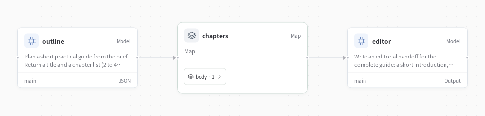
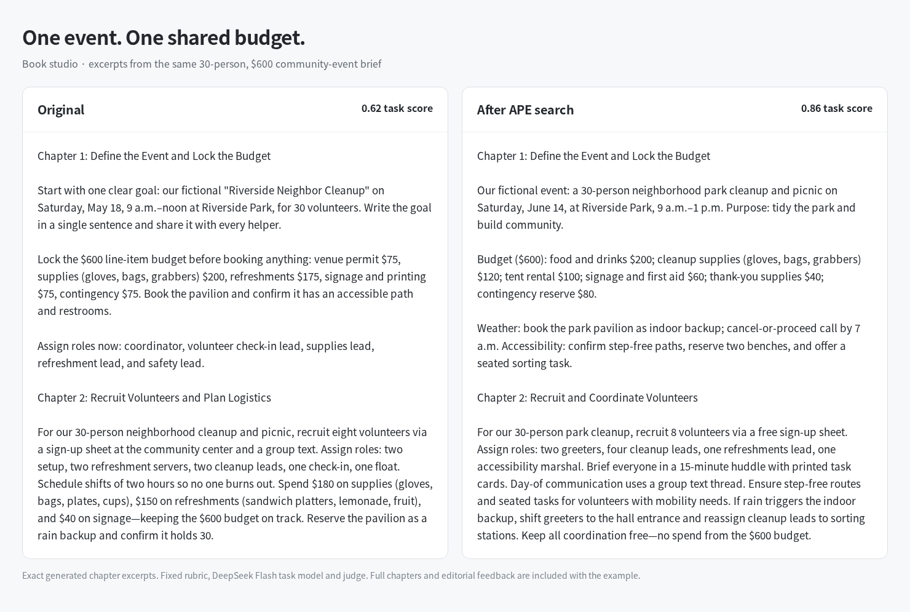

# Book studio



Turn an idea into a short guide. Plan a shared outline, write chapters in parallel and review consistency across the finished manuscript.

**Brief → outline → parallel chapter writers → editorial handoff**



## What evolution changed

The task: write a guide to a **30-person community event with a $600 budget**. APE searched the outline and chapter instructions.

| Resource | Before | After |
| --- | --- | --- |
| Outline prompt | “Respect the target audience and requested length.” | “Respect the specified audience, constraints, and length limits, and ensure chapters do not overlap in the advice they will cover.” |
| Chapter prompt | “Follow the shared outline, avoid repeating other chapters” | “Follow the shared outline, keep its content distinct from the other chapters” |

Selected output excerpts:

| Before | After |
| --- | --- |
| Chapter 1 allocates $200 to supplies and $175 to refreshments. Chapter 2 changes them to $180 and $150. | Chapter 1 allocates the $600 budget. Chapter 2 says: “Keep all coordination free—no spend from the $600 budget.” |
| The editor requests reconciliation of the conflicting amounts. | The editor asks for more precise wording about the remaining allocation and reserve. |

The average judge score was **0.740 → 0.895** across two separate writing tasks, using DeepSeek Flash for generation and judging. The prompts in this folder are the selected version.

### Improve your own writing team

Open **Improve** in Studio, add your writing briefs as task inputs, select `outline` and `chapter`, and choose APE. EvoSprig proposes edits, runs the workflow and compares the versions. You can also select a reusable skill attached to a writer, such as a style guide or editing checklist. Review the changes and enable the version you want to use.

## Try it

Configure a model as described in the [quickstart](../../docs/quickstart.md), then run:

```bash
evosprig run examples/book-studio/agent.yaml \
  --input-file examples/book-studio/sample.json
```

Open the application in Studio:

```bash
evosprig serve --project examples/book-studio/agent.yaml \
  --studio-dir apps/studio/dist
```

## Make it yours

Edit `sample.json` for your own task and the files under `prompts/` for the roles and instructions. All coordination, tool calls and parallel work use EvoSprig's AgentSpec and runtime. The [catalog builder](../build_catalog.py) shows how to create the same workflow with the Python SDK.

Use the [evolution guide](../../docs/evolution.md) to improve selected prompts and skills on your own tasks.

Application pattern inspired by [CrewAI’s book-writing workflow](https://github.com/crewAIInc/crewAI-examples); implemented with EvoSprig's own framework.
