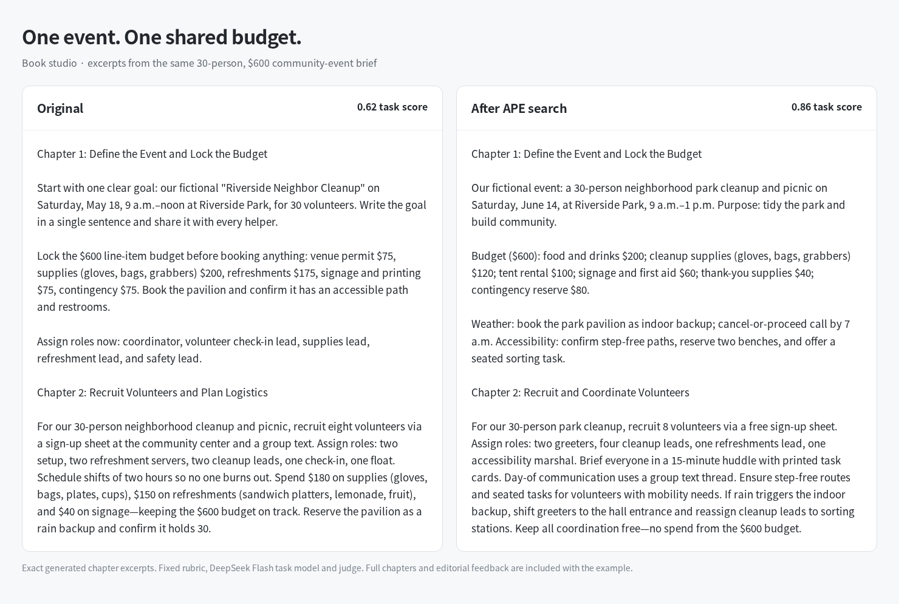

# Book studio — before and after

The shared chapter plan keeps budget and event details consistent across the guide.

On **2 held-out tasks**, the average judge score changed from **0.740 to 0.895**. DeepSeek Flash generated and judged both versions using the same task criteria.

| Task | Original | Evolved |
| --- | --- | --- |
| [Task 1](task-1.json) | [Read output](release-1-baseline.md) | [Read output](release-1-evolved.md) |
| [Task 2](task-2.json) | [Read output](release-2-baseline.md) | [Read output](release-2-evolved.md) |

[Original workflow](versions/baseline/agent.yaml) · [Evolved workflow](versions/selected/agent.yaml) · [Comparison data](comparison.json)

Run either snapshot with the model and tools from the [application guide](../README.md). These two-task examples show the observed change; evaluate your own tasks before adopting the prompts.
