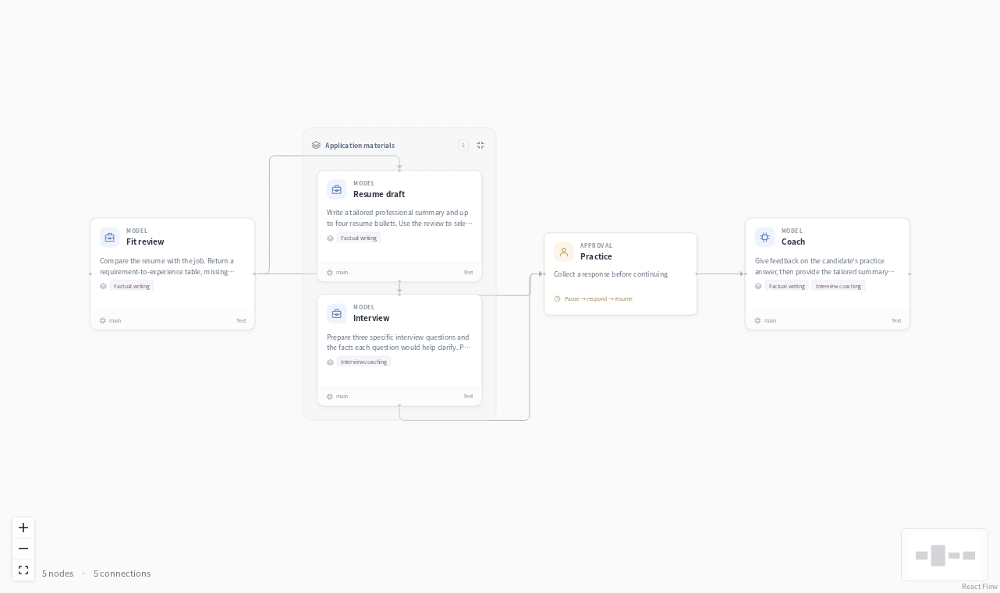
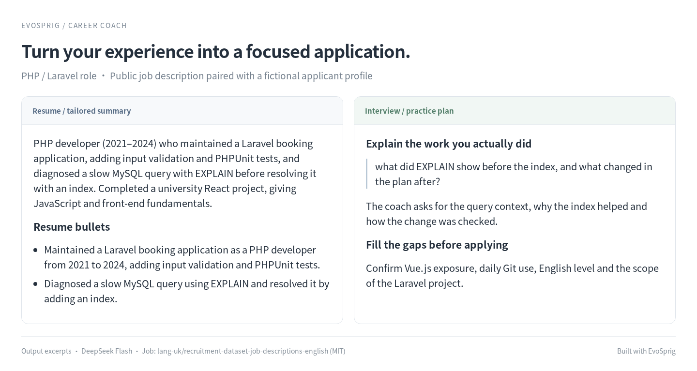

# Career coach



Turn a resume and a job description into a tailored application and an interview practice session. Role-fit analysis feeds two parallel writers; the candidate answers a question before receiving feedback.

## From experience to application materials



The coach prepares a PHP/Laravel summary, specific resume bullets and a practice plan. It asks about missing qualifications before adding them to the application. This output uses a public job description from [lang-uk’s recruitment dataset](https://huggingface.co/datasets/lang-uk/recruitment-dataset-job-descriptions-english) (MIT) and a fictional applicant profile, with DeepSeek Flash.

## Run it

Set `DEEPSEEK_API_KEY`, or use a [deployment profile](../../docs/deployment.md) for your own model. Open the application in Studio:

```bash
evosprig serve --project examples/career-coach/agent.yaml \
  --studio-dir apps/studio/dist
```

Choose **Live model** and paste the input from `sample.json`. At the practice node, enter your answer in **History** to continue.

## Make it yours

Change the role and resume in `sample.json`. Edit `factual_writing` to set your resume conventions and `interview_coaching` to change the practice method. The factual-writing skill is shared by the reviewer, resume writer and final coach.

For unattended improvement, import an [evaluation suite](../../docs/evaluation.md#bring-your-own-task-suite) with an interview answer in each task's `responses`, such as `{"graph/practice": {"answer": "I automated the weekly report with SQL and Python."}}`. Then select prompt or skill resources and an algorithm in **Improve**. EvoSprig runs the same workflow with each candidate. [Agent configuration](../../docs/agent-resources.md) describes resource selection and model parameters.

Built with EvoSprig's [Python SDK](../build_work_apps.py). Application patterns draw on [Coze community resume workflows](https://github.com/AICoderTudou/coze-workflows/tree/main/coze), with application review and interview practice added here.
