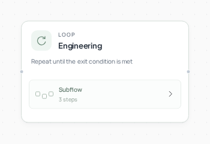
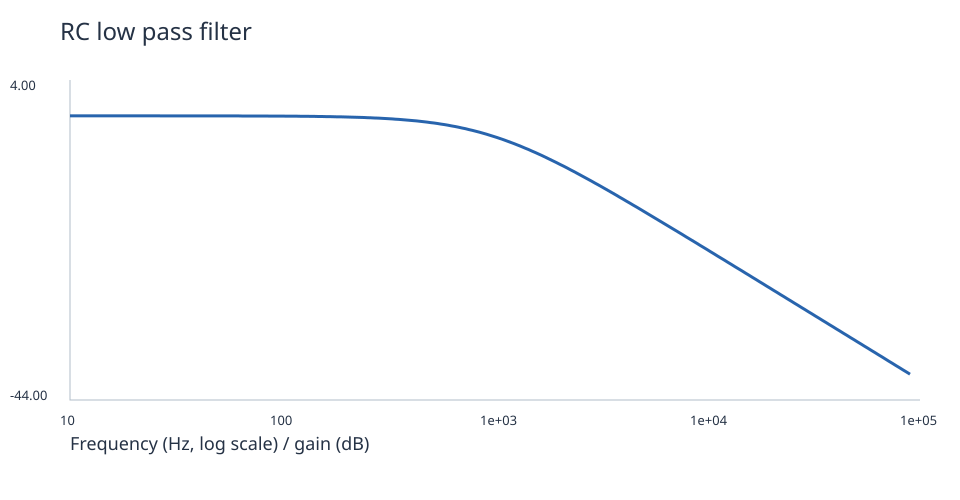

# Circuit Lab



[English](README.md) · [简体中文](README.zh-CN.md)

**Describe a small circuit. Get a netlist, a real waveform and measured results.**

Application inspiration: [tazhan](https://agent2048.com/zh/projects/tzb7yc8xasvc).

## A finished result



| Circuit | Measured result |
| --- | --- |
| RC low-pass | Cutoff **1,000.13 Hz** |
| Half-wave rectifier | Mean **4.013 V**, ripple **0.360 V** |
| Ideal feedback amplifier | Gain **1.99996** |

[Rectifier waveform](assets/rectifier.svg) · [Amplifier response](assets/amplifier.svg)

## How it works

A designer proposes a circuit, ngspice simulates it, and the native repair loop checks your target ranges. Failed measurements go back to the designer, for up to three attempts.

## Run it

Use Python 3.12+ and Git. In a new terminal:

```bash
git clone --depth 1 https://github.com/Toyhom/EvoSprig.git
cd EvoSprig
python3.12 -m venv .venv
source .venv/bin/activate
python -m pip install -e ".[models,server,artifacts]"
export DEEPSEEK_API_KEY="your-api-key"
python examples/quickstart.py circuit-lab setup
```

Install the simulator (Ubuntu/Debian):

```bash
sudo apt-get install ngspice
ngspice --version
```

Alternatively, point `EVOSPRIG_NGSPICE` at an existing executable.

Set the API URL, model ID and key variable in `.evosprig/examples/circuit-lab/deployment.yaml`: `models.main.base_url`, `model`, and `api_key_env`. The default uses DeepSeek. OpenAI-compatible APIs and local models also work. Set the key in each new terminal; `.env` files are not loaded automatically.

Or choose a different provider during the first setup:

```bash
export MODEL_API_KEY="your-api-key"
python examples/quickstart.py circuit-lab setup \
  --workspace .evosprig/my-circuit-lab \
  --base-url https://your-provider.example/v1 --model your-model-id --key-env MODEL_API_KEY
```

Edit `.evosprig/examples/circuit-lab/input.json`, then run:

```bash
python examples/quickstart.py circuit-lab run --allow-writes
```

If setup used a custom workspace, pass the same `--workspace` to run, studio and pack. See [sample.json](sample.json) and [agent.yaml](agent.yaml) for the input fields.

The output JSON includes `simulation.directory`, containing the generated files under the workspace’s `artifacts` folder. Keep the same workspace to retain run history.

## Continue in the canvas

With Node.js 20+:

```bash
npm --prefix apps/studio ci
npm --prefix apps/studio run build
python examples/quickstart.py circuit-lab studio --port 18766
```

Open `http://127.0.0.1:18766`, choose Live model and allow tool writes. Edit nodes, prompts and skills, or debug a selected step.

Export the application and import it into another EvoSprig workspace:

```bash
python examples/quickstart.py circuit-lab pack --out circuit-lab.zip
```

Use **Import project** in Studio. To run the ZIP independently, extract it, install its `requirements.lock` and bundled runtime, then use `python app.py --profile deployment.yaml --input-file input.json --allow-writes`. Supply your deployment profile and input data. See the [developer guide](../../docs/build-applications.md) for framework setup and extension.
