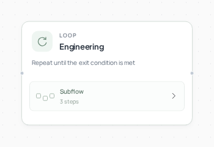
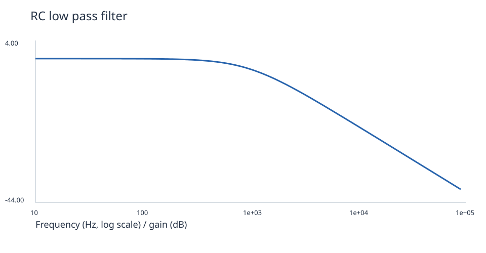

# 电路设计与仿真



[English](README.md) · [简体中文](README.zh-CN.md)

**描述一个小电路，得到网表、真实波形和测量结果。**

参考选题: [tazhan](https://agent2048.com/zh/projects/tzb7yc8xasvc).

## 看看结果



| Circuit | Measured result |
| --- | --- |
| RC low-pass | Cutoff **1,000.13 Hz** |
| Half-wave rectifier | Mean **4.013 V**, ripple **0.360 V** |
| Ideal feedback amplifier | Gain **1.99996** |

[Rectifier waveform](assets/rectifier.svg) · [Amplifier response](assets/amplifier.svg)

## 如何工作

设计智能体提出电路，ngspice 实际运行，原生回修循环核对目标范围。未达标的指标会反馈给设计智能体，最多尝试三次。

## 运行

需要 Python 3.12+ 和 Git。在新终端中执行：

```bash
git clone --depth 1 https://github.com/Toyhom/EvoSprig.git
cd EvoSprig
python3.12 -m venv .venv
source .venv/bin/activate
python -m pip install -e ".[models,server,artifacts]"
export DEEPSEEK_API_KEY="your-api-key"
python examples/quickstart.py circuit-lab setup
```

安装仿真器（Ubuntu/Debian）：

```bash
sudo apt-get install ngspice
ngspice --version
```

也可以用 `EVOSPRIG_NGSPICE` 指向已有的可执行文件。

配置保存在 `.evosprig/examples/circuit-lab/deployment.yaml`：`models.main.base_url` 是 API 地址，`model` 是模型 ID，`api_key_env` 是密钥环境变量名。默认使用 DeepSeek；支持 OpenAI-compatible API，也可以接入本地模型。每次打开新终端都需设置密钥；不自动读取 `.env`。

也可以在首次 setup 时直接指定：

```bash
export MODEL_API_KEY="your-api-key"
python examples/quickstart.py circuit-lab setup \
  --workspace .evosprig/my-circuit-lab \
  --base-url https://your-provider.example/v1 --model your-model-id --key-env MODEL_API_KEY
```

修改 `.evosprig/examples/circuit-lab/input.json`，然后运行：

```bash
python examples/quickstart.py circuit-lab run --allow-writes
```

如果 setup 使用了其他 workspace，后续 run、studio、pack 也添加相同的 `--workspace`。输入结构和可改字段见 [sample.json](sample.json) 与 [agent.yaml](agent.yaml)。

输出 JSON 的 `directory`（电路案例为 `simulation.directory`）是文件所在目录。使用同一 workspace 可保留运行历史；文件默认写入该 workspace 的 `artifacts`。

## 在画布上继续开发

需要 Node.js 20+：

```bash
npm --prefix apps/studio ci
npm --prefix apps/studio run build
python examples/quickstart.py circuit-lab studio --port 18766
```

打开 `http://127.0.0.1:18766`，选择真实模型并允许工具写入，在画布编辑节点、提示词和技能，或调试单个步骤。

导出并导入另一个 EvoSprig 工作空间：

```bash
python examples/quickstart.py circuit-lab pack --out circuit-lab.zip
```

在 Studio 点击 **导入工程**。解压 ZIP 后，也可安装其中的 `requirements.lock` 和运行时，再用 `python app.py --profile deployment.yaml --input-file input.json --allow-writes` 独立运行。部署配置和业务数据由你提供。框架安装与扩展见 [开发指南](../../docs/build-applications.md)。
