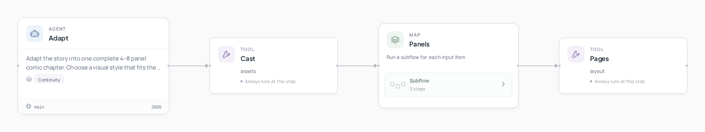

# Comic Studio



[English](README.md) · [简体中文](README.zh-CN.md)

**Turn a short story into a complete comic page.**

Application inspiration: [漫刻 AI](https://agent2048.com/zh/projects/w9ke86rmme86).

## A finished result


**The blue umbrella**: shared character references, four panels and a complete short story.

## How it works

An adaptation agent plans the panels and cast. A panel director writes scene instructions, image tools reuse character references, and a visual reviewer requests bounded retakes. Then the page tool adds captions and dialogue and exports a PDF, page images and editable HTML. Debug a selected map item to redraw one panel.

## Run it

Use Python 3.12+ and Git. In a new terminal:

```bash
git clone --depth 1 https://github.com/Toyhom/EvoSprig.git
cd EvoSprig
python3.12 -m venv .venv
source .venv/bin/activate
python -m pip install -e ".[models,server,artifacts]"
export MOONSHOT_API_KEY="your-api-key"
python examples/quickstart.py comic-studio setup
```

Start a local image service using the [media service setup](../../apps/media-service/README.md). The default URL is `http://127.0.0.1:18880`; use `--preload image --idle-unload-seconds 0`. Model downloads, VRAM and device placement depend on the chosen image model. For Chinese lettering, set:

```bash
export EVOSPRIG_COMIC_FONT="/path/to/NotoSansCJKsc-Regular.otf"
export EVOSPRIG_IMAGE_ORIGIN="http://127.0.0.1:18880"
```

Set the API URL, model ID and key variable in `.evosprig/examples/comic-studio/deployment.yaml`: `models.main.base_url`, `model`, and `api_key_env`. The default uses Kimi for planning and visual review. Both main and vision need a configured model; vision must accept images. OpenAI-compatible APIs and local models also work. Set the key in each new terminal; `.env` files are not loaded automatically.

Or choose a different provider during the first setup:

```bash
export MODEL_API_KEY="your-api-key"
python examples/quickstart.py comic-studio setup \
  --workspace .evosprig/my-comic-studio \
  --base-url https://your-provider.example/v1 --model your-model-id --key-env MODEL_API_KEY
```

Edit `.evosprig/examples/comic-studio/input.json`, then run:

```bash
python examples/quickstart.py comic-studio run --allow-writes
```

If setup used a custom workspace, pass the same `--workspace` to run, studio and pack. See [sample.json](sample.json) and [agent.yaml](agent.yaml) for the input fields.

Images run as background jobs. At `waiting_external`, resume the same run ID:

```bash
evosprig resume RUN_ID --workspace .evosprig/examples/comic-studio
```

Studio’s worker waits and resumes automatically. `chapter.directory` contains the PDF, HTML and page images; `panels` and `catalog` provide the references for panel edits and follow-up chapters.

## Continue in the canvas

With Node.js 20+:

```bash
npm --prefix apps/studio ci
npm --prefix apps/studio run build
python examples/quickstart.py comic-studio studio --port 18766
```

Open `http://127.0.0.1:18766`, choose Live model and allow tool writes. Edit nodes, prompts and skills, or debug a selected step.

Export the application and import it into another EvoSprig workspace:

```bash
python examples/quickstart.py comic-studio pack --out comic-studio.zip
```

Use **Import project** in Studio. To run the ZIP independently, extract it, install its `requirements.lock` and bundled runtime, then use `python app.py --profile deployment.yaml --input-file input.json --allow-writes`. Supply your deployment profile and input data. See the [developer guide](../../docs/build-applications.md) for framework setup and extension.
