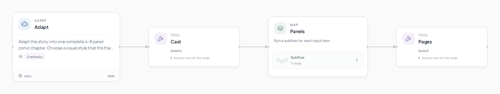

# 漫画工坊



[English](README.md) · [简体中文](README.zh-CN.md)

**把一个短故事变成一话漫画。**

参考选题: [漫刻 AI](https://agent2048.com/zh/projects/w9ke86rmme86).

## 看看结果


**《雨中的蓝伞》**：同一组人物参考，四个分格，一页完整小故事。

## 如何工作

改编智能体规划分格和角色，分格导演撰写画面指令，本地图像工具共用人物参考，视觉审核可发起有限次数重画。排版工具添加文字，输出 PDF、页面图片和可编辑 HTML。在画布上选择对应 map 项，可以单独重画一格。

## 运行

需要 Python 3.12+ 和 Git。在新终端中执行：

```bash
git clone --depth 1 https://github.com/Toyhom/EvoSprig.git
cd EvoSprig
python3.12 -m venv .venv
source .venv/bin/activate
python -m pip install -e ".[models,server,artifacts]"
export MOONSHOT_API_KEY="your-api-key"
python examples/quickstart.py comic-studio setup
```

先启动本地图像服务，见 [媒体服务安装](../../apps/media-service/README.md)。默认地址为 `http://127.0.0.1:18880`；启用 `--preload image --idle-unload-seconds 0`。模型下载、显存需求和设备分配由所选图像模型决定。中文排版还需设置：

```bash
export EVOSPRIG_COMIC_FONT="/path/to/NotoSansCJKsc-Regular.otf"
export EVOSPRIG_IMAGE_ORIGIN="http://127.0.0.1:18880"
```

配置保存在 `.evosprig/examples/comic-studio/deployment.yaml`：`models.main.base_url` 是 API 地址，`model` 是模型 ID，`api_key_env` 是密钥环境变量名。默认使用 Kimi 进行规划与视觉审核；main 与 vision 都需配置，vision 必须支持图像输入。支持 OpenAI-compatible API，也可以接入本地模型。每次打开新终端都需设置密钥；不自动读取 `.env`。

也可以在首次 setup 时直接指定：

```bash
export MODEL_API_KEY="your-api-key"
python examples/quickstart.py comic-studio setup \
  --workspace .evosprig/my-comic-studio \
  --base-url https://your-provider.example/v1 --model your-model-id --key-env MODEL_API_KEY
```

修改 `.evosprig/examples/comic-studio/input.json`，然后运行：

```bash
python examples/quickstart.py comic-studio run --allow-writes
```

如果 setup 使用了其他 workspace，后续 run、studio、pack 也添加相同的 `--workspace`。输入结构和可改字段见 [sample.json](sample.json) 与 [agent.yaml](agent.yaml)。

图像作业在后台运行；返回 `waiting_external` 后按原运行 ID 续接：

```bash
evosprig resume RUN_ID --workspace .evosprig/examples/comic-studio
```

也可以在 Studio 运行，后台 worker 会自动等待与续接。输出 `chapter.directory` 包含 PDF、HTML 和页面图片；`panels` 与 `catalog` 可用于局部重做和后续章节。

## 在画布上继续开发

需要 Node.js 20+：

```bash
npm --prefix apps/studio ci
npm --prefix apps/studio run build
python examples/quickstart.py comic-studio studio --port 18766
```

打开 `http://127.0.0.1:18766`，选择真实模型并允许工具写入，在画布编辑节点、提示词和技能，或调试单个步骤。

导出并导入另一个 EvoSprig 工作空间：

```bash
python examples/quickstart.py comic-studio pack --out comic-studio.zip
```

在 Studio 点击 **导入工程**。解压 ZIP 后，也可安装其中的 `requirements.lock` 和运行时，再用 `python app.py --profile deployment.yaml --input-file input.json --allow-writes` 独立运行。部署配置和业务数据由你提供。框架安装与扩展见 [开发指南](../../docs/build-applications.md)。
