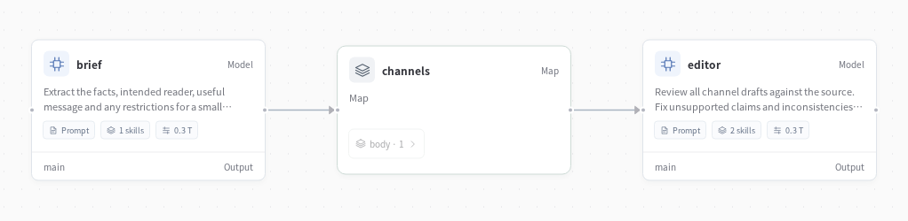
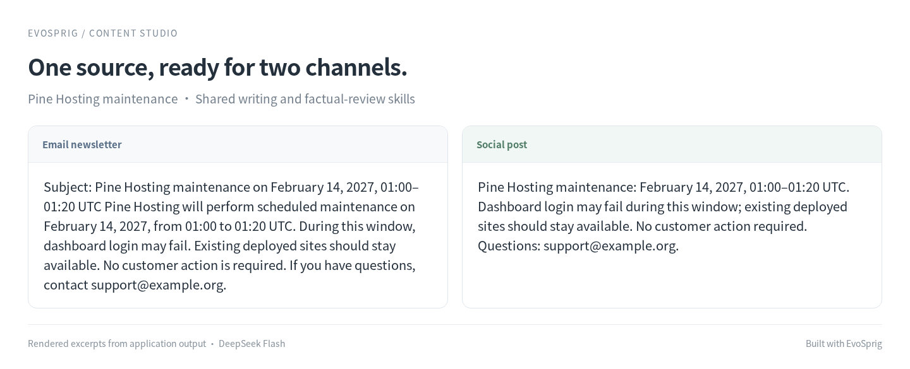

# Content studio



Turn one source into an email, a social post and a product article. A shared fact sheet feeds a map subflow for each channel, followed by an editorial pass.

## One announcement, several channels



The selected version turns a hosting-maintenance notice into email and social copy while preserving the date, UTC window and service impact. Its writing team shares `brand_voice` and `source_fidelity` skills, which can evolve independently of the workflow.

## Run it

### Install

Use **Python 3.12+** and Git. Run these commands in Bash (Linux, macOS or WSL):

```bash
git clone --depth 1 https://github.com/Toyhom/EvoSprig.git
cd EvoSprig
python3.12 -m venv .venv
source .venv/bin/activate
python -m pip install '.[server]'
```

Keep subsequent commands in this checkout, with `.venv` activated.

### Configure the model

```bash
python examples/quickstart.py content-studio setup
export DEEPSEEK_API_KEY="your-api-key"
```

The application uses **`deepseek-flash`** at **`https://api.deepseek.com`**. Its settings are in `.evosprig/examples/content-studio/deployment.yaml`: change `base_url`, `model` and `api_key_env` under `models` to use another OpenAI-compatible endpoint. When changing providers, also remove or update provider-specific `options`, `token_limit_field` and `send_sampling_parameters` in that connection. Set the environment variable named by `api_key_env` in each terminal that starts or resumes the app. API keys are read from that variable; `.env` files are not loaded automatically.

Setup also creates `.evosprig/examples/content-studio/input.json` from the included [sample.json](sample.json). Edit this input for your task. Repeating setup preserves your profile and input.

### Run a task

```bash
python examples/quickstart.py content-studio run
```

The final output contains the channel drafts and the shared editorial review. Runs and checkpoints stay in `.evosprig/examples/content-studio`. To use a separate input file, append `--input-file /path/to/task.json`.

### Open the canvas and keep developing

Install **Node.js 20+** and build the editor once:

```bash
npm --prefix apps/studio ci
npm --prefix apps/studio run build
python examples/quickstart.py content-studio studio
```

Open **http://127.0.0.1:18766**, select **Live model** and paste `input.json` into Run. Use **History** to inspect steps. Change the port with `--port 18768` if needed.

This loads the application into your Studio workspace. Edit its prompt, skill, model and tool settings on the canvas; use **Debug selection** to try a node or group. The same workflow is defined in [agent.yaml](agent.yaml). For framework installation and SDK development, see [Get started](../../README.md#get-started).

<details>
<summary>Import into another EvoSprig workspace or export an independent application</summary>

```bash
python examples/quickstart.py content-studio pack --out .evosprig/content-studio.zip
evosprig import .evosprig/content-studio.zip --out .evosprig/imported-content-studio
evosprig serve --project .evosprig/imported-content-studio/agent.yaml \
  --profile .evosprig/examples/content-studio/deployment.yaml \
  --workspace .evosprig/imported-content-studio-state --studio-dir apps/studio/dist
```

In an existing Studio, use **Import project** with this ZIP (use a new project ID if it is already present). Keep the same model/tool profile when starting that Studio. Data collections and running services belong to the deployment; prepare them on the destination as described above.

The ZIP also contains a standalone Python application. Unpack it into a new directory and environment, run `python -m pip install -r requirements.lock`, then `python -m pip install --no-deps .`. Copy your deployment profile and task input there, set the credential variables, and run `python app.py --profile deployment.yaml --input-file input.json`. Resume a paused exported run with `python app.py --resume RUN_ID --path NODE_PATH --response 'RESPONSE_JSON'`.

</details>

## Make it yours

Set the source, audience and channel list in `sample.json`. `brand_voice` and `source_fidelity` are shared skills used by the channel writers and editor. The native map node creates one task per channel.

In **Improve**, add your task inputs, select prompt or skill resources, and choose an algorithm. EvoSprig runs the same workflow with each candidate. [Agent configuration](../../docs/agent-resources.md) describes resource selection and model parameters.

Built with EvoSprig's [Python SDK](../build_work_apps.py). Application patterns draw on [Coze community content workflows](https://github.com/AICoderTudou/coze-workflows/tree/main/coze).
