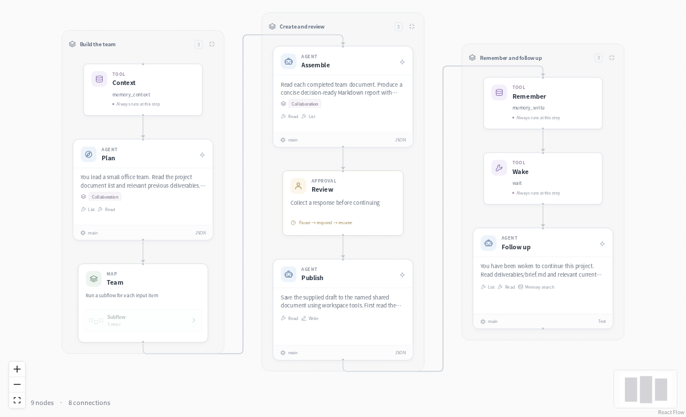
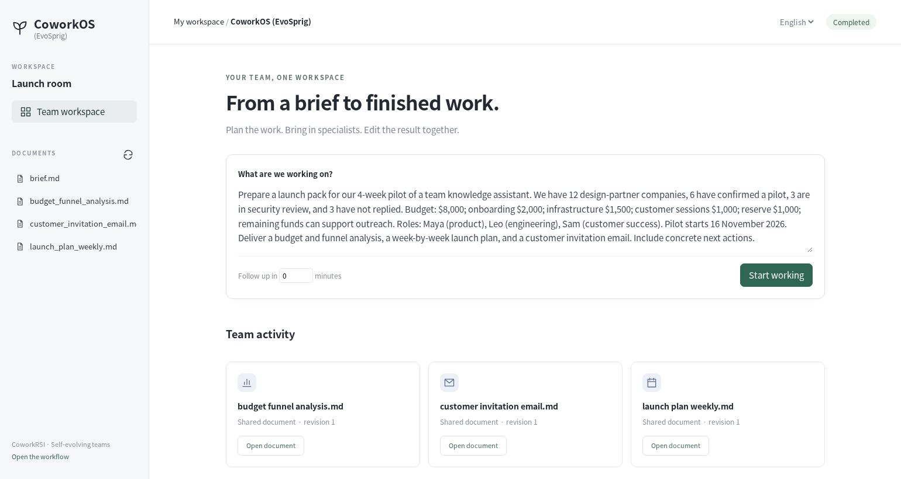
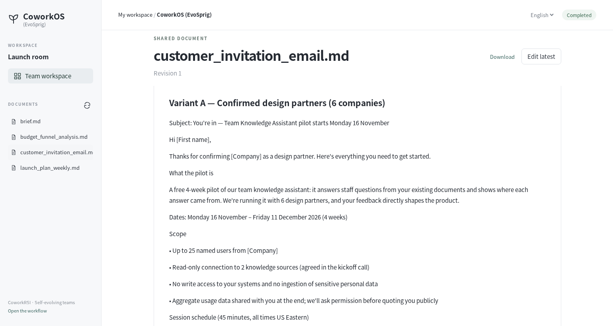

# CoworkOS (EvoSprig)



An EvoSprig reproduction of [CoworkOS](https://github.com/RUC-NLPIR/CoworkOS): give a team a task, work together on shared documents, and pick up where you left off.

## A launch pack in one workspace

> Prepare a four-week pilot launch: analyze the budget and customer funnel, make the schedule, and draft the invitation.





Conversations sit on the left, the working session in the center, and the team and its documents on the right. The team creates a budget analysis, launch plan, customer email and final decision brief. Open a document to edit it, inspect revisions or download the result. A scheduled follow-up reads your latest edits before recommending next actions.

## Run it

### Install

Use **Python 3.12+** and Git. Run these commands in Bash (Linux, macOS or WSL):

```bash
git clone --depth 1 https://github.com/Toyhom/EvoSprig.git
cd EvoSprig
python3.12 -m venv .venv
source .venv/bin/activate
python -m pip install '.[server]'
```

Keep subsequent commands in this checkout, with `.venv` activated.

### Configure the model

```bash
python examples/quickstart.py cowork setup
export DEEPSEEK_API_KEY="your-api-key"
```

The application uses **`deepseek-flash`** at **`https://api.deepseek.com`**. Its settings are in `.evosprig/examples/cowork/deployment.yaml`: change `base_url`, `model` and `api_key_env` under `models` to use another OpenAI-compatible endpoint. When changing providers, also remove or update provider-specific `options`, `token_limit_field` and `send_sampling_parameters` in that connection. Set the environment variable named by `api_key_env` in each terminal that starts or resumes the app. API keys are read from that variable; `.env` files are not loaded automatically.

Setup also creates `.evosprig/examples/cowork/input.json` from the included [request.json](request.json). Edit this input for your task. Repeating setup preserves your profile and input.

### Run a task

```bash
python examples/quickstart.py cowork run --allow-writes
```

Read the result in the command’s final JSON output. Runs and checkpoints stay in `.evosprig/examples/cowork`. To use a separate input file, append `--input-file /path/to/task.json`.

A `waiting_input` result pauses at `graph/review`. Read and edit the team brief, then submit its final content. Copy the `run_id` from the result and continue:

```bash
evosprig inspect RUN_ID --workspace .evosprig/examples/cowork
evosprig resume RUN_ID --workspace .evosprig/examples/cowork \
  --path graph/review --response '{"content": "Your reviewed decision brief"}'
```

### Open the canvas and keep developing

Install **Node.js 20+** and build the editor once:

```bash
npm --prefix apps/studio ci
npm --prefix apps/studio run build
python examples/quickstart.py cowork studio
```

Open **http://127.0.0.1:18766**, select **Live model** and paste `input.json` into Run. Enable **Allow writes** for this workflow. Use **History** to inspect steps and respond to review/input requests. Change the port with `--port 18768` if needed.

This loads the application into your Studio workspace. Edit its prompt, skill, model and tool settings on the canvas; use **Debug selection** to try a node or group. The same workflow is defined in [agent.yaml](agent.yaml). For framework installation and SDK development, see [Get started](../../README.md#get-started).

<details>
<summary>Import into another EvoSprig workspace or export an independent application</summary>

```bash
python examples/quickstart.py cowork pack --out .evosprig/cowork.zip
evosprig import .evosprig/cowork.zip --out .evosprig/imported-cowork
evosprig serve --project .evosprig/imported-cowork/agent.yaml \
  --profile .evosprig/examples/cowork/deployment.yaml \
  --workspace .evosprig/imported-cowork-state --studio-dir apps/studio/dist
```

In an existing Studio, use **Import project** with this ZIP (use a new project ID if it is already present). Keep the same model/tool profile when starting that Studio. Data collections and running services belong to the deployment; prepare them on the destination as described above.

The ZIP also contains a standalone Python application. Unpack it into a new directory and environment, run `python -m pip install -r requirements.lock`, then `python -m pip install --no-deps .`. Copy your deployment profile and task input there, set the credential variables, and run `python app.py --profile deployment.yaml --input-file input.json --allow-writes`. Resume a paused exported run with `python app.py --resume RUN_ID --path NODE_PATH --response 'RESPONSE_JSON'`.

</details>

For the Cowork workbench, run `python examples/quickstart.py cowork studio --workbench`. It uses the same profile, documents and run history, and needs no Node.js build. Keep the server running to process scheduled follow-ups.

## Make it your team

- **Main agent:** plans assignments, checks each wave and sends specific corrections back to the responsible specialists.
- **Coordinator:** dispatches each wave to checkpointed subflows with bounded concurrency; up to three waves by default.
- **Specialists:** use shared documents and project memory, message any teammate directly, and save their deliverables.
- **Shared workspace:** people and agents edit through the same revision checks.
- **Follow-up:** a persisted wake-up resumes the task and reads the latest documents.

Edit the roles and prompts in [build_agent.py](build_agent.py). Attach your own tools, or replace the supplied request with a project brief. Select `plan`, `specialist` and `collaboration` in **Improve** to optimize the team's instructions against your tasks.

[Shared document API](../../docs/shared-workspaces.md) · [Build applications](../../docs/build-applications.md) · [Original CoworkOS](https://github.com/RUC-NLPIR/CoworkOS)

## CoworkRSI

**CoworkOS (EvoSprig)** is the collaborative application. **CoworkRSI** adds a retrospective after your review. It saves reusable lessons to shared memory; later planners and specialists retrieve them. Use your team's tasks to improve planning, specialist instructions, acceptance checks and collaboration skills.

```bash
evosprig serve --project examples/cowork/rsi-agent.yaml \
  --studio-dir apps/cowork --workspace .evosprig/cowork-rsi
```

Open **http://127.0.0.1:18766/?project=cowork-rsi**. For evolution, use `--studio-dir apps/studio/dist`.

Open this project in Studio, then **Improve**:

1. Import an [evaluation suite](../../docs/evaluation.md#bring-your-own-task-suite) with project briefs and responses for the human review step.
2. Select `plan`, `specialist`, `acceptance` and `collaboration`; choose an algorithm and a budget.
3. Compare resource changes and generated documents. Enable the selected version in **Versions**.

Your review criteria stay fixed while the team instructions change. [Choose an algorithm](../../docs/evolution.md) · [Add your own optimizer](../../docs/optimizer-plugins.md).

For harness evolution, use the supplied [search space](search-space.yaml) with `modular_rsi`,
`meta_harness` or `adas`. It separates planning, collaboration and execution targets.
[Configure your harness search](../../docs/harness-search.md) · [Peer messaging](../../docs/shared-workspaces.md#peer-to-peer-messages).
