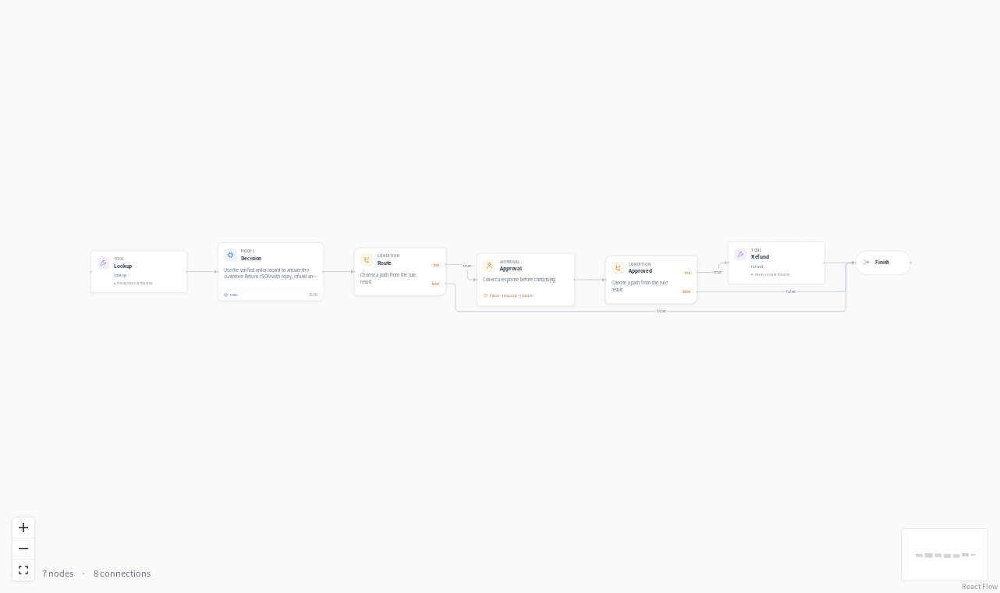
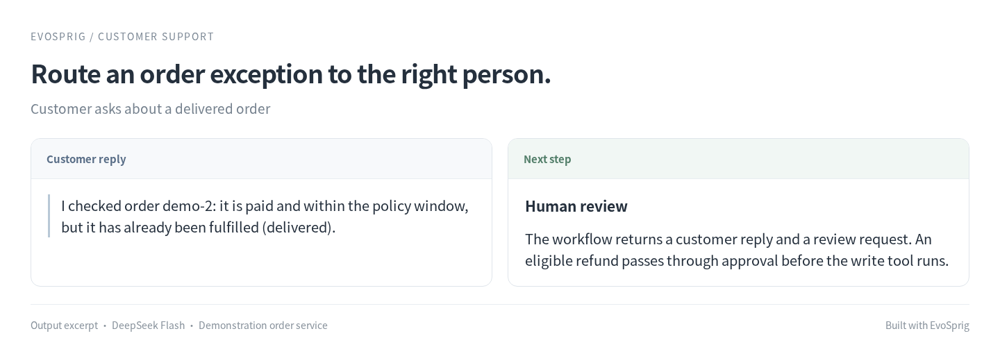

# Customer support



**Help customers resolve order problems, with a person in control of refunds.**

The assistant looks up an order and suggests a response. Refund requests pause for approval; an approved request goes to your order service.

## An order request, handled with the policy



## Run it

### Install

Use **Python 3.12+** and Git. Run these commands in Bash (Linux, macOS or WSL):

```bash
git clone --depth 1 https://github.com/Toyhom/EvoSprig.git
cd EvoSprig
python3.12 -m venv .venv
source .venv/bin/activate
python -m pip install '.[server]'
```

Keep subsequent commands in this checkout, with `.venv` activated.

### Configure the model

```bash
python examples/quickstart.py customer-support setup
export DEEPSEEK_API_KEY="your-api-key"
```

The application uses **`deepseek-flash`** at **`https://api.deepseek.com`**. Its settings are in `.evosprig/examples/customer-support/deployment.yaml`: change `base_url`, `model` and `api_key_env` under `models` to use another OpenAI-compatible endpoint. When changing providers, also remove or update provider-specific `options`, `token_limit_field` and `send_sampling_parameters` in that connection. Set the environment variable named by `api_key_env` in each terminal that starts or resumes the app. API keys are read from that variable; `.env` files are not loaded automatically.

Setup also creates `.evosprig/examples/customer-support/input.json` from the included [sample.json](sample.json). Edit this input for your task. Repeating setup preserves your profile and input.

### Start the order service

The included local store has two orders: `ORDER-1001` (paid, unfulfilled, $49) and `ORDER-1002` (delivered, $75). Start it in a second terminal:

```bash
source .venv/bin/activate
export SUPPORT_API_TOKEN="local-store-token"
python examples/customer-support/store.py
```

In the agent terminal, set the same `SUPPORT_API_TOKEN`. The service listens on **http://127.0.0.1:18881** and saves orders and refund receipts in `.evosprig/support-store.sqlite`. It applies full refunds once, after approval. To connect your store, replace `support.lookup` and `support.refund` endpoints and their authentication variable in the deployment file.

### Run a task

```bash
python examples/quickstart.py customer-support run --allow-writes
```

Read the result in the command’s final JSON output. Runs and checkpoints stay in `.evosprig/examples/customer-support`. To use a separate input file, append `--input-file /path/to/task.json`.

A `waiting_input` result pauses at `graph/approval`. For a proposed refund, inspect the order and amount before approving it. Copy the `run_id` from the result and continue:

```bash
evosprig inspect RUN_ID --workspace .evosprig/examples/customer-support
evosprig resume RUN_ID --workspace .evosprig/examples/customer-support \
  --path graph/approval --response '{"approved": true}'
```

### Open the canvas and keep developing

Install **Node.js 20+** and build the editor once:

```bash
npm --prefix apps/studio ci
npm --prefix apps/studio run build
python examples/quickstart.py customer-support studio
```

Open **http://127.0.0.1:18766**, select **Live model** and paste `input.json` into Run. Enable **Allow writes** for this workflow. Use **History** to inspect steps and respond to review/input requests. Change the port with `--port 18768` if needed.

This loads the application into your Studio workspace. Edit its prompt, skill, model and tool settings on the canvas; use **Debug selection** to try a node or group. The same workflow is defined in [agent.yaml](agent.yaml). For framework installation and SDK development, see [Get started](../../README.md#get-started).

<details>
<summary>Import into another EvoSprig workspace or export an independent application</summary>

```bash
python examples/quickstart.py customer-support pack --out .evosprig/customer-support.zip
evosprig import .evosprig/customer-support.zip --out .evosprig/imported-customer-support
evosprig serve --project .evosprig/imported-customer-support/agent.yaml \
  --profile .evosprig/examples/customer-support/deployment.yaml \
  --workspace .evosprig/imported-customer-support-state --studio-dir apps/studio/dist
```

In an existing Studio, use **Import project** with this ZIP (use a new project ID if it is already present). Keep the same model/tool profile when starting that Studio. Data collections and running services belong to the deployment; prepare them on the destination as described above.

The ZIP also contains a standalone Python application. Unpack it into a new directory and environment, run `python -m pip install -r requirements.lock`, then `python -m pip install --no-deps .`. Copy your deployment profile and task input there, set the credential variables, and run `python app.py --profile deployment.yaml --input-file input.json --allow-writes`. Resume a paused exported run with `python app.py --resume RUN_ID --path NODE_PATH --response 'RESPONSE_JSON'`.

</details>

## Make it yours

Edit `prompts/policy.md` for your store's tone and rules. Add shipping or inventory tools, or change the workflow to route different requests to different teams. The graph uses EvoSprig's conditions, approval nodes and durable tool execution.
