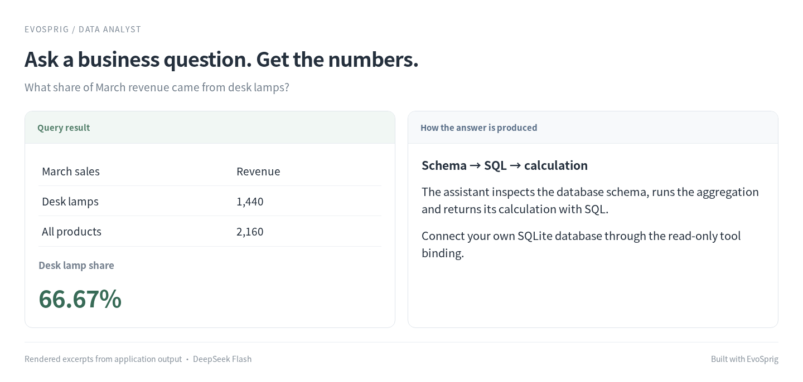

# Data analyst


**Ask a question. Get an answer from your data.**

“Which region grew fastest between January and March?” The assistant inspects your database, writes SQL, checks the result and explains what it found. You can inspect its queries in the run history.

## Ask a business question



## Run it

### Install

Use **Python 3.12+** and Git. Run these commands in Bash (Linux, macOS or WSL):

```bash
git clone --depth 1 https://github.com/Toyhom/EvoSprig.git
cd EvoSprig
python3.12 -m venv .venv
source .venv/bin/activate
python -m pip install '.[server]'
```

Keep subsequent commands in this checkout, with `.venv` activated.

### Configure the model

```bash
python examples/quickstart.py data-analyst setup
export DEEPSEEK_API_KEY="your-api-key"
```

The application uses **`deepseek-flash`** at **`https://api.deepseek.com`**. Its settings are in `.evosprig/examples/data-analyst/deployment.yaml`: change `base_url`, `model` and `api_key_env` under `models` to use another OpenAI-compatible endpoint. When changing providers, also remove or update provider-specific `options`, `token_limit_field` and `send_sampling_parameters` in that connection. Set the environment variable named by `api_key_env` in each terminal that starts or resumes the app. API keys are read from that variable; `.env` files are not loaded automatically.

Setup also creates `.evosprig/examples/data-analyst/input.json` from the included [sample.json](sample.json). Edit this input for your task. Repeating setup preserves your profile and input.

### Use your own database

Setup imports the included shop CSV into `.evosprig/examples/data-analyst/shop.sqlite`. The launcher selects it automatically. To query another database:

```bash
export EVOSPRIG_SQLITE_PATH="/absolute/path/to/shop.sqlite"
```

Edit the `tables` allowlist under both database tools in `deployment.yaml`. Queries are read-only. To import another CSV, use `evosprig data load-csv path/to/orders.csv --database path/to/shop.sqlite --table orders` with a new table name.

### Run a task

```bash
python examples/quickstart.py data-analyst run
```

Read the result in the command’s final JSON output. Runs and checkpoints stay in `.evosprig/examples/data-analyst`. To use a separate input file, append `--input-file /path/to/task.json`.

### Open the canvas and keep developing

Install **Node.js 20+** and build the editor once:

```bash
npm --prefix apps/studio ci
npm --prefix apps/studio run build
python examples/quickstart.py data-analyst studio
```

Open **http://127.0.0.1:18766**, select **Live model** and paste `input.json` into Run. Use **History** to inspect steps. Change the port with `--port 18768` if needed.

This loads the application into your Studio workspace. Edit its prompt, skill, model and tool settings on the canvas; use **Debug selection** to try a node or group. The same workflow is defined in [agent.yaml](agent.yaml). For framework installation and SDK development, see [Get started](../../README.md#get-started).

<details>
<summary>Import into another EvoSprig workspace or export an independent application</summary>

```bash
python examples/quickstart.py data-analyst pack --out .evosprig/data-analyst.zip
evosprig import .evosprig/data-analyst.zip --out .evosprig/imported-data-analyst
export EVOSPRIG_SQLITE_PATH="$PWD/.evosprig/examples/data-analyst/shop.sqlite"
evosprig serve --project .evosprig/imported-data-analyst/agent.yaml \
  --profile .evosprig/examples/data-analyst/deployment.yaml \
  --workspace .evosprig/imported-data-analyst-state --studio-dir apps/studio/dist
```

In an existing Studio, use **Import project** with this ZIP (use a new project ID if it is already present). Keep the same model/tool profile when starting that Studio. Data collections and running services belong to the deployment; prepare them on the destination as described above.

The ZIP also contains a standalone Python application. Unpack it into a new directory and environment, run `python -m pip install -r requirements.lock`, then `python -m pip install --no-deps .`. Copy your deployment profile and task input there, set the credential variables, and run `python app.py --profile deployment.yaml --input-file input.json`. Resume a paused exported run with `python app.py --resume RUN_ID --path NODE_PATH --response 'RESPONSE_JSON'`.

</details>

## Make it yours

Change the assistant's prompt to focus on sales, inventory or another domain. Tool errors return to the agent so it can correct a query within its run budget. The SQL-agent pattern is also explored in [LangChain's SQL tutorial](https://docs.langchain.com/oss/python/langgraph/sql-agent); this template uses EvoSprig's own agent loop and database adapter.
