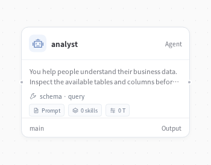

# Data analyst



**Ask a question. Get an answer from your data.**

“Which region grew fastest between January and March?” The assistant inspects your database, writes SQL, checks the result and explains what it found. You can inspect its queries in the run history.

## Ask a business question

**“What share of March revenue came from desk lamps?”**

| March sales | Revenue |
| --- | ---: |
| Desk lamps | 1,440 |
| All products | 2,160 |
| Desk lamp share | **66.67%** |

The assistant reads the database schema, runs the aggregation and returns the calculation with its SQL.

## Try it

After installing EvoSprig and setting `DEEPSEEK_API_KEY`, import the included shop orders:

```bash
evosprig data load-csv examples/data-analyst/data/orders.csv \
  --database .evosprig/shop.sqlite --table orders
export EVOSPRIG_SQLITE_PATH="$PWD/.evosprig/shop.sqlite"
evosprig run examples/data-analyst/agent.yaml \
  --profile examples/data-analyst/deployment.example.yaml \
  --workspace .evosprig/analyst \
  --input '{"question":"Which region grew fastest between January and March? Show the numbers and SQL."}'
```

The sample CSV describes a fictional shop. Import it once per database. To use your own data, point `EVOSPRIG_SQLITE_PATH` at an existing SQLite database and update the table allowlist in the profile. Database access is read-only, with bounded query work and result sizes.

## Open in Studio

```bash
evosprig serve --project examples/data-analyst/agent.yaml \
  --profile examples/data-analyst/deployment.example.yaml \
  --workspace .evosprig/analyst --studio-dir apps/studio/dist
```

Change the assistant's prompt to focus on sales, inventory or another domain. Tool errors return to the agent so it can correct a query within its run budget. The SQL-agent pattern is also explored in [LangChain's SQL tutorial](https://docs.langchain.com/oss/python/langgraph/sql-agent); this template uses EvoSprig's own agent loop and database adapter.
