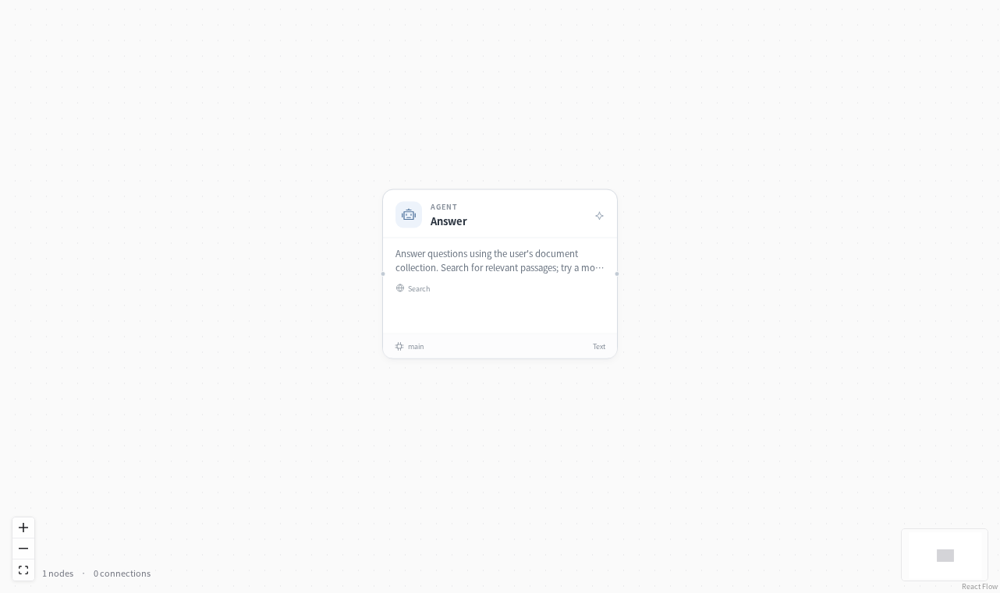
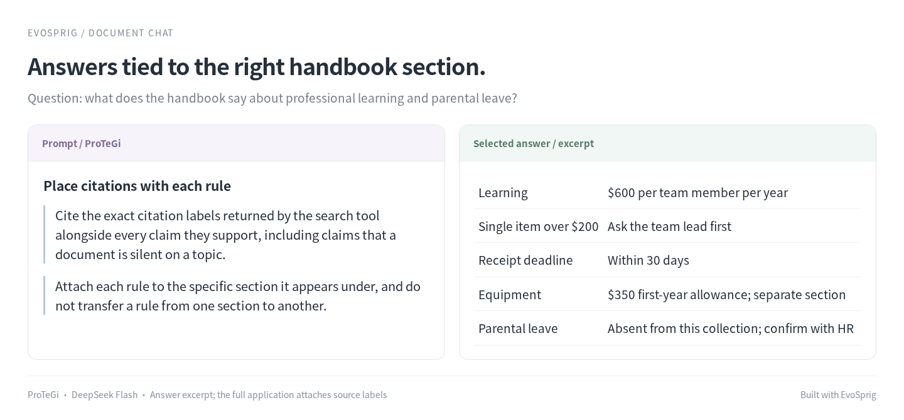

# Chat with your documents



**Turn your team's knowledge into an assistant people can ask.**

“How much can I spend on a course?” Add a handbook, meeting notes or product documentation. The assistant searches the collection and answers with source references.

## A prompt change you can see in the answer



ProTeGi added instructions to cite individual claims and keep rules attached to their handbook section. The selected response distinguishes the learning allowance, equipment allowance and absent parental-leave policy. The prompts in this folder are the selected version.

## Run it

### Install

Use **Python 3.12+** and Git. Run these commands in Bash (Linux, macOS or WSL):

```bash
git clone --depth 1 https://github.com/Toyhom/EvoSprig.git
cd EvoSprig
python3.12 -m venv .venv
source .venv/bin/activate
python -m pip install '.[server]'
```

Keep subsequent commands in this checkout, with `.venv` activated.

### Configure the model

```bash
python examples/quickstart.py document-chat setup
export DEEPSEEK_API_KEY="your-api-key"
```

The application uses **`deepseek-flash`** at **`https://api.deepseek.com`**. Its settings are in `.evosprig/examples/document-chat/deployment.yaml`: change `base_url`, `model` and `api_key_env` under `models` to use another OpenAI-compatible endpoint. When changing providers, also remove or update provider-specific `options`, `token_limit_field` and `send_sampling_parameters` in that connection. Set the environment variable named by `api_key_env` in each terminal that starts or resumes the app. API keys are read from that variable; `.env` files are not loaded automatically.

Setup also creates `.evosprig/examples/document-chat/input.json` from the included [sample.json](sample.json). Edit this input for your task. Repeating setup preserves your profile and input.

### Add your documents

Setup loads the included handbook. Add your own `.md` or `.txt` files with:

```bash
evosprig data add-documents /path/to/notes \
  --project document-chat --workspace .evosprig/examples/document-chat
```

Use the same workspace for loading, running and opening Studio so the assistant can retrieve the documents.

### Run a task

```bash
python examples/quickstart.py document-chat run
```

Read the result in the command’s final JSON output. Runs and checkpoints stay in `.evosprig/examples/document-chat`. To use a separate input file, append `--input-file /path/to/task.json`.

### Open the canvas and keep developing

Install **Node.js 20+** and build the editor once:

```bash
npm --prefix apps/studio ci
npm --prefix apps/studio run build
python examples/quickstart.py document-chat studio
```

Open **http://127.0.0.1:18766**, select **Live model** and paste `input.json` into Run. Use **History** to inspect steps. Change the port with `--port 18768` if needed.

This loads the application into your Studio workspace. Edit its prompt, skill, model and tool settings on the canvas; use **Debug selection** to try a node or group. The same workflow is defined in [agent.yaml](agent.yaml). For framework installation and SDK development, see [Get started](../../README.md#get-started).

<details>
<summary>Import into another EvoSprig workspace or export an independent application</summary>

```bash
python examples/quickstart.py document-chat pack --out .evosprig/document-chat.zip
evosprig import .evosprig/document-chat.zip --out .evosprig/imported-document-chat
evosprig data add-documents examples/document-chat/documents \
  --project document-chat --workspace .evosprig/imported-document-chat-state
evosprig serve --project .evosprig/imported-document-chat/agent.yaml \
  --profile .evosprig/examples/document-chat/deployment.yaml \
  --workspace .evosprig/imported-document-chat-state --studio-dir apps/studio/dist
```

In an existing Studio, use **Import project** with this ZIP (use a new project ID if it is already present). Keep the same model/tool profile when starting that Studio. Data collections and running services belong to the deployment; prepare them on the destination as described above.

The ZIP also contains a standalone Python application. Unpack it into a new directory and environment, run `python -m pip install -r requirements.lock`, then `python -m pip install --no-deps .`. Copy your deployment profile and task input there, set the credential variables, and run `python app.py --profile deployment.yaml --input-file input.json`. Load your document collection first with `python app.py --documents /path/to/notes`. Resume a paused exported run with `python app.py --resume RUN_ID --path NODE_PATH --response 'RESPONSE_JSON'`.

</details>

## Make it yours

Edit `prompts/assistant.md` for your audience. Add or replace the retrieval tool when your knowledge lives elsewhere.
