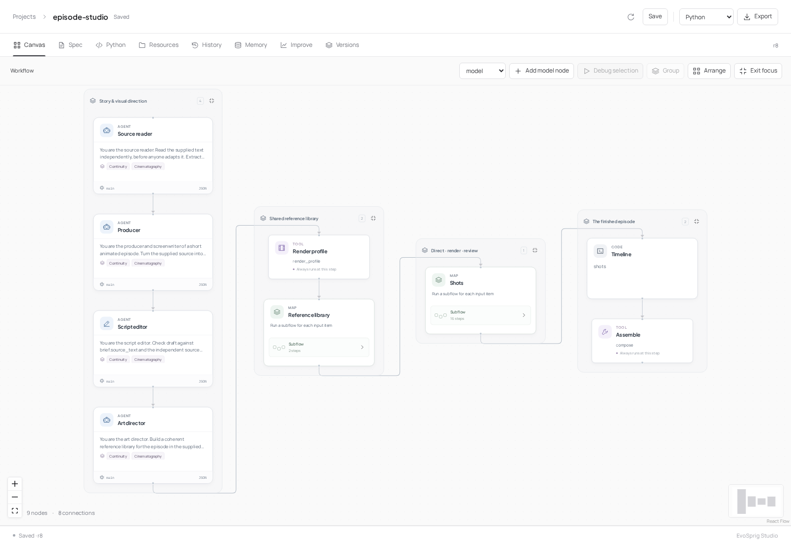
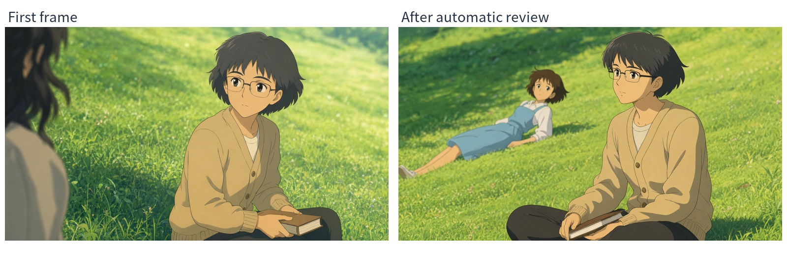
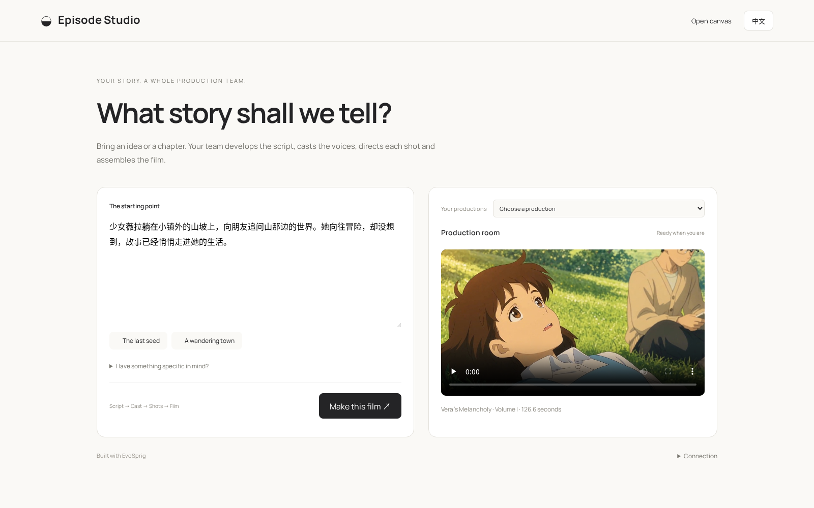

# Episode Studio



[English](README.md) · [简体中文](README.zh-CN.md)

**A novel. A sentence. Your next animated film.**

Give Episode Studio a story. Its agents develop the script, cast and locations, create the reference images, direct each shot and assemble the film with dialogue and sound. The entire production team is editable in EvoSprig.

[**Showcase ↓**](#showcase) · [**Features ↓**](#features) · [**Make a film ↓**](#implementation)

## Showcase

### Vera’s Melancholy · Volume I

[](assets/chapter-one.mp4)

**A quiet town. A restless imagination. The beginning of an adventure.**

126.6 seconds · 16 shots · Chinese dialogue and narration · **[Watch with sound](assets/chapter-one.mp4)**

From [Vera’s Melancholy, Volume I](https://wiki.biligame.com/ys/少女薇拉的忧郁), an in-game book in *Genshin Impact*.

### From story to shot

[](assets/episode-studio-demo.mp4)

**[Watch the application demo · sound on](assets/episode-studio-demo.mp4)** — story input, production team, visual retakes and a finished shot from the same film.

## Features

| Feature | What it does for your production |
| --- | --- |
| **Start with a story** | A sentence or a chapter becomes visual direction, a screenplay and timed shots |
| **A specialist production team** | Writers, art directors, shot directors, render engineers and reviewers each have their own prompts, skills, tools and harness |
| **Build the cast before filming** | Character designs, costumes, locations and reference images are prepared before shot production |
| **Carry the story across cuts** | Shared references, previous-shot state and ending frames guide the next shot |
| **Recurring character voices** | Save suitable single-speaker audio and reuse it in later shots and episodes |
| **Automatic review and retakes** | Check the generated image and clip, explain a mismatch and direct a bounded retry |
| **Preserve tuned settings** | Agents change the shot prompt and necessary controls while keeping the render defaults |
| **Continue a long production** | Background jobs and checkpoints preserve completed work through worker restarts |
| **Redo one part** | Debug one node, shot or group with saved inputs; reuse the rest of the production |
| **Choose each role’s model** | Mix API vendors and local models, with a multimodal connection for visual review |
| **Keep tools ready** | Preload local services and share them across tasks; use a lower-memory deployment preset |
| **Edit the whole application** | Move between canvas and Python; import, edit and export the ComfyUI render graph |

### Automatic visual review and retakes



The visual editor checks generated frames against the cast and shot plan. When it finds a mismatch, it sends specific corrections to the shot director and requests another take. Here the reviewer identified the wrong character; the next take restored Vera’s short hair and blue dress.

## Implementation

### Run the application



Use **Linux, Python 3.12, Node.js 20+, Git and an NVIDIA CUDA driver**. Agents use your model APIs by default; image and video generation run as local tools. Start here:

```bash
git clone --depth 1 https://github.com/Toyhom/EvoSprig.git
cd EvoSprig
mkdir -p .evosprig/episode
cp apps/episode-studio/model-api.example.json .evosprig/episode/model-api.json
export EPISODE_MODEL_API_KEY="your-api-key"
python3.12 apps/episode-studio/launch.py setup \
  --model-config .evosprig/episode/model-api.json \
  --model-dir "$PWD/models" --env-root "$PWD/.venvs"
python3.12 apps/episode-studio/launch.py start
```

The installer creates the application/model environments, downloads the pinned weights and builds the canvas editor. Set `--model-dir` to your large model disk and `--env-root` to your environment directory. Append `--mirror https://hf-mirror.com` to setup for domestic downloads. Rerun the same setup command to resume an interrupted installation.

Before setup, edit `.evosprig/episode/model-api.json`: enter your provider's **base URL, model ID and API-key environment variable**. Use OpenAI, Kimi, MiniMax, Qwen/DashScope or another compatible endpoint. Configure `main` for the production team and optionally `vision` for a separate multimodal reviewer. Each node can select its own model in **Model connections → Model**; [configure API or resident local models](../../docs/model-connections.md).

For smaller GPUs, add `--memory-profile low-vram`. The preset uses CPU offload, CPU video-text encoding, smaller image/render defaults and feed-forward chunking. See [GPU capacity and placement](../../apps/episode-studio/HARDWARE.md) for weight sizes, 16/24/32–48 GB planning and device assignments.

For a fully local director, run setup with `--director local` and omit `--model-config`. Change GPU assignments and ports in `.evosprig/episode/services.json` after installation. The image and video model sources are listed in [models.json](../../apps/episode-studio/models.json).

Open **http://127.0.0.1:18767/episode/**. Paste your story and choose **Make this film**. Follow the script, cast and shots as they appear. Completed films stay in **Your productions**.

Use **Open canvas** to change an agent, **Debug selection** to try a node or group, and **Open render workflow** to edit the render graph and export it to ComfyUI.

**[Installation, API models and domestic mirrors](../../apps/episode-studio/)** · **[ComfyUI import/export](../../docs/comfyui.md)**

### Stop or reopen the application

```bash
python3.12 apps/episode-studio/launch.py status
python3.12 apps/episode-studio/launch.py stop
```

Models stay loaded between films; `stop` releases this session's services. Use the same state directory when restarting to retain productions. If port **18767** is occupied, change `ports.app` in `services.json` before starting.

### Import into an existing EvoSprig installation

After the first start, the configured tool/model profile is `.evosprig/episode/deployment.yaml`. Open the application directly:

```bash
evosprig serve --project examples/episode-studio/agent.yaml \
  --profile .evosprig/episode/deployment.yaml \
  --workspace .evosprig/episode-editor --studio-dir apps/studio/dist --port 18768
```

Keep the image and ComfyUI services running. Open **http://127.0.0.1:18768**, edit the team and debug individual nodes. Use **Export** to create a Python/HTTP application ZIP, or **Import project** in another Studio to continue editing it. Reconnect its deployment profile and media services on the destination. [Framework installation and SDK development](../../README.md#get-started).

### Edit the team and continue a series

Change the [role instructions](prompts/), [production skills](skills/) and [render recipe](../../apps/episode-studio/render-recipe.json). The render agent keeps the tuned defaults and changes only what the shot needs. Its video-prompt skill follows [MiniMax H3’s official examples](https://github.com/MiniMax-AI/MiniMax-H3/tree/main/skills/h3-prompt-writing).

Pass a completed run’s `series` into the next story to carry its cast bible, reference images and voices forward. Models stay loaded between productions. [Series input and deployment settings](../../apps/episode-studio/#continue-a-series).

Want the team to improve? Open **Improve**, choose the prompts, skills or harness settings, and supply scene tasks with your judging criteria. The included [search space](search-space.yaml) covers story, visual direction, frame review and continuity. [Set up evaluation](../../docs/evaluation.md).
