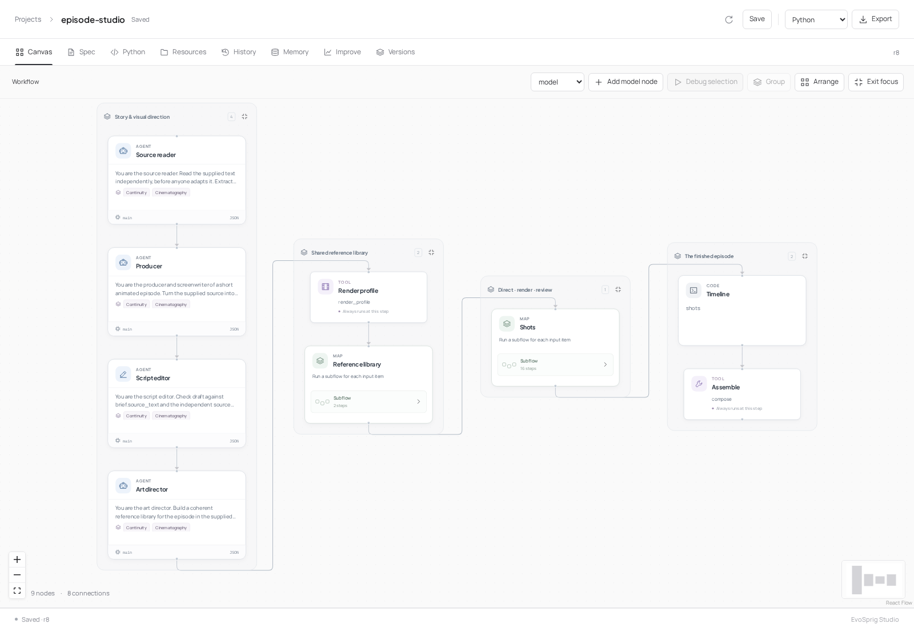
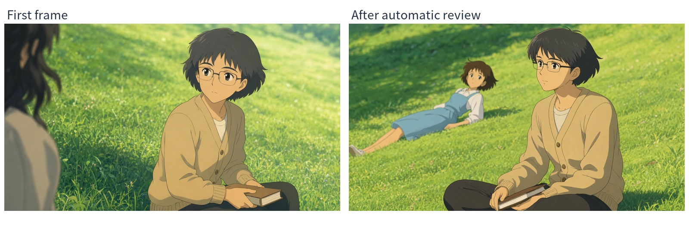
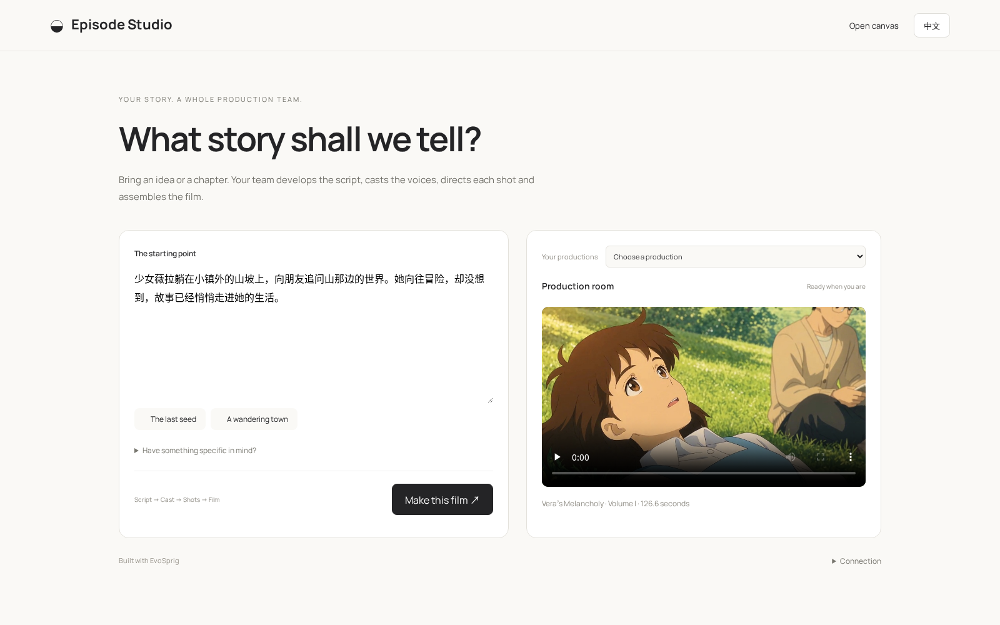

# Episode Studio



[English](README.md) · 简体中文

**一段小说，一句想法，拍成你的下一部动画。**

把故事交给 Episode Studio。智能体团队完成剧本、角色与场景设定，生成参考图，逐镜拍摄，最后合成带对白和声音的影片。整支制作团队都可以在 EvoSprig 中修改。

[**作品展示 ↓**](#作品展示) · [**应用特性 ↓**](#应用特性) · [**开始制作 ↓**](#运行与实现)

## 作品展示

### 《少女薇拉的忧郁》· 第二卷

[](assets/chapter-two.mp4)

**神秘的访客，不可思议的故事，薇拉的新冒险。**

183.5 秒 · 24 个镜头 · 中文对白与旁白 · **[有声播放](assets/chapter-two.mp4)**

改编自《原神》中的书籍[《少女薇拉的忧郁》第二卷](https://wiki.biligame.com/ys/少女薇拉的忧郁)。

### 《少女薇拉的忧郁》· 第一卷

[](assets/chapter-one.mp4)

**一座安静的小镇，一颗闲不住的心，一场冒险的开端。**

126.6 秒 · 16 个镜头 · 中文对白与旁白 · **[有声播放](assets/chapter-one.mp4)**

改编自《原神》中的书籍[《少女薇拉的忧郁》第一卷](https://wiki.biligame.com/ys/少女薇拉的忧郁)。

### 从故事到镜头

[](assets/episode-studio-demo.mp4)

**[观看应用演示 · 带音乐与字幕](assets/episode-studio-demo.mp4)**：输入故事、制作分工、视觉重拍，以及同一部影片中的成品镜头。

## 应用特性

| 应用特性 | 制作时能做什么 |
| --- | --- |
| **一句想法也能开拍** | 自动确定视觉方向、扩写剧本、安排分镜与时长 |
| **分工明确的制作团队** | 编剧、美术、镜头导演、渲染工程师和审核各有自己的 prompt、skill、工具和 harness |
| **先定人设，再拍镜头** | 提前准备角色、服装、场景和参考图 |
| **让镜头接得上** | 共享参考图、上一镜状态和尾帧参与下一镜制作 |
| **让角色沿用自己的声音** | 保存合适的单人音轨，在后续镜头和剧集中复用 |
| **自动检查与定向重拍** | 检查图像和视频，指出不符之处，在设定次数内重做 |
| **保留调好的渲染参数** | 智能体集中处理镜头提示词与必要控制项，其余使用默认值 |
| **长任务可以继续** | 后台作业和检查点保留已完成工作，支持中断续接 |
| **随时看制作进度** | 查看已采用的版本、完成镜头数与累计成片时长 |
| **只改需要改的地方** | 单独调试节点、镜头或分组，复用已有输入与产物 |
| **先看修改影响范围** | 比较人设、参考图、音色和分镜的变化，计算连续镜头的重做范围与可复用镜头 |
| **每个角色都能选模型** | 混用不同厂商 API 或本地模型，为视觉审核配置多模态模型 |
| **模型提前准备好** | 预加载本地服务、跨任务常驻，并提供低显存部署预设 |
| **整套应用都可修改** | 画布和 Python 双向开发；导入、编辑并导出 ComfyUI 渲染图 |

### 自动检查画面，定向重拍



视觉编辑根据角色设定和分镜检查生成画面，发现问题后，把具体修改意见交给镜头导演，自动发起重拍。这个镜头中，审核发现误生成的人物，下一次绘制恢复了薇拉的短发和蓝裙。

## 运行与实现

### 启动应用



需要 **Linux、Python 3.12、Node.js 20+、Git 和 NVIDIA CUDA 驱动**。默认由 API 模型驱动智能体，本地图像与视频模型作为工具运行：

```bash
git clone --depth 1 https://github.com/Toyhom/EvoSprig.git
cd EvoSprig
mkdir -p .evosprig/episode
cp apps/episode-studio/model-api.example.json .evosprig/episode/model-api.json
export EPISODE_MODEL_API_KEY="你的 API Key"
python3.12 apps/episode-studio/launch.py setup \
  --model-config .evosprig/episode/model-api.json \
  --model-dir "$PWD/models" --env-root "$PWD/.venvs"
python3.12 apps/episode-studio/launch.py start
```

安装器创建应用和模型环境、下载固定版本的权重，并构建画布编辑器。将 `--model-dir` 指向容量充足的模型磁盘，`--env-root` 指向环境目录。需要国内镜像时，在 setup 命令后加 `--mirror https://hf-mirror.com`。安装中断后，可以重复相同命令继续。

setup 前编辑 `.evosprig/episode/model-api.json`，填入厂商的 **Base URL、模型 ID 和密钥环境变量名**。可选 OpenAI、Kimi、MiniMax、Qwen/百炼或其他兼容接口。`main` 负责制作团队，另设 `vision` 可为视觉审核使用独立多模态模型。每个节点都能在“模型连接 → 模型”中单独选择；[API 与本地常驻模型配置](../../docs/model-connections.md)。

较小显卡可添加 `--memory-profile low-vram`，启用 CPU 卸载、视频文本编码器放 CPU、更小的图像/渲染尺寸与前馈分块。[显存需求与设备分配](../../apps/episode-studio/HARDWARE.md)列出了权重大小和 16/24/32–48 GB 显卡的规划依据。

完全本地运行时，setup 改用 `--director local` 并去掉 `--model-config`。安装后可在 `.evosprig/episode/services.json` 修改 GPU 分配和端口。[models.json](../../apps/episode-studio/models.json) 列出了图像、视频模型来源。

打开 **http://127.0.0.1:18767/episode/**，切换中文，粘贴故事，选择 **开始制作**。剧本、角色与镜头会逐步出现；完成后，在 **制作记录** 中播放影片。

通过 **打开画布** 修改智能体，使用 **调试所选节点** 单独尝试一个节点或一组流程。在 **打开渲染工作流** 中修改渲染节点，再导出到 ComfyUI。

**[安装、API 模型与国内镜像](../../apps/episode-studio/)** · **[ComfyUI 导入与导出](../../docs/comfyui.md)**

### 停止和重新打开

```bash
python3.12 apps/episode-studio/launch.py status
python3.12 apps/episode-studio/launch.py stop
```

模型在制作之间保持加载；`stop` 停止当前会话的服务并释放显存。重新启动时复用同一个 state 目录，即可保留制作记录。若 **18767** 端口被占用，启动前修改 `services.json` 中的 `ports.app`。

### 导入已安装的 EvoSprig 继续开发

首次 start 后，模型和工具配置位于 `.evosprig/episode/deployment.yaml`：

```bash
evosprig serve --project examples/episode-studio/agent.yaml \
  --profile .evosprig/episode/deployment.yaml \
  --workspace .evosprig/episode-editor --studio-dir apps/studio/dist --port 18768
```

保持图像和 ComfyUI 服务运行，打开 **http://127.0.0.1:18768**，即可修改团队和调试节点。通过 **导出** 生成 Python 或 HTTP 应用 ZIP；在另一个 Studio 中使用 **导入项目** 继续编辑，并接回目标机器的模型、工具配置和媒体服务。[框架安装与 SDK 开发](../../README.zh-CN.md)。

### 修改团队，接着拍下一集

修改[角色指令](prompts/)、[制作技能](skills/)和[渲染配方](../../apps/episode-studio/render-recipe.json)。渲染智能体保留调好的默认值，只修改当前镜头确实需要的参数；视频提示词采用 [MiniMax H3 官方范例](https://github.com/MiniMax-AI/MiniMax-H3/tree/main/skills/h3-prompt-writing)的写法。

将上一集输出的 `series` 传入新故事，继续使用同一套角色设定、参考图和音色。模型在制作之间保持常驻。[系列输入与部署设置](../../apps/episode-studio/#continue-a-series)。

希望这支团队越拍越好？打开 **改进**，选择 prompt、skill 或 harness 参数，提供场景任务和评价标准。已有[搜索空间](search-space.yaml)覆盖故事、美术、首帧检查和运动衔接。[配置评测任务](../../docs/evaluation.md)。

[修改范围预览](../../apps/episode-studio/revisions.md) · [H3 流式解码](../../apps/episode-studio/streaming-decoder.zh-CN.md)
