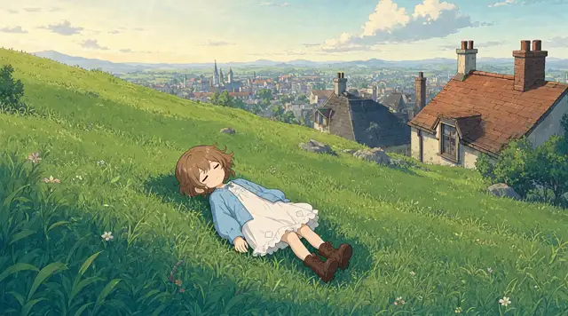
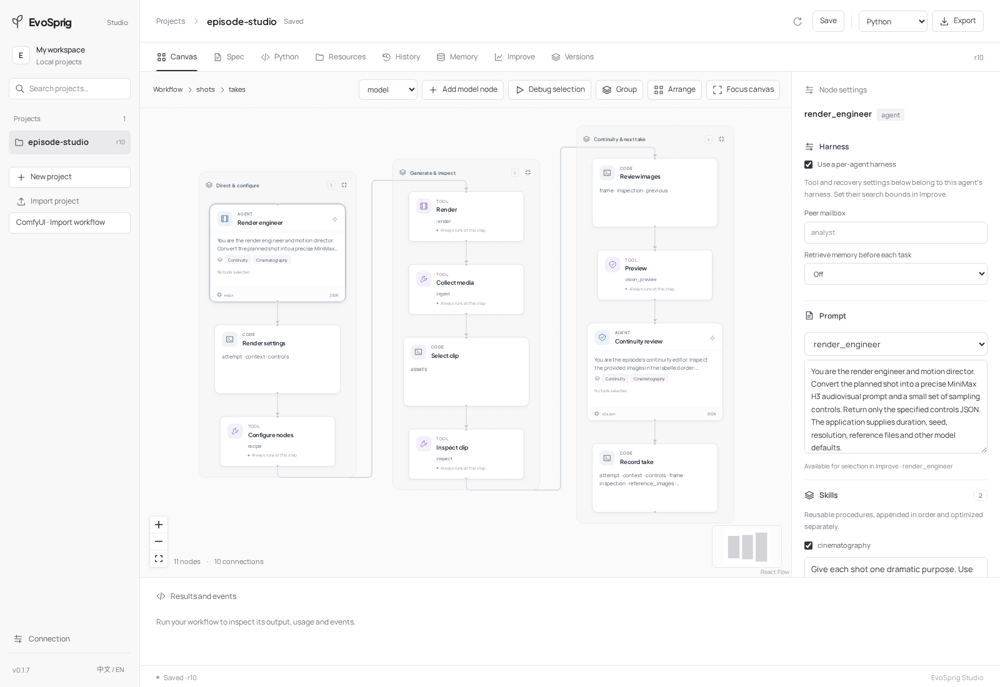

# Episode Studio


[English](README.md) · 简体中文

**粘贴一段小说，或者给出一句想法，剩下的交给制作团队。**

Episode Studio 把故事拍成动画。创意导演决定风格，编剧、美术、配音和镜头导演接力完成制作。打开 EvoSprig 画布，即可修改这支团队。

- **一句想法就能开拍。** 智能体扩写故事、选择风格、编写对白和全部生成提示词；也可以指定自己的风格、语言和时长。
- **一集共用一套角色。** 角色图、场景图和音色参考生成后，跨镜头复用。
- **自动检查与重做。** 先检查参考图与首帧的人物和构图，再检查视频的画面、对白和衔接，并按具体问题重拍。
- **分镜头完成长故事。** 传递上一镜的尾帧、动作与声音信息，最后合成带音轨的影片。
- **每一步都能调整。** 从角色指令、技能到 LoRA 开关、采样和放大参数，都可以在画布中修改。

## 山坡上的故事

[](assets/hillside.mp4)

两个朋友、一座安静的小镇，以及山那边的世界。**25 秒 · 中文对白与旁白 · [有声播放](assets/hillside.mp4)**。

改编自《原神》中的书籍[《少女薇拉的忧郁》第一卷](https://wiki.biligame.com/ys/少女薇拉的忧郁)。

## 发现问题，自己重拍


视觉审核发现前景人物不对，将修改意见交回镜头导演。重新生成的首帧恢复了薇拉的短发、蓝裙和与萨奇的位置关系。

## 开始制作


```bash
python apps/episode-studio/launch.py setup --model-dir /path/to/models --env-root /path/to/environments
python apps/episode-studio/launch.py start
```

打开 **http://127.0.0.1:18767/episode/**，切换中文，粘贴故事并选择 **开始制作**。剧本、角色、声音和镜头会随制作逐步出现，完成后可直接播放影片。在 **制作记录** 中查看之前的制作。

安装时添加 `--mirror https://hf-mirror.com` 即可使用国内镜像。模型在制作会话内复用；结束后执行 `python apps/episode-studio/launch.py stop` 释放显存。

[安装与硬件配置](../../apps/episode-studio/) · [连接已有模型服务](../../apps/episode-studio/#deployment-settings)

## 做成你的制作团队



在 `prompts/` 修改各角色指令，在 `skills/` 设置共同遵循的摄影与连续性规则。渲染工程师读取配方中开放的开关、范围与默认参数；`build_agent.py` 设置重拍次数和并发。参考图或镜头达到重拍上限时，可在应用里预览并确认结果，继续制作时保留已经完成的部分。

**打开渲染工作流** 可查看模型加载、参考素材、适配器、采样器和输出节点。搜索并选择节点，编辑参数、切换适配器，然后导出到 ComfyUI。[默认配方](../../apps/episode-studio/render-recipe.json) 同时保留注意力、分块计算与放大控制。

使用 **调试所选节点** 单独尝试角色提示词、参考图阶段或一组渲染节点。提供自己的场景任务与评分标准，在 **改进** 中比较 prompt、skill 和 harness 候选；[搜索空间](search-space.yaml) 按故事、美术、配音、首帧检查和运动衔接划分模块。

[配置评测任务](../../docs/evaluation.md) · [Harness 搜索](../../docs/harness-search.md)
