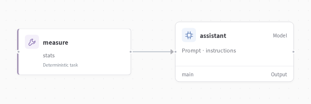

# Hello, EvoSprig



Run a small workflow, inspect the output, then change its instructions.

```bash
evosprig run examples/hello/agent.yaml --input '{"question":"What can we build?"}' --mock
```

Remove `--mock` after connecting a model in the [quickstart](../../docs/quickstart.md). Open `build_agent.py` for the Python SDK version, or edit `prompts/assistant.md` and load the same project in Studio.
