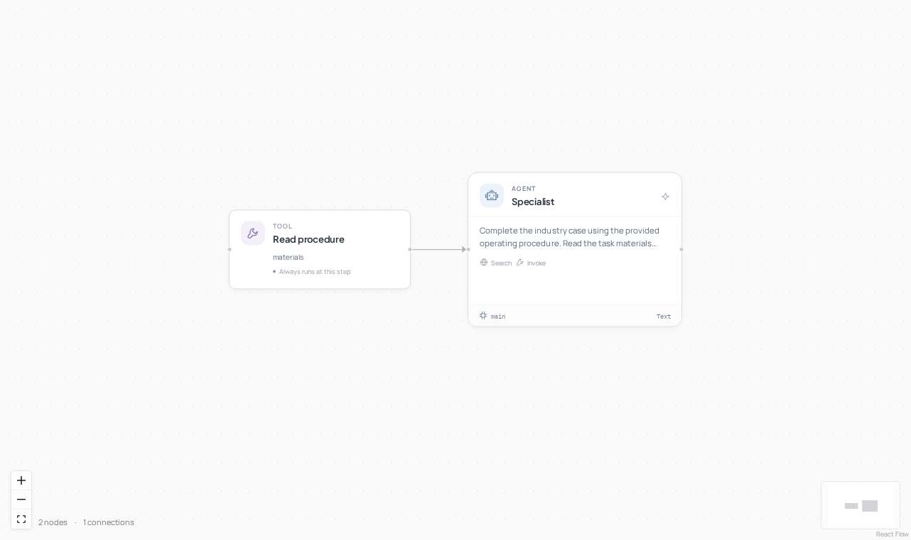

# Industry assistant



Develop agents that complete business processes: process a benefits application, handle a financial request or resolve a manufacturing inspection. Give them procedures and business tools, then evaluate the records they actually change.


## A business task, from start to finish

The agent reads the case and operating procedure, searches for the tools it needs, inspects records and performs the required operations. The environment checks the resulting business state against fixed criteria.

| Environment | Agent work |
| --- | --- |
| Finance | Lending, accounts, cards, deposits and investment workflows |
| Government | Benefits applications, eligibility and approval routing |
| Manufacturing | Quality inspections, disposition and follow-up actions |

A task gets its own sandbox, so one run's edits do not change the next run's starting point. People, models and optimizers use the same business criteria.

## Try it

Connect your IndustryBench installation and prepare a project:

```bash
export INDUSTRYBENCH_ROOT=/path/to/industry-agent
evosprig industry prepare --industry government --limit 12 --out my-industry-agent
```

Set the model credential specified in `my-industry-agent/deployment.yaml`, then evaluate:

```bash
evosprig evaluate my-industry-agent/agent.yaml \
  --suite my-industry-agent/suite.yaml --profile my-industry-agent/deployment.yaml
```

The generated project includes the agent, editable procedure instructions, a model/environment profile and separate search, selection and release tasks.

## Improve the operating instructions

```bash
evosprig improve my-industry-agent/agent.yaml \
  --suite my-industry-agent/suite.yaml --profile my-industry-agent/deployment.yaml \
  --method reflexion --resource procedure --rounds 2 \
  --max-evaluations 100 --timeout 1800
```

Compare the procedure edits and business outcomes, then adopt the version you want. In Studio, load the same profile and task suite in **Improve**.

Need a different business process? Start with the [environment builder](../industry-environment-builder/). For setup, task splits and tool limits, see the [industry guide](../../docs/industry-environments.md).
