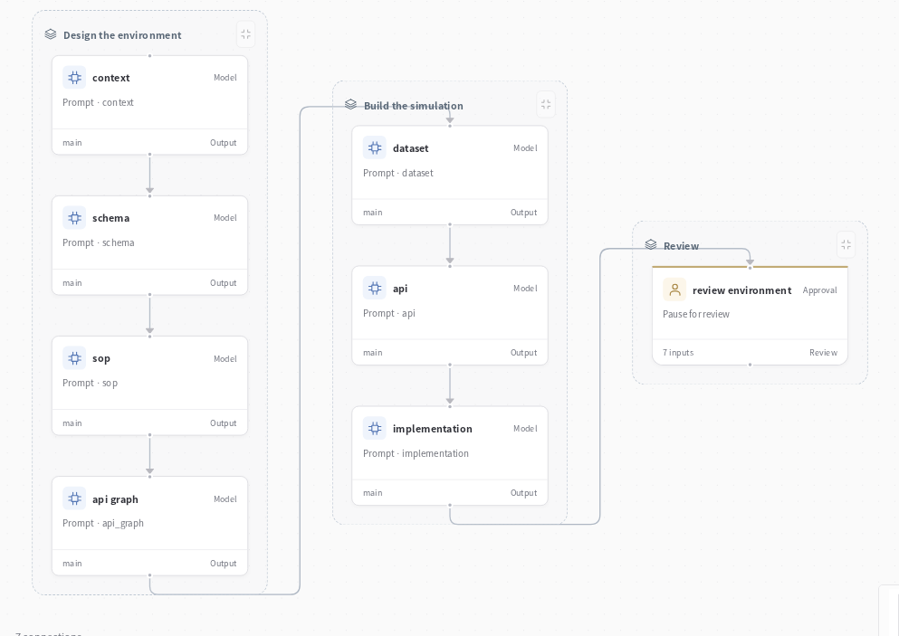

# Industry environment builder



Build the world your industry agent works in: business records, operating procedures, tools and rules for checking the result. Start from a scenario in finance, government services or manufacturing, then connect the reviewed environment to agent evaluation and self-evolution.


## From a business brief to a sandbox

> Build a benefits-application workflow. Check the applicant's records, determine eligibility, route exceptions for review and record the final decision.

Seven connected stages develop the environment:

| Stage | What it produces |
| --- | --- |
| Context | Participants, business goals and constraints |
| Schema | Records, fields, relationships and state |
| Procedures | Decision rules, required steps and approval paths |
| Tool graph | Operations and their dependencies |
| Data | Records for exercising the workflow |
| APIs | Tool descriptions, inputs and outputs |
| Implementation | Code drafts for the environment's operations |

Review the package, integrate its implementations and validate the reference cases. The resulting sandbox gives an agent somewhere to act and a concrete way to check its work.

## Run it

### Install

Use **Python 3.12+** and Git. Run these commands in Bash (Linux, macOS or WSL):

```bash
git clone --depth 1 https://github.com/Toyhom/EvoSprig.git
cd EvoSprig
python3.12 -m venv .venv
source .venv/bin/activate
python -m pip install '.[server]'
```

Keep subsequent commands in this checkout, with `.venv` activated.

### Configure the model

```bash
python examples/quickstart.py industry-environment-builder setup
export DEEPSEEK_API_KEY="your-api-key"
```

The application uses **`deepseek-flash`** at **`https://api.deepseek.com`**. Its settings are in `.evosprig/examples/industry-environment-builder/deployment.yaml`: change `base_url`, `model` and `api_key_env` under `models` to use another OpenAI-compatible endpoint. When changing providers, also remove or update provider-specific `options`, `token_limit_field` and `send_sampling_parameters` in that connection. Set the environment variable named by `api_key_env` in each terminal that starts or resumes the app. API keys are read from that variable; `.env` files are not loaded automatically.

Setup also creates `.evosprig/examples/industry-environment-builder/input.json` from the included [sample.json](sample.json). Edit this input for your task. Repeating setup preserves your profile and input.

### Run a task

```bash
python examples/quickstart.py industry-environment-builder run
```

The output contains the seven environment design drafts and your review. Runs and checkpoints stay in `.evosprig/examples/industry-environment-builder`. To use a separate input file, append `--input-file /path/to/task.json`.

A `waiting_input` result pauses at `graph/review_environment`. Review the seven design outputs and approve the package when ready. Copy the `run_id` from the result and continue:

```bash
evosprig inspect RUN_ID --workspace .evosprig/examples/industry-environment-builder
evosprig resume RUN_ID --workspace .evosprig/examples/industry-environment-builder \
  --path graph/review_environment --response '{"approved": true, "notes": "Reviewed the procedures and tool contracts."}'
```

### Open the canvas and keep developing

Install **Node.js 20+** and build the editor once:

```bash
npm --prefix apps/studio ci
npm --prefix apps/studio run build
python examples/quickstart.py industry-environment-builder studio
```

Open **http://127.0.0.1:18766**, select **Live model** and paste `input.json` into Run. Use **History** to inspect steps and respond to review/input requests. Change the port with `--port 18768` if needed.

This loads the application into your Studio workspace. Edit its prompt, skill, model and tool settings on the canvas; use **Debug selection** to try a node or group. The same workflow is defined in [agent.yaml](agent.yaml). For framework installation and SDK development, see [Get started](../../README.md#get-started).

<details>
<summary>Import into another EvoSprig workspace or export an independent application</summary>

```bash
python examples/quickstart.py industry-environment-builder pack --out .evosprig/industry-environment-builder.zip
evosprig import .evosprig/industry-environment-builder.zip --out .evosprig/imported-industry-environment-builder
evosprig serve --project .evosprig/imported-industry-environment-builder/agent.yaml \
  --profile .evosprig/examples/industry-environment-builder/deployment.yaml \
  --workspace .evosprig/imported-industry-environment-builder-state --studio-dir apps/studio/dist
```

In an existing Studio, use **Import project** with this ZIP (use a new project ID if it is already present). Keep the same model/tool profile when starting that Studio. Data collections and running services belong to the deployment; prepare them on the destination as described above.

The ZIP also contains a standalone Python application. Unpack it into a new directory and environment, run `python -m pip install -r requirements.lock`, then `python -m pip install --no-deps .`. Copy your deployment profile and task input there, set the credential variables, and run `python app.py --profile deployment.yaml --input-file input.json`. Resume a paused exported run with `python app.py --resume RUN_ID --path NODE_PATH --response 'RESPONSE_JSON'`.

</details>

## Use your own synthesis templates

The included seven-stage project works with a model API. To substitute your IndustryBench templates, generate another project:

```bash
evosprig industry synthesis --templates /path/to/industry-agent/synthesis \
  --scene government --out .evosprig/custom-environment-builder
```

Load its `agent.yaml` with `evosprig serve --project`, using the same model profile. Template scenes include `loan`, `account`, `credit_cards`, `deposit`, `invest`, `government` and `manufacturing`.

Review and integrate the generated implementations, then validate their reference cases. The [industry assistant](../industry-assistant/) includes a runnable training-grant sandbox and shows how to connect an environment to evaluation and self-evolution.
