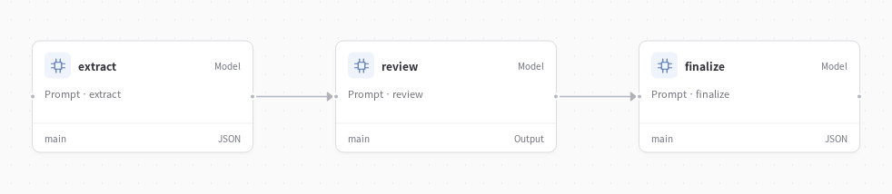

# Meeting assistant



Turn a meeting transcript into shareable notes and an action list. Keep decisions distinct from proposals, preserve owners and deadlines, and surface unanswered questions.

**Transcript → structured record → review → notes + action items**

## Try it

Configure a model as described in the [quickstart](../../docs/quickstart.md), then run:

```bash
evosprig run examples/meeting-assistant/agent.yaml \
  --input-file examples/meeting-assistant/sample.json
```

Open the application in Studio:

```bash
evosprig serve --project examples/meeting-assistant/agent.yaml \
  --studio-dir apps/studio/dist
```

## Make it yours

Edit `sample.json` for your own task and the files under `prompts/` for the roles and instructions. All coordination, tool calls and parallel work use EvoSprig's AgentSpec and runtime. The [catalog builder](../build_catalog.py) shows how to create the same workflow with the Python SDK.

Use the [evolution guide](../../docs/evolution.md) to improve selected prompts on your own tasks. [Example outputs](results/README.md) show what the application produces.

Application pattern inspired by [CrewAI’s meeting assistant](https://github.com/crewAIInc/crewAI-examples); implemented with EvoSprig's own framework.
