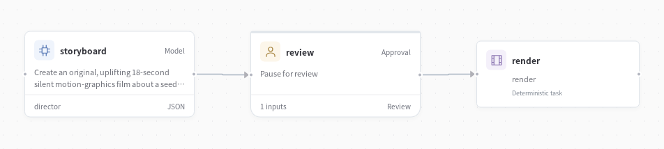

# Motion graphics



Render an original 18-second animation with a storyboard, a human checkpoint and a separate CPU render service. This example demonstrates external-job execution with an actual MP4 artifact.


Install `python -m pip install -e '.[models,server,media]'`. Set `DEEPSEEK_API_KEY` and a local `EVOSPRIG_RENDER_TOKEN` for the renderer connection.

Pillow draws the frames and FFmpeg encodes three six-second scenes at 640×360 and 12 fps. Use the [video studio](../video-studio/) to connect image/video generation tools and produce scenes with character assets and retakes.

Start the renderer in one terminal:

```bash
python examples/motion-graphics/renderer_service.py --state .evosprig/renderer --artifacts .evosprig/film-artifacts
```

The deployment profile connects through POST/GET/DELETE job endpoints. Jobs use stable idempotency keys, and the workflow polls the original job after restart. Review the storyboard interactively through Studio's History page.

In another terminal with the same environment, open the workflow:

```bash
evosprig serve --project examples/motion-graphics/agent.yaml \
  --profile examples/motion-graphics/deployment.example.yaml \
  --workspace .evosprig/film --studio-dir apps/studio/dist
```

Run with `{"brief":"A seed grows into a flower at sunrise."}`, enable writes, and approve the storyboard in History. The output identifies the rendered MP4 in the renderer's artifact directory.
