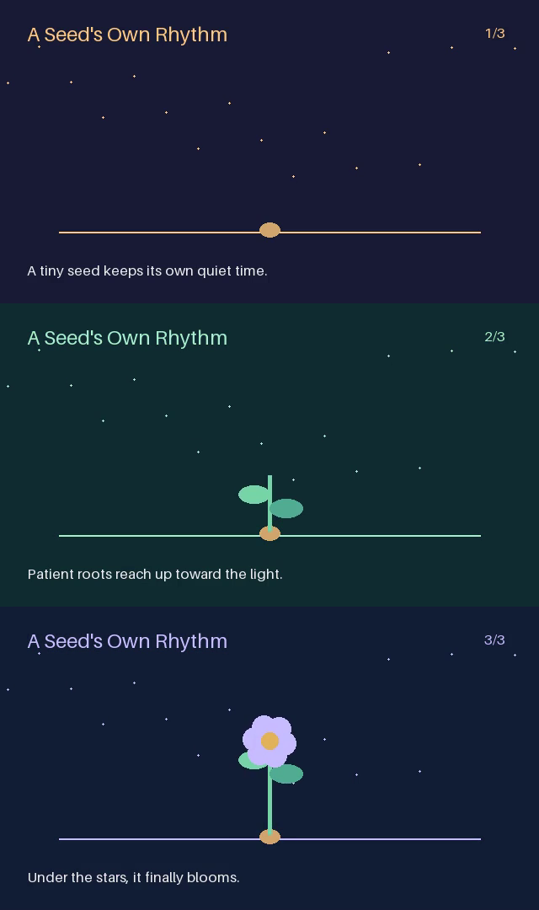

# Motion graphics

Render an original 18-second animation with a storyboard, a human checkpoint and a separate CPU render service. This example demonstrates external-job execution with an actual MP4 artifact.



```bash
python -m pip install -e '.[models,server,media]'
python examples/motion-graphics/run_demo.py \
  --workspace .evosprig/film-run --artifacts .evosprig/film-artifacts \
  --approve-demo-storyboard
```

The workspace must be new. By default the script replays the included storyboard; `--live` asks the configured DeepSeek model for a new one. The explicit `--approve-demo-storyboard` flag accepts the demonstration review automatically.

Pillow draws the frames and FFmpeg encodes three six-second scenes at 640×360 and 12 fps. Outputs include the storyboard, runtime records, MP4 and an exported HTTP application. Use the [video studio](../video-studio/) for a provider-neutral image/video generation pipeline with character assets and retakes.

To run the renderer separately, set `EVOSPRIG_RENDER_TOKEN`, then start:

```bash
python examples/motion-graphics/renderer_service.py --state .evosprig/renderer --artifacts .evosprig/film-artifacts
```

The deployment profile connects through POST/GET/DELETE job endpoints. Jobs use stable idempotency keys, and the workflow polls the original job after restart. Review the storyboard interactively through Studio's History page.
