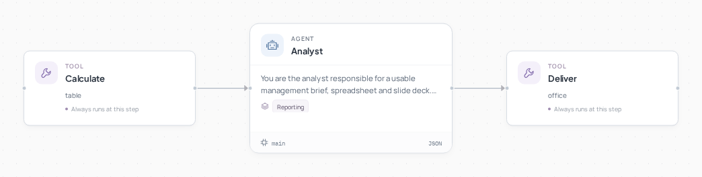
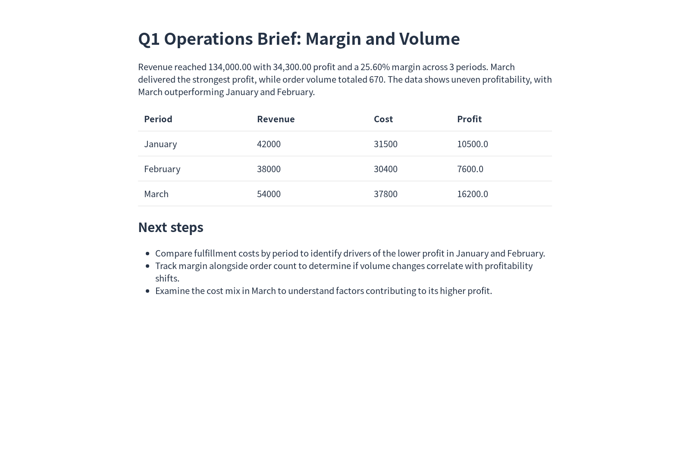

# 办公交付助手



[English](README.md) · [简体中文](README.zh-CN.md)

**把一张表变成可编辑的分析表、简报和汇报幻灯片。**

参考选题: [LiveDoc](https://agent2048.com/zh/projects/9ygfsksfp7qu).

## 看看结果



三个月销售数据：收入 **134,000**，利润 **34,300**，利润率 **25.60%**，共 **670** 单。生成的 Excel 公式、简报和幻灯片使用同一套数值。

## 如何工作

计算指标 → 撰写简报 → 从同一套数值生成 XLSX、DOCX 和 PPTX。Excel 带公式与计算结果，预览页可直接在浏览器打开。

## 运行

需要 Python 3.12+ 和 Git。在新终端中执行：

```bash
git clone --depth 1 https://github.com/Toyhom/EvoSprig.git
cd EvoSprig
python3.12 -m venv .venv
source .venv/bin/activate
python -m pip install -e ".[models,server,artifacts]"
export DEEPSEEK_API_KEY="your-api-key"
python examples/quickstart.py office-deliverables setup
```

配置保存在 `.evosprig/examples/office-deliverables/deployment.yaml`：`models.main.base_url` 是 API 地址，`model` 是模型 ID，`api_key_env` 是密钥环境变量名。默认使用 DeepSeek；支持 OpenAI-compatible API，也可以接入本地模型。每次打开新终端都需设置密钥；不自动读取 `.env`。

也可以在首次 setup 时直接指定：

```bash
export MODEL_API_KEY="your-api-key"
python examples/quickstart.py office-deliverables setup \
  --workspace .evosprig/my-office-deliverables \
  --base-url https://your-provider.example/v1 --model your-model-id --key-env MODEL_API_KEY
```

修改 `.evosprig/examples/office-deliverables/input.json`，然后运行：

```bash
python examples/quickstart.py office-deliverables run --allow-writes
```

如果 setup 使用了其他 workspace，后续 run、studio、pack 也添加相同的 `--workspace`。输入结构和可改字段见 [sample.json](sample.json) 与 [agent.yaml](agent.yaml)。

输出 JSON 的 `directory`（电路案例为 `simulation.directory`）是文件所在目录。使用同一 workspace 可保留运行历史；文件默认写入该 workspace 的 `artifacts`。

## 在画布上继续开发

需要 Node.js 20+：

```bash
npm --prefix apps/studio ci
npm --prefix apps/studio run build
python examples/quickstart.py office-deliverables studio --port 18766
```

打开 `http://127.0.0.1:18766`，选择真实模型并允许工具写入，在画布编辑节点、提示词和技能，或调试单个步骤。

导出并导入另一个 EvoSprig 工作空间：

```bash
python examples/quickstart.py office-deliverables pack --out office-deliverables.zip
```

在 Studio 点击 **导入工程**。解压 ZIP 后，也可安装其中的 `requirements.lock` 和运行时，再用 `python app.py --profile deployment.yaml --input-file input.json --allow-writes` 独立运行。部署配置和业务数据由你提供。框架安装与扩展见 [开发指南](../../docs/build-applications.md)。

```bash
python examples/office-deliverables/from_csv.py sales.csv --goal "Review margin and orders" --out task.json
python examples/quickstart.py office-deliverables run --input-file task.json --allow-writes
```

CSV columns: `period,revenue,cost,orders`.
