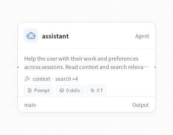

# Personal assistant



**An assistant that remembers what you ask it to remember.**

Save a preference today and use it in a later session. The agent chooses when to look up a saved fact and can consult the context blocks and relationships you maintain in Studio.

## Preferences carry into the next task

With vegetarian meals and morning meetings saved in memory, the assistant suggests:

> **Lunch:** A vegetarian option — e.g., a veggie bowl, a Mediterranean mezze plate, or a plant-based sandwich/salad.
>
> **Meeting time:** Morning, before noon — e.g., **10:00–10:45** or **11:00–11:45**, which leaves a clean gap before lunch.

It asks for the date and timezone before turning those suggestions into a schedule.

## Try it

After installing EvoSprig and setting `DEEPSEEK_API_KEY`:

```bash
evosprig run examples/personal-memory/agent.yaml --allow-writes \
  --workspace .evosprig/personal \
  --input '{"question":"Remember that I prefer vegetarian lunches."}'
evosprig run examples/personal-memory/agent.yaml --allow-writes \
  --workspace .evosprig/personal \
  --input '{"question":"Suggest a lunch based on my preferences."}'
```

Reuse the workspace to retain memory. `--allow-writes` enables the save tool declared in this workflow. The prompt asks the agent to save only explicit requests; it is editable application behavior. Use Studio's Memory page to inspect and remove saved records.

## Make it yours

Change `prompts/persona.md`, add useful tools, and configure a profile block for your assistant's working context. An authenticated deployment binds memory to the current user and project. See the [memory guide](../../docs/memory.md) for retrieval and relationship options.

The assistant also exposes experience recall and source-aware summaries. `recall` combines relevance, importance and recency; `summarize` retains source IDs so stale or deleted facts do not remain visible through a summary. Memory changes still require explicit user intent and write permission.
