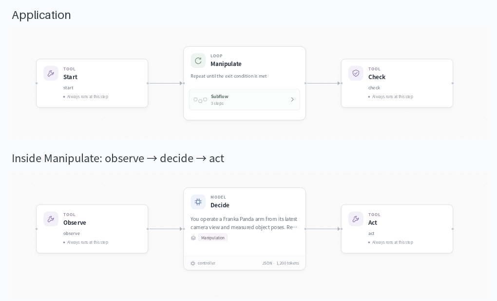
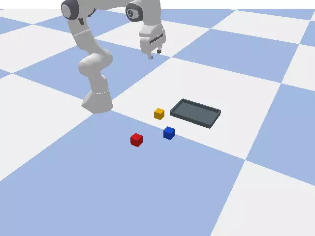

# RAI manipulation (EvoSprig)



An EvoSprig reproduction of [RAI's tabletop manipulation application](https://github.com/RobotecAI/rai/blob/main/docs/demos/manipulation.md). Give a robot arm a task: it looks at the scene, moves an object, then looks again before choosing the next action.

## Clear the table

> Put the red cube and the yellow cube inside the tray. Keep the blue cube where it is.

[](assets/sorting.mp4)

## Build a stack

> Put the red cube on top of the blue cube. Leave the yellow cube where it is.

[](assets/stacking.mp4)

## Run it

### Install

Use **Python 3.12+** and Git. Run these commands in Bash (Linux, macOS or WSL):

```bash
git clone --depth 1 https://github.com/Toyhom/EvoSprig.git
cd EvoSprig
python3.12 -m venv .venv
source .venv/bin/activate
python -m pip install '.[server]'
```

Keep subsequent commands in this checkout, with `.venv` activated.

### Configure the model

```bash
python examples/quickstart.py rai-manipulation setup
export MOONSHOT_API_KEY="your-api-key"
```

The application uses **`kimi-k3.1-pro`** at **`https://api.moonshot.cn/v1`**. Its settings are in `.evosprig/examples/rai-manipulation/deployment.yaml`: change `base_url`, `model` and `api_key_env` under `models` to use another OpenAI-compatible endpoint. When changing providers, also remove or update provider-specific `options`, `token_limit_field` and `send_sampling_parameters` in that connection. Set the environment variable named by `api_key_env` in each terminal that starts or resumes the app. API keys are read from that variable; `.env` files are not loaded automatically.

Setup also creates `.evosprig/examples/rai-manipulation/input.json` from the included [request.json](request.json). Edit this input for your task. Repeating setup preserves your profile and input.

### Start the robot simulator

The simulator runs on the CPU. Install **Python 3.11** for its PyBullet wheel, then use a separate environment in a second terminal:

```bash
python3.11 -m venv .venv-robot
.venv-robot/bin/python -m pip install -r apps/robot-service/requirements.txt
.venv-robot/bin/python apps/robot-service/app.py --workspace .evosprig/robot
```

Leave it running at **http://127.0.0.1:18890**. The agent needs a **vision-capable** API model to inspect its camera frames. Change the four `robot.*` endpoints in `deployment.yaml` if the simulator runs elsewhere.

### Run a task

```bash
python examples/quickstart.py rai-manipulation run --allow-writes
```

The output contains the action history and geometric checks against your goals. Runs and checkpoints stay in `.evosprig/examples/rai-manipulation`. To use a separate input file, append `--input-file /path/to/task.json`.

### Open the canvas and keep developing

Install **Node.js 20+** and build the editor once:

```bash
npm --prefix apps/studio ci
npm --prefix apps/studio run build
python examples/quickstart.py rai-manipulation studio
```

Open **http://127.0.0.1:18766**, select **Live model** and paste `input.json` into Run. Enable **Allow writes** for this workflow. Use **History** to inspect steps. Change the port with `--port 18768` if needed.

This loads the application into your Studio workspace. Edit its prompt, skill, model and tool settings on the canvas; use **Debug selection** to try a node or group. The same workflow is defined in [agent.yaml](agent.yaml). For framework installation and SDK development, see [Get started](../../README.md#get-started).

<details>
<summary>Import into another EvoSprig workspace or export an independent application</summary>

```bash
python examples/quickstart.py rai-manipulation pack --out .evosprig/rai-manipulation.zip
evosprig import .evosprig/rai-manipulation.zip --out .evosprig/imported-rai-manipulation
evosprig serve --project .evosprig/imported-rai-manipulation/agent.yaml \
  --profile .evosprig/examples/rai-manipulation/deployment.yaml \
  --workspace .evosprig/imported-rai-manipulation-state --studio-dir apps/studio/dist
```

In an existing Studio, use **Import project** with this ZIP (use a new project ID if it is already present). Keep the same model/tool profile when starting that Studio. Data collections and running services belong to the deployment; prepare them on the destination as described above.

The ZIP also contains a standalone Python application. Unpack it into a new directory and environment, run `python -m pip install -r requirements.lock`, then `python -m pip install --no-deps .`. Copy your deployment profile and task input there, set the credential variables, and run `python app.py --profile deployment.yaml --input-file input.json --allow-writes`. Resume a paused exported run with `python app.py --resume RUN_ID --path NODE_PATH --response 'RESPONSE_JSON'`.

</details>

## Make it your robot agent

- Change the task and its geometric goals in the request.
- Edit the controller and manipulation skill on the canvas or in [Python](build_agent.py).
- Configure the loop limit, model and tool endpoints for your environment.
- Select `controller` and `manipulation` in **Improve** to search their instructions using your task suite and environment outcomes.

[RAI paper](https://arxiv.org/abs/2505.07532) · [Original application](https://github.com/RobotecAI/rai/blob/main/examples/manipulation_common.py) · [Build applications](../../docs/build-applications.md)
