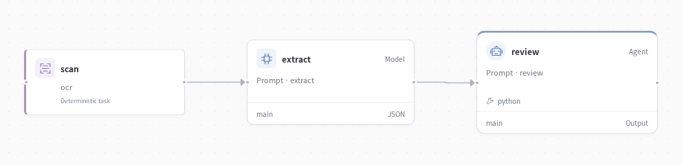
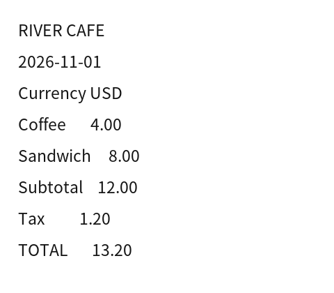

# Receipt assistant



Turn a receipt photo into structured expenses. Read the image, extract the printed amounts, check the arithmetic and review it against your expense policy.

**Image → OCR → structured receipt → calculation and policy review**

## Try it

Start the [optional Toolbox](../../apps/toolbox/README.md) for OCR and Python checks. Its connection is already described in `deployment.example.yaml`. You can replace it with your own service using the same tool contracts.

Configure a model as described in the [quickstart](../../docs/quickstart.md), then run:

```bash
evosprig run examples/receipt-assistant/agent.yaml \
  --input-file examples/receipt-assistant/sample.json \
  --profile examples/receipt-assistant/deployment.example.yaml
```

Open the application in Studio:

```bash
evosprig serve --project examples/receipt-assistant/agent.yaml \
  --studio-dir apps/studio/dist \
  --profile examples/receipt-assistant/deployment.example.yaml
```

## Make it yours

Edit `sample.json` for your own task and the files under `prompts/` for the roles and instructions. All coordination, tool calls and parallel work use EvoSprig's AgentSpec and runtime. The [catalog builder](../build_catalog.py) shows how to create the same workflow with the Python SDK.

Use the [evolution guide](../../docs/evolution.md) to improve selected prompts on your own tasks. [Example outputs](results/README.md) show what the application produces.

Application pattern inspired by [MetaGPT’s receipt assistant](https://github.com/FoundationAgents/MetaGPT); implemented with EvoSprig's own framework.



For another image, base64-encode its bytes into the `image_base64` input. The workflow sends the image to OCR and only the resulting text to the extraction model.
