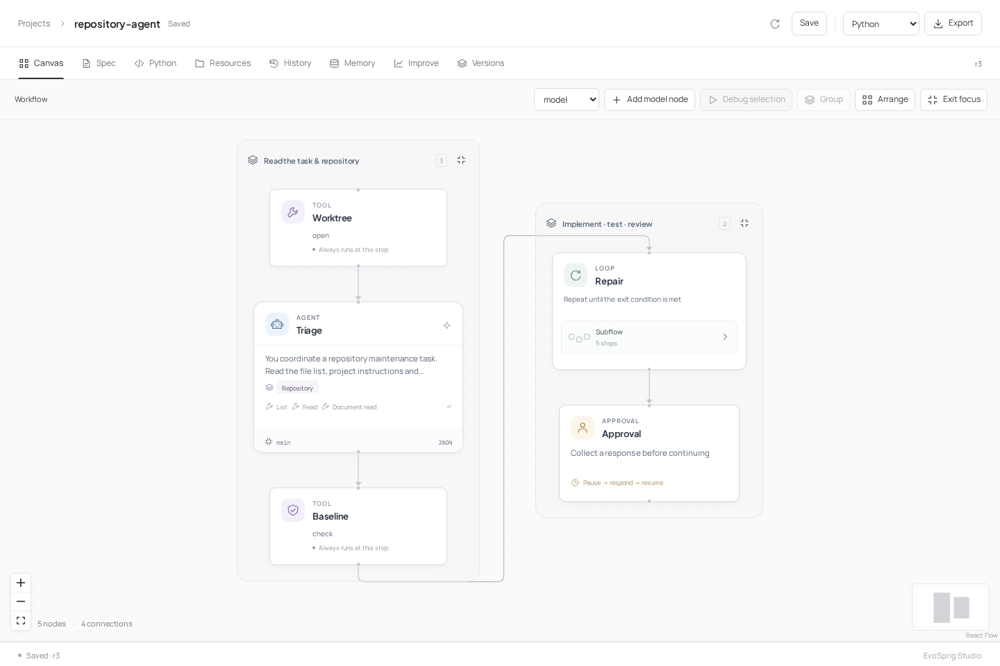

# Super-agent (EvoSprig)



A repository maintenance team based on [DeepSeek's Super-agent prototype](https://github.com/deepseek-ai/dsh-superagent-prototype): read a task, inspect the code, make a patch, run tests and return it for review.

The coordinator plans the change. An engineer edits an independent Git worktree, and a reviewer checks the patch against the request and actual test output. Failed checks return to the engineer for another pass. The final patch opens in a human review step.

## Run

Point `AGENT_REPOSITORY` at a local checkout and configure the test command:

```bash
export AGENT_REPOSITORY=/path/to/repository
python examples/repository-agent/configure.py \
  --model-url http://127.0.0.1:8000/v1 --model local-model \
  --editable src/ --out deployment.yaml -- python -m pytest -q
evosprig serve --project examples/repository-agent/agent.yaml \
  --profile deployment.yaml --workspace .evosprig/repository-agent \
  --studio-dir apps/studio/dist
```

Set `MODEL_API_KEY` for your model endpoint. In Studio, enter `request` and `check: "unit"`, enable write tools and run the team. The review step shows the patch, test output and proposed changes. Use [event triggers](../../docs/triggers.md) to accept tasks from a webhook or queue.

## Adapt the team

Edit `prompts/` and `skills/repository.md` for your coding conventions. [Repository bindings](../../docs/repository-tools.md) define the editable files, test commands and execution limits. Use a container worker for untrusted repositories.

The [search space](search-space.yaml) exposes planning, implementation and review instructions, along with tool and revision budgets. Evaluate candidates on your own repository tasks and executable checks with **Improve**.
