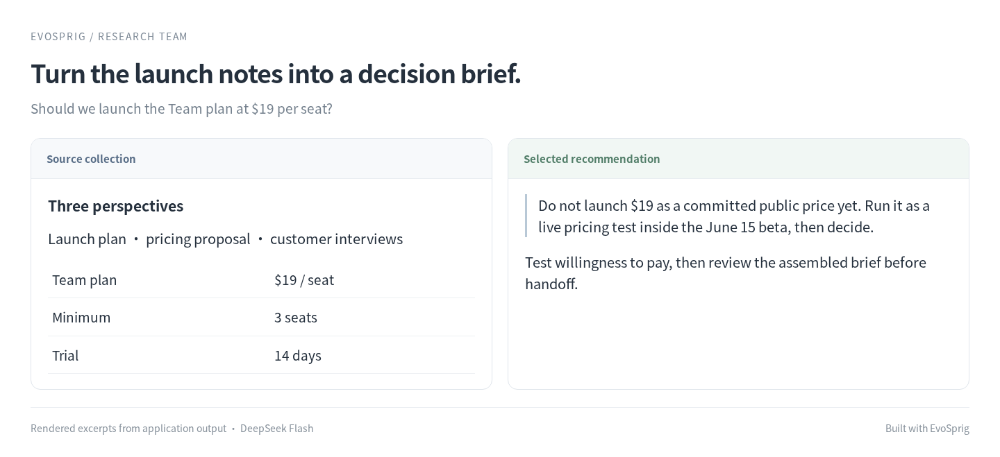

# Research team


**Give your agent a question that needs more than one search.**

“What should we address before launching Review Desk?” A planner divides the question into focused tasks. Researchers explore your documents, a writer combines their findings, and you review the final brief.

## A launch question becomes a sourced brief



## Run it

### Install

Use **Python 3.12+** and Git. Run these commands in Bash (Linux, macOS or WSL):

```bash
git clone --depth 1 https://github.com/Toyhom/EvoSprig.git
cd EvoSprig
python3.12 -m venv .venv
source .venv/bin/activate
python -m pip install '.[server]'
```

Keep subsequent commands in this checkout, with `.venv` activated.

### Configure the model

```bash
python examples/quickstart.py research-team setup
export DEEPSEEK_API_KEY="your-api-key"
```

The application uses **`deepseek-flash`** at **`https://api.deepseek.com`**. Its settings are in `.evosprig/examples/research-team/deployment.yaml`: change `base_url`, `model` and `api_key_env` under `models` to use another OpenAI-compatible endpoint. When changing providers, also remove or update provider-specific `options`, `token_limit_field` and `send_sampling_parameters` in that connection. Set the environment variable named by `api_key_env` in each terminal that starts or resumes the app. API keys are read from that variable; `.env` files are not loaded automatically.

Setup also creates `.evosprig/examples/research-team/input.json` from the included [sample.json](sample.json). Edit this input for your task. Repeating setup preserves your profile and input.

### Add your research material

Setup loads the included launch notes. Add your own `.md` or `.txt` files with:

```bash
evosprig data add-documents /path/to/notes \
  --project research-team --workspace .evosprig/examples/research-team
```

The included researchers search this local collection. Add an HTTP or MCP search binding to investigate web sources.

### Run a task

```bash
python examples/quickstart.py research-team run
```

Read the result in the command’s final JSON output. Runs and checkpoints stay in `.evosprig/examples/research-team`. To use a separate input file, append `--input-file /path/to/task.json`.

A `waiting_input` result pauses at `graph/editor`. Read the draft, then submit the final text you want to keep. Copy the `run_id` from the result and continue:

```bash
evosprig inspect RUN_ID --workspace .evosprig/examples/research-team
evosprig resume RUN_ID --workspace .evosprig/examples/research-team \
  --path graph/editor --response '{"text": "Your reviewed brief"}'
```

### Open the canvas and keep developing

Install **Node.js 20+** and build the editor once:

```bash
npm --prefix apps/studio ci
npm --prefix apps/studio run build
python examples/quickstart.py research-team studio
```

Open **http://127.0.0.1:18766**, select **Live model** and paste `input.json` into Run. Use **History** to inspect steps and respond to review/input requests. Change the port with `--port 18768` if needed.

This loads the application into your Studio workspace. Edit its prompt, skill, model and tool settings on the canvas; use **Debug selection** to try a node or group. The same workflow is defined in [agent.yaml](agent.yaml). For framework installation and SDK development, see [Get started](../../README.md#get-started).

<details>
<summary>Import into another EvoSprig workspace or export an independent application</summary>

```bash
python examples/quickstart.py research-team pack --out .evosprig/research-team.zip
evosprig import .evosprig/research-team.zip --out .evosprig/imported-research-team
evosprig data add-documents examples/research-team/documents \
  --project research-team --workspace .evosprig/imported-research-team-state
evosprig serve --project .evosprig/imported-research-team/agent.yaml \
  --profile .evosprig/examples/research-team/deployment.yaml \
  --workspace .evosprig/imported-research-team-state --studio-dir apps/studio/dist
```

In an existing Studio, use **Import project** with this ZIP (use a new project ID if it is already present). Keep the same model/tool profile when starting that Studio. Data collections and running services belong to the deployment; prepare them on the destination as described above.

The ZIP also contains a standalone Python application. Unpack it into a new directory and environment, run `python -m pip install -r requirements.lock`, then `python -m pip install --no-deps .`. Copy your deployment profile and task input there, set the credential variables, and run `python app.py --profile deployment.yaml --input-file input.json`. Load your document collection first with `python app.py --documents /path/to/notes`. Resume a paused exported run with `python app.py --resume RUN_ID --path NODE_PATH --response 'RESPONSE_JSON'`.

</details>

## Make it yours

Load your own documents. Edit the planner, researcher and writer prompts. Add a web search HTTP/MCP tool to the researcher's tool list to investigate external sources. The included template researches the document collection you supply.

The framework's `map` node handles the variable task list, bounded parallel work and checkpoints. No separate team scheduler is needed. [Open Deep Research](https://github.com/langchain-ai/open_deep_research) is a useful reference for the broader research-agent application pattern.
