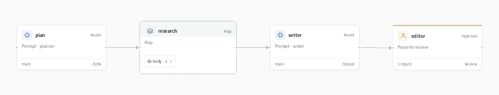

# Research team



**Give your agent a question that needs more than one search.**

“What should we address before launching Review Desk?” A planner divides the question into focused tasks. Researchers explore your documents, a writer combines their findings, and you review the final brief.

## Try it

After installing EvoSprig and setting `DEEPSEEK_API_KEY`, load the included fictional launch notes:

```bash
evosprig data add-documents examples/research-team/documents \
  --project research-team --workspace .evosprig/research
evosprig serve --project examples/research-team/agent.yaml \
  --workspace .evosprig/research --studio-dir apps/studio/dist
```

Open Studio, run with `{"question":"What should we address before launching Review Desk?"}`, then open History to read and approve the draft. The final review accepts `{"text":"Your approved brief"}`.

You can also start from the CLI with `evosprig run` and complete the review with [`evosprig resume`](../../docs/durable-runtime.md).

## Make it yours

Load your own documents. Edit the planner, researcher and writer prompts. Add a web search HTTP/MCP tool to the researcher's tool list to investigate external sources. The included template researches the document collection you supply.

The framework's `map` node handles the variable task list, bounded parallel work and checkpoints. No separate team scheduler is needed. [Open Deep Research](https://github.com/langchain-ai/open_deep_research) is a useful reference for the broader research-agent application pattern.

## Example outputs

[Open the example outputs](results/README.md), then adapt the application to your own tasks.
