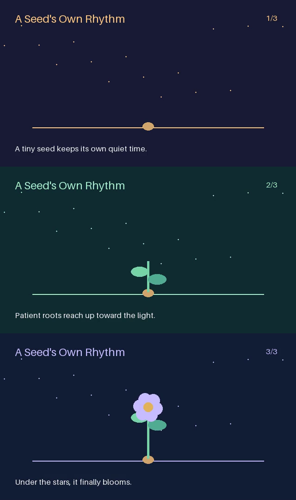

# A Little Tomorrow · 三镜头短片

一个原创的 18 秒无声动态图形示例：模型生成分镜，人工节点审核，外部 CPU 渲染服务生成 MP4。它借鉴 VideoClaw 的阶段式制作流程，未移植其源码、资产或神经视频生成组件。当前属于独立工程示范，后续再扩展多模态生成和交互重做。



Python 3.12+，安装产品及媒体依赖：

```bash
python -m pip install -e '.[models,server,media]'
python examples/short-film/run_demo.py --workspace ./film-run --artifacts ./film-artifacts --approve-demo-storyboard
```

默认重放已保存的真实分镜，不调用模型。`--live` 使用 `deepseek-flash` 重新生成分镜，未设置 `DEEPSEEK_API_KEY` 时采用隐藏输入。工作目录必须不存在。输出包括 `storyboard.json`、`canvas.json`、运行数据库、`result.json` 与可独立运行的 HTTP 工程 `export/`。视频写入单独的 artifacts 目录；SQLite 保持在本地随机写文件系统。

脚本中的 `--approve-demo-storyboard` 是明确的自动演示审核。实际审核可在 Studio 的运行页查看分镜并提交修改后的 JSON；构建定义在 `build_agent.py`，同一规格在 `agent.yaml`，画布可以由 CLI 的 `serve --project` 加载。媒体服务必须先启动，并将实际端点写入部署 profile，凭据只填写环境变量引用。

```bash
# Set EVOSPRIG_RENDER_TOKEN, then keep this service running:
python examples/short-film/renderer_service.py --state ./renderer-state --artifacts ./film-artifacts
# See deployment.example.yaml; supply the same token to the workflow process.
evosprig serve --project examples/short-film/agent.yaml --profile examples/short-film/deployment.example.yaml --workspace ./film-studio --studio-dir apps/studio/dist
```

启用真实模型和写工具。模型只调用一次，最多输出 768 tokens；三段各 6 秒，640×360，12 fps。工作流允许 8 步、4096 tokens；模型金额以供应商账单为准。渲染由 Pillow 和 FFmpeg/libx264 完成，无图像生成、配音、音乐或外部素材。默认示例是植物形状动画，不衡量角色一致性或影视级质量。

实际验证记录在 `results/deepseek-smoke.json`：1 次模型调用，364 输入 / 96 输出 tokens；提交渲染后退出 CLI，再从新进程恢复；同一个 job ID 最终成功，渲染数据库只有 1 个任务且仅执行 1 次。`results/storyboard.json` 可无密钥复现内容。MP4 的 SHA-256 记录用于本次产物核验；跨 FFmpeg/硬件版本的编码字节可能不同。

服务协议：POST `/jobs` 携带 `Idempotency-Key`，GET `/jobs/{id}` 返回 pending/succeeded/failed/canceled，DELETE 取消。状态库保存幂等键和参数，重复键配不同内容返回 409。示例渲染服务采用单进程 worker；重启可重做未完成渲染，输出仍使用固定 job ID。运行器恢复查询已有任务，不重新提交已保存的 job。

分镜、代码和图形由本项目创作。参照：[VideoClaw](https://github.com/HITsz-TMG/VideoClaw)。
