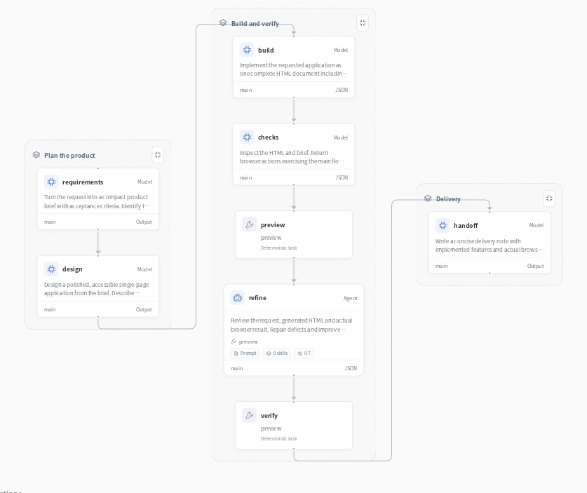
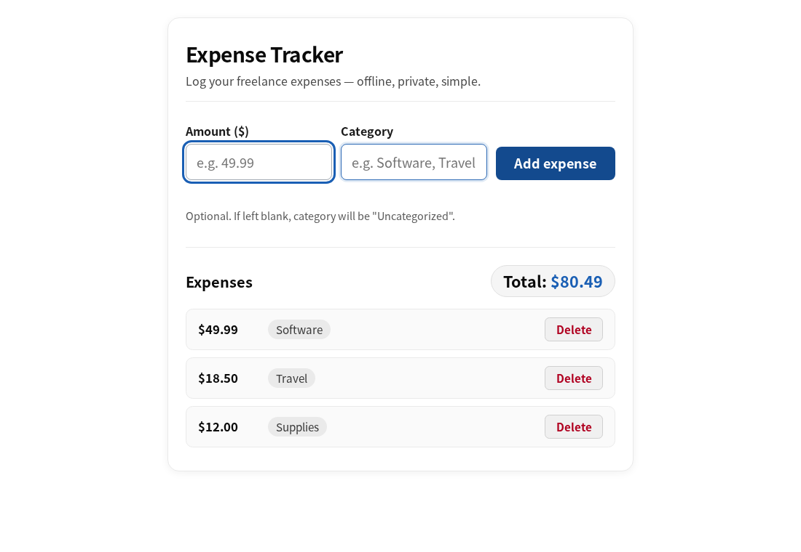

# Software team



Turn a product brief into a working web app. A product manager, designer, developer and reviewer share one workflow; the browser opens the actual HTML and checks its interactions.

**Brief → design → implementation → browser checks → repair → verification → handoff**



## A working expense tracker

The application above supports adding expenses, deleting entries and updating totals. The team turns the brief into HTML, opens it in a browser, checks the requested interactions and feeds failures back into the repair stage.

## Try it

Start the [optional Toolbox](../../apps/toolbox/README.md) for browser previews. Its connection is already described in `deployment.example.yaml`. You can replace it with your own service using the same tool contracts.

Configure a model as described in the [quickstart](../../docs/quickstart.md), then run:

```bash
evosprig run examples/software-team/agent.yaml \
  --input-file examples/software-team/sample.json \
  --profile examples/software-team/deployment.example.yaml
```

Open the application in Studio:

```bash
evosprig serve --project examples/software-team/agent.yaml \
  --studio-dir apps/studio/dist \
  --profile examples/software-team/deployment.example.yaml
```

## Make it yours

Edit `sample.json` for your own task and the files under `prompts/` for the roles and instructions. All coordination, tool calls and parallel work use EvoSprig's AgentSpec and runtime. The [catalog builder](../build_catalog.py) shows how to create the same workflow with the Python SDK.

Use the [evolution guide](../../docs/evolution.md) to improve selected prompts and skills on your own tasks.

Application pattern inspired by [MetaGPT’s software company](https://github.com/FoundationAgents/MetaGPT); implemented with EvoSprig's own framework.
