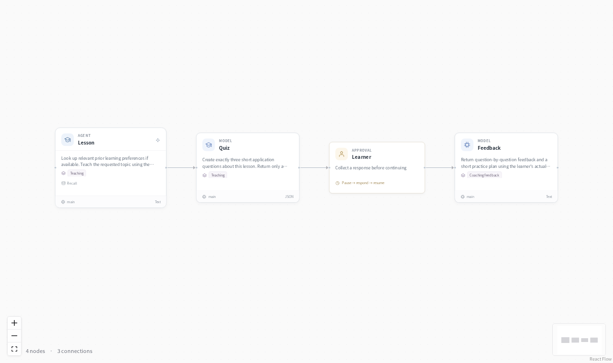
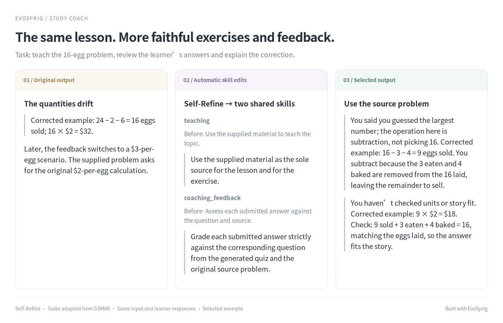

# Study coach



Learn a topic, try three application questions, then get feedback on your answers. The lesson can use saved learning preferences; a human node keeps the exercise interactive.

## Keep the lesson and feedback on the same problem



One Self-Refine round rewrote the `teaching` and `coaching_feedback` skills shared by the lesson, quiz and feedback nodes. The original exercise drifted away from the supplied problem; the selected version keeps its quantities and explains the learner’s mistakes against the source.

On two held-out teaching tasks, the paired output score was **0.55 → 0.86**, with DeepSeek Flash generating and judging. The judge receives the actual quiz and learner replies. The six input tasks were adapted from [GSM8K](https://huggingface.co/datasets/openai/gsm8k) (MIT), with incomplete learner responses. This folder contains the selected skills.

To improve your own tutor, add representative lessons and learner answers, select these skills in **Improve**, and choose Self-Refine. Inspect the edits and feedback before enabling the version.

## Run it

### Install

Use **Python 3.12+** and Git. Run these commands in Bash (Linux, macOS or WSL):

```bash
git clone --depth 1 https://github.com/Toyhom/EvoSprig.git
cd EvoSprig
python3.12 -m venv .venv
source .venv/bin/activate
python -m pip install '.[server]'
```

Keep subsequent commands in this checkout, with `.venv` activated.

### Configure the model

```bash
python examples/quickstart.py study-coach setup
export DEEPSEEK_API_KEY="your-api-key"
```

The application uses **`deepseek-flash`** at **`https://api.deepseek.com`**. Its settings are in `.evosprig/examples/study-coach/deployment.yaml`: change `base_url`, `model` and `api_key_env` under `models` to use another OpenAI-compatible endpoint. When changing providers, also remove or update provider-specific `options`, `token_limit_field` and `send_sampling_parameters` in that connection. Set the environment variable named by `api_key_env` in each terminal that starts or resumes the app. API keys are read from that variable; `.env` files are not loaded automatically.

Setup also creates `.evosprig/examples/study-coach/input.json` from the included [sample.json](sample.json). Edit this input for your task. Repeating setup preserves your profile and input.

### Run a task

```bash
python examples/quickstart.py study-coach run
```

The final output contains the lesson, quiz and feedback on your submitted answers. Runs and checkpoints stay in `.evosprig/examples/study-coach`. To use a separate input file, append `--input-file /path/to/task.json`.

A `waiting_input` result pauses at `graph/learner`. Read the lesson and three questions, then replace the three answers below. Copy the `run_id` from the result and continue:

```bash
evosprig inspect RUN_ID --workspace .evosprig/examples/study-coach
evosprig resume RUN_ID --workspace .evosprig/examples/study-coach \
  --path graph/learner --response '{"answers": ["My first answer", "My second answer", "My third answer"]}'
```

### Open the canvas and keep developing

Install **Node.js 20+** and build the editor once:

```bash
npm --prefix apps/studio ci
npm --prefix apps/studio run build
python examples/quickstart.py study-coach studio
```

Open **http://127.0.0.1:18766**, select **Live model** and paste `input.json` into Run. Use **History** to inspect steps and respond to review/input requests. Change the port with `--port 18768` if needed.

This loads the application into your Studio workspace. Edit its prompt, skill, model and tool settings on the canvas; use **Debug selection** to try a node or group. The same workflow is defined in [agent.yaml](agent.yaml). For framework installation and SDK development, see [Get started](../../README.md#get-started).

<details>
<summary>Import into another EvoSprig workspace or export an independent application</summary>

```bash
python examples/quickstart.py study-coach pack --out .evosprig/study-coach.zip
evosprig import .evosprig/study-coach.zip --out .evosprig/imported-study-coach
evosprig serve --project .evosprig/imported-study-coach/agent.yaml \
  --profile .evosprig/examples/study-coach/deployment.yaml \
  --workspace .evosprig/imported-study-coach-state --studio-dir apps/studio/dist
```

In an existing Studio, use **Import project** with this ZIP (use a new project ID if it is already present). Keep the same model/tool profile when starting that Studio. Data collections and running services belong to the deployment; prepare them on the destination as described above.

The ZIP also contains a standalone Python application. Unpack it into a new directory and environment, run `python -m pip install -r requirements.lock`, then `python -m pip install --no-deps .`. Copy your deployment profile and task input there, set the credential variables, and run `python app.py --profile deployment.yaml --input-file input.json`. Resume a paused exported run with `python app.py --resume RUN_ID --path NODE_PATH --response 'RESPONSE_JSON'`.

</details>

## Make it yours

Replace the topic, level and teaching material in `sample.json`. Edit the `teaching` and `coaching_feedback` skills to match your course. Saved preferences are read from the current user and project memory.

For unattended improvement, import an [evaluation suite](../../docs/evaluation.md#bring-your-own-task-suite) with three learner answers in each task's `responses`: `{"graph/learner": {"answers": ["...", "...", "..."]}}`. Then select prompt or skill resources and an algorithm in **Improve**. EvoSprig runs the same workflow with each candidate. [Agent configuration](../../docs/agent-resources.md) describes resource selection and model parameters.

Built with EvoSprig's [Python SDK](../build_work_apps.py). Application patterns draw on [Coze community learning workflows](https://github.com/AICoderTudou/coze-workflows/tree/main/coze).
