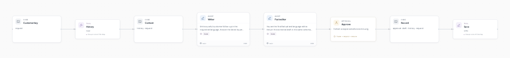
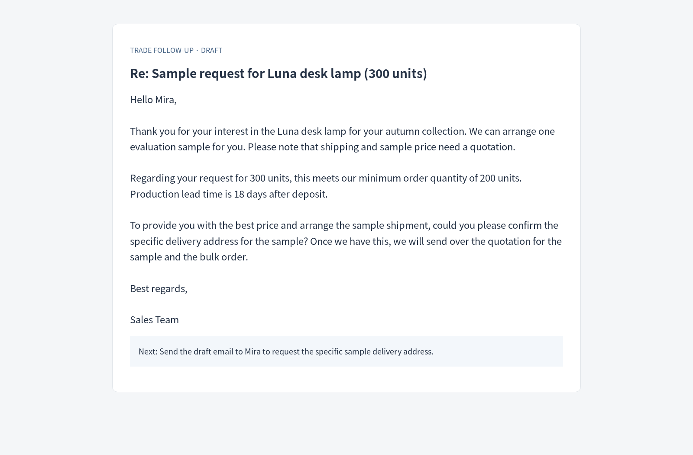

# Trade follow-up



[English](README.md) · [简体中文](README.zh-CN.md)

**Reply to the buyer’s actual question, with your product facts and customer history.**

Application inspiration: [Foreign-trade writing assistant](https://agent2048.com/zh/projects/em7anxnu3x0h).

## A finished result



A buyer asks about 300 lamps and a sample. The reply preserves the 200-unit minimum and 18-day lead time after deposit, asks for the sample address and leaves pricing for a quotation.

## How it works

A writer prepares the reply; a factual editor checks specifications, prices and conditions. Each customer has a separate history document. Duplicate threads are flagged, and an approval checkpoint lets you review the final draft.

## Run it

Use Python 3.12+ and Git. In a new terminal:

```bash
git clone --depth 1 https://github.com/Toyhom/EvoSprig.git
cd EvoSprig
python3.12 -m venv .venv
source .venv/bin/activate
python -m pip install -e ".[models,server,artifacts]"
export DEEPSEEK_API_KEY="your-api-key"
python examples/quickstart.py trade-followup setup
```

Set the API URL, model ID and key variable in `.evosprig/examples/trade-followup/deployment.yaml`: `models.main.base_url`, `model`, and `api_key_env`. The default uses DeepSeek. OpenAI-compatible APIs and local models also work. Set the key in each new terminal; `.env` files are not loaded automatically.

Or choose a different provider during the first setup:

```bash
export MODEL_API_KEY="your-api-key"
python examples/quickstart.py trade-followup setup \
  --workspace .evosprig/my-trade-followup \
  --base-url https://your-provider.example/v1 --model your-model-id --key-env MODEL_API_KEY
```

Edit `.evosprig/examples/trade-followup/input.json`, then run:

```bash
python examples/quickstart.py trade-followup run --allow-writes
```

If setup used a custom workspace, pass the same `--workspace` to run, studio and pack. See [sample.json](sample.json) and [agent.yaml](agent.yaml) for the input fields.

At `waiting_input`, read the draft and `run_id` in the output. After review:

```bash
evosprig resume RUN_ID --workspace .evosprig/examples/trade-followup \
  --path graph/approve --response '{"approved":true,"note":"Approved for manual follow-up"}'
```

The app saves the draft and review; you send the email yourself. Reuse `customer_id` for the same buyer and use a different ID for each customer.

## Continue in the canvas

With Node.js 20+:

```bash
npm --prefix apps/studio ci
npm --prefix apps/studio run build
python examples/quickstart.py trade-followup studio --port 18766
```

Open `http://127.0.0.1:18766`, choose Live model and allow tool writes. Edit nodes, prompts and skills, or debug a selected step.

Export the application and import it into another EvoSprig workspace:

```bash
python examples/quickstart.py trade-followup pack --out trade-followup.zip
```

Use **Import project** in Studio. To run the ZIP independently, extract it, install its `requirements.lock` and bundled runtime, then use `python app.py --profile deployment.yaml --input-file input.json --allow-writes`. Supply your deployment profile and input data. See the [developer guide](../../docs/build-applications.md) for framework setup and extension.
