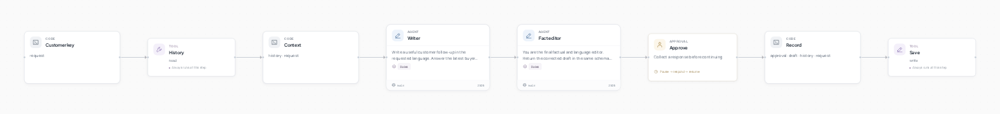
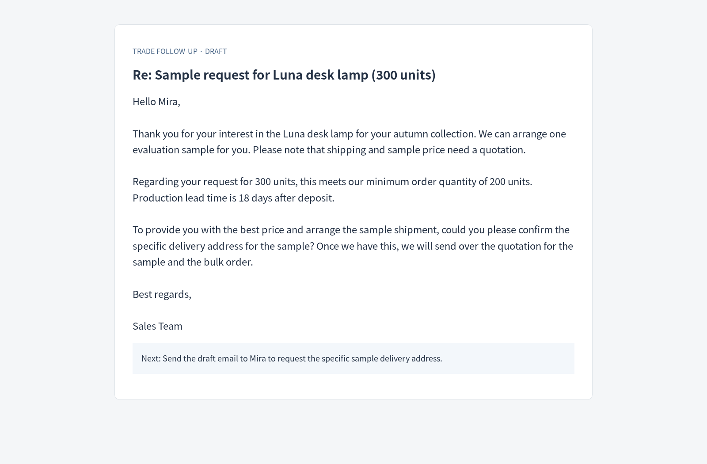

# 外贸跟进助手



[English](README.md) · [简体中文](README.zh-CN.md)

**根据产品资料和客户往来，回答买家真正关心的问题。**

参考选题: [Foreign-trade writing assistant](https://agent2048.com/zh/projects/em7anxnu3x0h).

## 看看结果



客户询问 300 盏灯及样品。草稿保留 200 件起订与“定金后 18 天”的条件，询问寄样地址，价格留待报价。

## 如何工作

写作智能体起草回复，事实编辑检查规格、价格和条件。不同客户使用独立历史文档，重复线程会提示，最终草稿停在人工审核节点。

## 运行

需要 Python 3.12+ 和 Git。在新终端中执行：

```bash
git clone --depth 1 https://github.com/Toyhom/EvoSprig.git
cd EvoSprig
python3.12 -m venv .venv
source .venv/bin/activate
python -m pip install -e ".[models,server,artifacts]"
export DEEPSEEK_API_KEY="your-api-key"
python examples/quickstart.py trade-followup setup
```

配置保存在 `.evosprig/examples/trade-followup/deployment.yaml`：`models.main.base_url` 是 API 地址，`model` 是模型 ID，`api_key_env` 是密钥环境变量名。默认使用 DeepSeek；支持 OpenAI-compatible API，也可以接入本地模型。每次打开新终端都需设置密钥；不自动读取 `.env`。

也可以在首次 setup 时直接指定：

```bash
export MODEL_API_KEY="your-api-key"
python examples/quickstart.py trade-followup setup \
  --workspace .evosprig/my-trade-followup \
  --base-url https://your-provider.example/v1 --model your-model-id --key-env MODEL_API_KEY
```

修改 `.evosprig/examples/trade-followup/input.json`，然后运行：

```bash
python examples/quickstart.py trade-followup run --allow-writes
```

如果 setup 使用了其他 workspace，后续 run、studio、pack 也添加相同的 `--workspace`。输入结构和可改字段见 [sample.json](sample.json) 与 [agent.yaml](agent.yaml)。

运行返回 `waiting_input` 时，在输出中查看草稿与 `run_id`。审核后执行：

```bash
evosprig resume RUN_ID --workspace .evosprig/examples/trade-followup \
  --path graph/approve --response '{"approved":true,"note":"Approved for manual follow-up"}'
```

应用保存草稿和审核结果，邮件由你自行发送。保持同一 `customer_id` 可复用历史，更换客户时使用不同 ID。

## 在画布上继续开发

需要 Node.js 20+：

```bash
npm --prefix apps/studio ci
npm --prefix apps/studio run build
python examples/quickstart.py trade-followup studio --port 18766
```

打开 `http://127.0.0.1:18766`，选择真实模型并允许工具写入，在画布编辑节点、提示词和技能，或调试单个步骤。

导出并导入另一个 EvoSprig 工作空间：

```bash
python examples/quickstart.py trade-followup pack --out trade-followup.zip
```

在 Studio 点击 **导入工程**。解压 ZIP 后，也可安装其中的 `requirements.lock` 和运行时，再用 `python app.py --profile deployment.yaml --input-file input.json --allow-writes` 独立运行。部署配置和业务数据由你提供。框架安装与扩展见 [开发指南](../../docs/build-applications.md)。
